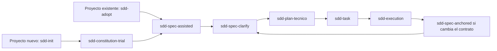

# SDD Universal — Grupo 17 SW2-26-2

Miniframework de **Spec-Driven Development** para convertir una intención en
requisitos verificables, diseño, tareas e implementación integrada. Incluye
inferencia proactiva, revisión funcional, dirección visual y un verificador de
progreso. Las instrucciones guían al agente; las pruebas y controles del entorno
aportan comprobaciones reales.

## IDEs Disponibles

- **Antigravity**
- **Cursor**
- **VS Code / Copilot**
- **OpenCode / Continue**
- **Codex CLI (OpenAI)**
- **Claude Code**

## Instalación

Requiere **Python 3.9+**, Git Bash/Bash con curl o PowerShell. No usa paquetes Python
externos. Ejecutar desde la raíz del proyecto donde quieras habilitar la metodología SDD.

### Linux / macOS / Windows Git Bash:

```bash
curl -fsSL https://raw.githubusercontent.com/Thebetus7/SW2-G17-SDD-26-2/main/install.sh | bash
```

### Windows (PowerShell):

```powershell
irm https://raw.githubusercontent.com/Thebetus7/SW2-G17-SDD-26-2/main/install.ps1 | iex
```

Al ejecutar, aparece un **menú interactivo** para seleccionar el IDE destino:
`antigravity`, `cursor`, `opencode`, `continue`, `vscode` (o `copilot`),
`codex` (o `codex-cli`), `claude` o `all` (instala para todos). OpenCode y Continue tienen
adaptadores separados. La instalación genera archivos; la compatibilidad del
cliente debe comprobarse con la versión que uses.

Para especificar el IDE directamente sin menú interactivo:

```bash
curl -fsSL https://raw.githubusercontent.com/Thebetus7/SW2-G17-SDD-26-2/main/install.sh | bash -s -- cursor
```

```powershell
& ([scriptblock]::Create((irm https://raw.githubusercontent.com/Thebetus7/SW2-G17-SDD-26-2/main/install.ps1))) -Target cursor
```

Para instalar desde una copia local, incluso sin red:

```bash
# Ejecutar desde la raíz del proyecto destino:
bash /ruta/al/repositorio/SDD/install.sh
```

```powershell
& 'C:\ruta\al\repositorio\SDD\install.ps1'
```

Los dos instaladores llaman al mismo motor Python. Descargan el paquete antes de
escribir, conservan instrucciones propias y guardan archivos reemplazados en
`.sdd/backups/`. No garantizan una transacción de instalación completa. Para
reproducibilidad, usar un commit/tag en `GITHUB_BRANCH`; consultar [DEPLOY.md](DEPLOY.md).

## Qué se instala

```text
MI-PROYECTO/
├── AGENTS.md                   # Mapa breve; se conserva el contenido propio
├── .sdd/
│   ├── core.md                 # Reglas compartidas y matriz de autonomía
│   ├── catalog.json            # Comandos disponibles
│   ├── workflows/              # Procedimientos leídos bajo demanda
│   ├── tools/sdd_validate.py    # Validador sin dependencias externas
│   └── backups/                # Copias previas, si hubo cambios
└── docs/                       # Creado durante los workflows, no por instalar
    ├── constitution.md
    └── specs/01-feature/
        ├── spec.md
        ├── plan.md
        └── tasks.md
```

Cada cliente recibe adaptadores breves que apuntan a `.sdd/workflows/`. Las reglas
persistentes no contienen el manual entero ni activan todos los workflows por un
glob universal. Versionar `.sdd/core.md`, `.sdd/catalog.json`, `.sdd/workflows/` y
`.sdd/tools/` en el proyecto destino para compartir la misma versión. Excluir
`.sdd/backups/`, que puede contener configuración previa del equipo.

## Flujo de trabajo



| Comando | Responsabilidad |
| --- | --- |
| `/sdd-init` | Gobernanza breve y comandos reales del proyecto |
| `/sdd-adopt` | Inspección de código existente y baseline de contratos |
| `/sdd-constitution-trial` | Visión, invariantes y decisiones globales |
| `/sdd-spec-assisted` | Especificación con inferencia proactiva y selección asistida |
| `/sdd-spec-clarify` | Revisión de ambigüedades; único aprobador de spec |
| `/sdd-plan-tecnico` | Arquitectura, contratos backend/frontend y diseño visual |
| `/sdd-planning` | Alias del plan técnico |
| `/sdd-task` | Tareas por flujos completos y progreso generado |
| `/sdd-execution` | Implementación, integración y evidencia por tarea |
| `/sdd-spec-anchored` | Evolución, análisis de impacto y revisión de artefactos |
| `/extended` | Dirección visual y criterios de experiencia de usuario |
| `/doc-deploy` | Documentación operativa para infraestructura real |

Los cambios pequeños usan documentos compactos y pueden recorrer fases en una
misma sesión. Los críticos agregan análisis de seguridad, compatibilidad,
concurrencia y recuperación. Los gates no obligan a pedir permiso por acciones ya
autorizadas.

Ejemplo de inicio:

```text
/sdd-spec-assisted Necesito registrar ventas y descontar stock de forma consistente.
Inspecciona el proyecto, deduce consecuencias necesarias y propón las decisiones
de negocio que aún falten. La pantalla debe usar datos reales del backend.
```

## Autonomía con límites claros

| Clase | Acción del agente |
| --- | --- |
| HECHO | Recuperar contexto verificado y aplicarlo |
| DERIVADO | Incorporar consecuencia necesaria con origen y razonamiento |
| TÉCNICO | Resolver detalles reversibles dentro del alcance |
| PROPUESTA | Presentar ampliación o política de negocio para aceptación |
| BLOQUEO | Preguntar solo una decisión de impacto que falte |

La selección asistida conserva las seis dimensiones de inferencia. Las propuestas
recomendadas no se aceptan por defecto. Sin controles interactivos se usan listas
numeradas. Los borradores pueden guardarse con pendientes explícitos.

## Tareas: tablero y registro siempre al principio

Los bloques detallados de `tasks.md` son la única fuente de estado. El script
genera métricas, registro resumido de tareas/evidencia y checklist después del
título. No depende de mantener cuatro listas manuales sincronizadas.

```bash
# Tras revisar/aprobar el plan:
python3 .sdd/tools/sdd_validate.py bind docs/specs/01-feature --artifact plan
# Tras revisar las tareas contra las entradas aprobadas:
python3 .sdd/tools/sdd_validate.py bind docs/specs/01-feature --artifact tasks
# Tras cada cambio de estado o evidencia:
python3 .sdd/tools/sdd_validate.py progress docs/specs/01-feature/tasks.md
# Antes de implementar y cerrar:
python3 .sdd/tools/sdd_validate.py check docs/specs/01-feature
```

En Windows puede usarse `py -3` o `python` según la instalación. `progress --check`
comprueba sin escribir. `bind` registra hashes de entradas **después de una revisión**;
no aprueba automáticamente su contenido. `check` detecta cambios posteriores,
referencias desconocidas, IDs duplicados, dependencias inválidas, evidencia
incompleta y tableros desactualizados. Ver [contrato de tareas](templates/sdd-task.md).

COMPLETED requiere PASS, comando, salida 0 y evidencia específica. El verificador
no ejecuta comandos escritos en Markdown, no autentica logs y no sustituye CI ni
revisión humana. El porcentaje cuenta tareas, no calidad ni valor entregado.

## Calidad de interfaz e integración

`/extended` y el plan técnico exigen dirección visual, referencias o criterio de
diseño, tokens, composición, contenido representativo, responsive y accesibilidad.
Tema oscuro, tablas y modales son opciones, no obligaciones universales.

La ejecución conecta UI, contrato real, permisos, dominio y persistencia. Revisa
la aplicación renderizada en móvil/escritorio y sus estados relevantes, con
capturas cuando haya herramientas. Sin navegador o servicio disponible, registra
NOT_RUN y mantiene pendiente la verificación afectada. Un prompt no garantiza
calidad estética; conviene medirla con las [evaluaciones de uso](docs/EVALUATION.md).

## Actualización desde la versión anterior

`/sdd-spec-assisted` conserva el generador con selección asistida. El generador high se retira.
Los instaladores migran artefactos reconocidos de los clientes seleccionados y
conservan copias; archivos ajenos con esos nombres se mantienen y se avisa. Los
`tasks.md` existentes necesitan una migración revisada al nuevo contrato; no se
reescriben automáticamente. Ver [MIGRATION.md](docs/MIGRATION.md).

## Mantenimiento y fuentes

```bash
python3 -m unittest discover -s tests -v
bash -n install.sh
```

CI configura pruebas en Linux, Windows y macOS. Las pruebas comprueban instalación
y consistencia documental; no ejecutan agentes ni demuestran mejoras estéticas.
[Fuentes y decisiones](docs/DESIGN.md), [evaluación del framework](docs/EVALUATION.md)
y [publicación de un fork](DEPLOY.md).
