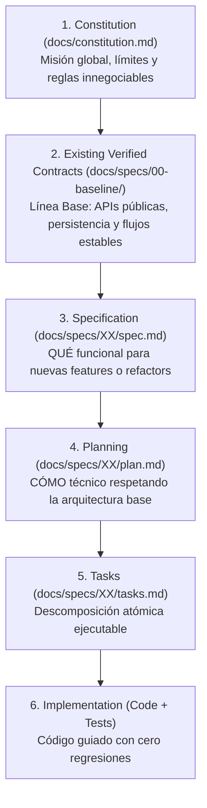

# SDD-Adopt: Adopción e Ingeniería Inversa de SDD en Proyectos Existentes (Brownfield)

Este workflow es el **motor de onboarding e ingeniería inversa exhaustiva** del framework SDD. Su propósito es acoplar la metodología **Spec-Driven Development** en **proyectos existentes, avanzados o heredados (*legacy*)** que fueron construidos sin especificaciones previas, protegiendo el código en producción, forzando una auditoría forense del sistema y estableciendo una **Línea Base Modular Explícita** en `docs/specs/00-baseline/`.

`/sdd-adopt` ejecuta:

* la inspección física obligatoria y no destructiva en **6 Ejes de Descubrimiento**;
* la consolidación de la **Constitución De Facto** (`docs/constitution.md`);
* la generación y calibración del archivo maestro `AGENTS.md` con comandos reales de verificación;
* la creación de la **Suite Documental de Línea Base Modular** en `docs/specs/00-baseline/` (`00_INDICE_BASELINE.md` a `05_DEUDA_TECNICA_Y_RIESGOS.md`);
* el levantamiento de contratos de API, modelos de persistencia, flujos de usuario y matriz de riesgos;
* la definición de la hoja de ruta de coexistencia entre código legado y nuevo desarrollo bajo SDD.

---

# 0. REGLA SUPREMA — CODEBASE IS KING, CERO DESTRUCCIÓN Y ANÁLISIS FORZADO

Esta regla tiene **precedencia absoluta dentro de este workflow**.

1. **La Verdad Reside en el Código Real**: En proyectos existentes, el código fuente ya materializó cientos de decisiones funcionales y técnicas. La IA **NO DEBE INVENTAR** un stack idealizado, ni asumir librerías ausentes, ni proyectar arquitecturas hipotéticas que no correspondan con la realidad del repositorio.
2. **Prohibición Total de Edición o Borrado de Código**: `/sdd-adopt` es un proceso puramente documental, analítico y de gobernanza. **ESTÁ TERMINANTEMENTE PROHIBIDO** crear, modificar o eliminar archivos de código de producción (`src/`, `lib/`, `backend/`, `frontend/`, etc.) durante este workflow.
3. **Prohibición de Escaneo Superficial (*Shallow Scan*)**: La IA **NO PUEDE** limitarse a leer únicamente el `package.json` o el `README.md`. Tiene la **obligación física** de inspeccionar los archivos fuente clave en los 6 ejes de auditoría antes de emitir cualquier documento. Si un eje no aplica (ej. el proyecto no tiene frontend por ser una API pura), la IA debe certificar dicha ausencia tras verificar físicamente la estructura de directorios.
4. **Preservación Incondicional de Contratos Vigentes**: Todo endpoint expuesto, interfaz pública o tabla de base de datos en producción representa un compromiso activo y no puede alterarse sin una especificación formal aprobada (`/sdd-spec-anchored`).

---

# 1. Jerarquía de Precedencia Adaptada para Proyectos Brownfield

Para proyectos existentes bajo adopción SDD, la jerarquía de verdad y precedencia por ámbito se define como:



### Principio de Invariante de No Regresión
> Ningún nuevo desarrollo, refactorización o corrección puede romper los contratos preexistentes catalogados en la Línea Base, a menos que exista una especificación formal aprobada (`/sdd-spec-anchored`) que documente explícitamente el cambio de contrato y su migración.

---

# 2. Las 5 Fases Operativas de `/sdd-adopt`

```text
[FASE 1: Full System Scan en 6 Ejes Obligatorios]
                        ↓
[FASE 2: Calibración de AGENTS.md (Gobernanza Brownfield)]
                        ↓
[FASE 3: Constitución De Facto (docs/constitution.md)]
                        ↓
[FASE 4: Suite Documental de Línea Base (docs/specs/00-baseline/)]
                        ↓
[FASE 5: Hoja de Ruta de Transición y Cierre]
```

---

## FASE 1: Full System Scan en 6 Ejes Obligatorios (Inspección Forzada)

Antes de generar cualquier documento, el asistente **DEBE LEER** evidencia concreta en los siguientes 6 ejes:

### Eje 1: Configuración, Entorno e Infraestructura
* **Manifests**: Inspeccionar `package.json`, `pom.xml`, `build.gradle`, `requirements.txt`, `pyproject.toml`, `pubspec.yaml`, `go.mod`, etc.
* **Entornos y Secretos**: Inspeccionar `.env.example`, `.env.local.example`, variables requeridas y puertos expuestos.
* **Contenedores**: Inspeccionar `docker-compose.yml`, Dockerfiles de cada servicio y redes configuradas.

### Eje 2: Persistencia, Modelos y Esquemas de Datos
* Localizar y leer los schemas de datos reales: `schema.prisma`, entidades JPA (`@Entity`), TypeORM, Sequelize, SQLAlchemy, scripts `.sql` o migraciones (Flyway, Alembic, etc.).
* Identificar motor de base de datos activo (PostgreSQL, MySQL, SQLite, Mongo) y convenciones de nombres de tablas y columnas.

### Eje 3: Backend, Enrutamiento y Controladores
* Inspeccionar controladores, routers o handlers del backend para catalogar los endpoints existentes.
* Identificar middlewares activos (autenticación JWT, CORS, validación de schemas con Zod/Joi/BeanValidation).

### Eje 4: Servicios en Tiempo Real e Integraciones Externas
* Localizar servicios de WebSocket, Webhooks, SSE o colas de mensajería (RabbitMQ, Kafka, Redis).
* Mapear clientes HTTP o SDKs que se comuniquen con APIs de terceros (pasarelas de pago, Google Gemini, OpenAI, Twilio, etc.).

### Eje 5: Frontend, Rutas de Usuario y Consumo de APIs
* Identificar páginas, vistas o rutas del cliente (Next.js App/Pages router, React Router, Flutter screens, Vue, etc.).
* Inspeccionar servicios de cliente o adaptadores HTTP (Axios, Fetch, Apollo GraphQL) para verificar cómo consumen el backend.

### Eje 6: Testing, Calidad y Tooling Operativo
* Localizar suites de pruebas existentes (`tests/`, `src/test/`, `__tests__/`).
* Identificar y probar los comandos reales configurados para: `test`, `lint`, `typecheck` y `build`.

---

## FASE 2: Calibración de Gobernanza (`AGENTS.md`)

A partir de la auditoría física de la Fase 1, el asistente genera o actualiza **`AGENTS.md`** en la raíz:

```markdown
# AGENTS.md — Gobernanza y Reglas Operativas SDD (Adopción Brownfield)

## 1. Identidad y Contexto del Proyecto
* **Proyecto**: [Nombre del Proyecto detectado]
* **Modalidad**: Adopción SDD en Código Existente (Brownfield)
* **Stack Principal**: [Lenguajes, Frameworks y BD detectados]
* **Arquitectura Base**: [Clean Architecture / MVC / Monorepo Modular / etc.]

## 2. Comandos Operativos Verificados
El asistente DEBE utilizar estrictamente los comandos reales configurados en este proyecto:
* **Ejecutar Pruebas**: `[comando real verificado, ej: npm test / ./mvnw test]`
* **Verificación de Tipos / Compilación**: `[comando real, ej: npx tsc --noEmit / ./mvnw compile]`
* **Linter**: `[comando real, ej: npm run lint]`
* **Build de Producción**: `[comando real, ej: npm run build]`

## 3. Reglas Innegociables para Proyectos Existentes
1. **Invariante de No Regresión**: Cualquier nueva feature o corrección debe garantizar que la suite de pruebas existente continúe pasando al 100%.
2. **Prohibición de Refactorización Silenciosa**: Ningún agente modificará código existente a menos que exista una tarea formal aprobada en `tasks.md`.
3. **Respeto a Convenciones Vigentes**: Todo nuevo código debe respetar las convenciones de nombres, estructura de carpetas y patrones ya observados.
4. **Flujo de Trabajo Operativo**:
   * Nuevas Features: `/sdd-spec-high` ➔ `/sdd-planning` ➔ `/sdd-task` ➔ `/sdd-execution`
   * Refactors y Bugs en Código Legado: `/sdd-spec-anchored`
   * Despliegue y Ops: `/doc-deploy`
```

---

## FASE 3: Constitución De Facto (`docs/constitution.md`)

El asistente genera el documento supremo **`docs/constitution.md`** reflejando la realidad consolidada del proyecto:

1. **Misión y Dominio de Negocio**: Propósito de la plataforma deducido de las pantallas, controladores y modelos ya construidos.
2. **Actores y Roles Detectados**: Roles identificados en middlewares, tokens o tablas (ej. `ADMIN`, `USER`, `MODERATOR`).
3. **Stack y Dependencias Aprobadas**: Catálogo exhaustivo de librerías vigentes en el proyecto. Prohibido agregar dependencias redundantes.
4. **Invariantes Técnicas y de Entorno**: Puertos asignados, variables de entorno críticas y restricciones de red/CORS.
5. **Principios de Arquitectura y Calidad**: Patrones transversales observados (inyección de dependencias, tratamiento unificado de errores).

---

## FASE 4: Suite Documental de Línea Base (`docs/specs/00-baseline/`)

Para garantizar un historial explícito y navegable del estado exacto en que se encuentra el proyecto, el asistente crea el directorio `docs/specs/00-baseline/` y genera la siguiente suite modular de 6 documentos:

```text
📁 docs/specs/00-baseline/
├── 📄 00_INDICE_BASELINE.md               <-- Mapa de navegación, matriz de módulos y estado de adopción
├── 📄 01_ARQUITECTURA_Y_STACK.md          <-- Topología de carpetas, dependencias, puertos y servicios
├── 📄 02_MODELO_DATOS_Y_PERSISTENCIA.md   <-- Esquema relacional en texto, tablas, colecciones, campos y relaciones
├── 📄 03_CONTRATOS_API_Y_SERVICIOS.md     <-- Endpoints con método HTTP, ruta, función y WebSockets/eventos
├── 📄 04_FLUJOS_Y_CASOS_USO_ACTUALES.md   <-- Flujos E2E de usuario ya funcionales en la aplicación
└── 📄 05_DEUDA_TECNICA_Y_RIESGOS.md       <-- Matriz de riesgos por severidad (ALTA, MEDIA, BAJA)
```

### Detalle de cada Documento Modular:

#### 1. `00_INDICE_BASELINE.md`:
* Resumen ejecutivo del proyecto y fecha de la auditoría forense.
* Tabla de navegación con enlaces relativos a los otros 5 documentos.
* **Matriz de Estado de Módulos**:
  * `SEALED`: Módulo funcional y estable. Caja negra que solo se toca con `/sdd-spec-anchored`.
  * `STABLE`: Módulo operativo pero con margen de extensión menor.
  * `IN_PROGRESS`: Código a medio terminar, mocks o stubs detectados.
  * `PENDING`: Módulo conceptual que aún no tiene código de producción.

#### 2. `01_ARQUITECTURA_Y_STACK.md`:
* Árbol físico de directorios del proyecto con explicación de cada carpeta clave.
* Lista de versiones de lenguajes, frameworks, ORM y herramientas de build.
* Topología de infraestructura (servicios en `docker-compose.yml`, bases de datos auxiliares como Redis, etc.).
* Tabla de variables de entorno requeridas en `.env.example`.

#### 3. `02_MODELO_DATOS_Y_PERSISTENCIA.md`:
* Esquema relacional estructurado en texto (Entidad -> Campos -> Tipos -> Restricciones).
* Relaciones cardinales detectadas (1:N, N:M) y claves foráneas (PK/FK).
* Estado de las migraciones de base de datos (herramienta de migración utilizada y lista de scripts/versiones).

#### 4. `03_CONTRATOS_API_Y_SERVICIOS.md` *(Rigor Intermedio)*:
* Catálogo de endpoints organizados por controlador/dominio:
  * Método HTTP y Ruta (ej. `POST /api/v1/auth/login`).
  * Breve descripción de la funcionalidad de negocio.
  * Autenticación requerida (Pública / Bearer JWT / Cookie).
* Catálogo de eventos o sockets en tiempo real (canales, eventos emitidos y escuchados).
* Integraciones con servicios externos (APIs de terceros, pasarelas, IA).

#### 5. `04_FLUJOS_Y_CASOS_USO_ACTUALES.md`:
* Mapeo de flujos de negocio completos que la aplicación ya soporta de punta a punta:
  * Ej: Flujo de Registro e Inicio de Sesión.
  * Ej: Flujo de Visualización o Creación de Recursos.
* Puntos de entrada del usuario en el frontend y qué llamadas al backend desencadenan.

#### 6. `05_DEUDA_TECNICA_Y_RIESGOS.md`:
* **Matriz de Riesgos y Deuda Técnica clasificada por severidad**:
  * **SEVERIDAD ALTA (Crítica)**: Secretos o credenciales expuestos en código, endpoints desprotegidos, fallos de inyección o transacciones de BD no atómicas.
  * **SEVERIDAD MEDIA (Funcional)**: Módulos a medio implementar, controladores que devuelven mocks, rutas rotas o contratos desincronizados entre frontend y backend.
  * **SEVERIDAD BAJA (Mantenimiento)**: Archivos sin cobertura de tests unitarios, warnings de linter, código comentado (*dead code*) o tipos `any` excesivos.

---

## FASE 5: Hoja de Ruta de Transición y Protocolo de Trabajo

Al culminar la generación de la suite documental, el asistente presenta al usuario la guía de acción inmediata:

```text
                                   ¿Qué deseas hacer ahora?
                                              │
               ┌──────────────────────────────┼──────────────────────────────┐
               ▼                              ▼                              ▼
    [Desarrollar Feature Nueva]   [Completar Código Incompleto]   [Auditar Despliegue]
               │                              │                              │
               ▼                              ▼                              ▼
        /sdd-spec-high                /sdd-spec-anchored                /doc-deploy
               │                              │                              │
        Flujo SDD puro               Alineación con tests            Docker / Cloud / Ops
```

1. **Para desarrollar una funcionalidad nueva (Módulos `PENDING`)**:
   * Ejecutar: `/sdd-spec-high [nombre de la nueva feature]`
   * Diseña el QUÉ funcional asegurando total compatibilidad con los contratos catalogados en `03_CONTRATOS_API_Y_SERVICIOS.md`.
2. **Para resolver ítems de deuda técnica o completar módulos (Módulos `IN_PROGRESS`)**:
   * Ejecutar: `/sdd-spec-anchored 00. [nombre del ítem de deuda o módulo a terminar]`
   * Genera la spec retrospectiva, el plan de ajuste y las tareas atómicas con pruebas obligatorias.
3. **Para ejecutar tareas**:
   * Ejecutar: `/sdd-execution` bajo validación dual con consola real.

---

# 3. Reporte de Cierre de Adopción

Al finalizar `/sdd-adopt`, la IA debe emitir un resumen estructurado en el chat:

```text
================================================================================
🎉 ADOPCIÓN SDD COMPLETADA EXITOSAMENTE (LÍNEA BASE MODULAR CONSOLIDADA)
================================================================================
✔ Repositorio Auditado: [Nombre o ruta del proyecto]
✔ Análisis Forzado Completado: 6 Ejes de Inspección Física Verificados
✔ Comandos Operativos Configurados en AGENTS.md:
  - Test Runner: [Comando verificado]
  - Linter / Typecheck: [Comando verificado]
  - Build: [Comando verificado]
✔ Suite Documental Generada:
  ├── AGENTS.md
  └── docs/
      ├── constitution.md
      └── specs/00-baseline/
          ├── 00_INDICE_BASELINE.md
          ├── 01_ARQUITECTURA_Y_STACK.md
          ├── 02_MODELO_DATOS_Y_PERSISTENCIA.md
          ├── 03_CONTRATOS_API_Y_SERVICIOS.md
          ├── 04_FLUJOS_Y_CASOS_USO_ACTUALES.md
          └── 05_DEUDA_TECNICA_Y_RIESGOS.md
--------------------------------------------------------------------------------
📊 Estado Inicial del Sistema:
- Módulos Catalogados: [N] SEALED | [N] STABLE | [N] IN_PROGRESS | [N] PENDING
- Deuda Técnica Detectada: [N] Alta | [N] Media | [N] Baja
--------------------------------------------------------------------------------
🚀 El proyecto cuenta con un historial explícito y está listo para operar bajo SDD.
================================================================================
```
