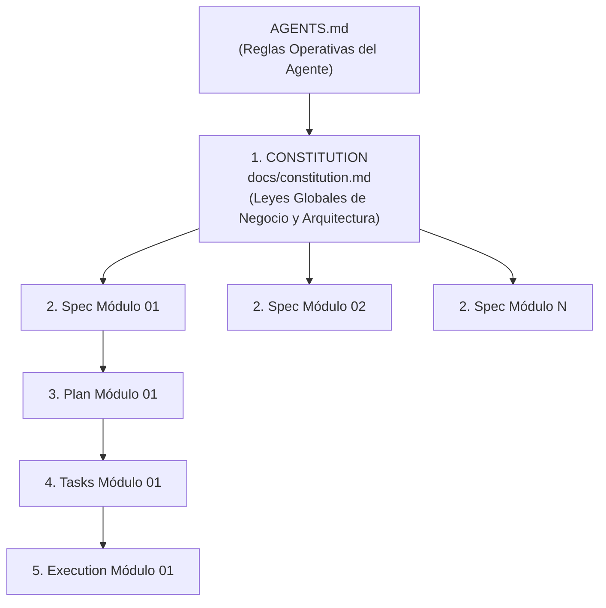
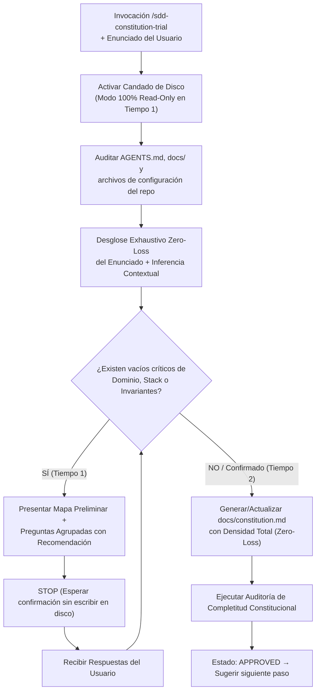
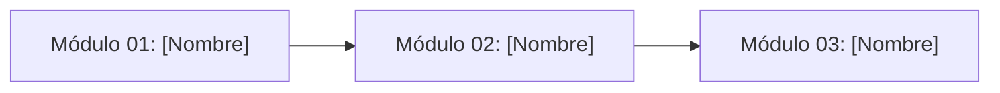

# SDD-Constitution-Trial: Gobernanza Global, Lenguaje Ubicuo, Stack e Invariantes del Proyecto

Este workflow es la **fase fundacional y el tribunal de gobernanza global** del ecosistema SDD. Su propósito es transformar la visión del proyecto, un enunciado general (sea breve o extremadamente extenso) o una solicitud de cambio arquitectónico/normativo transversal en el artefacto rector **`docs/constitution.md`**.

`/sdd-constitution-trial` cumple dos funciones críticas dentro del ciclo de vida:
1. **Fundación Constitucional (Modo Inicial)**: Establece las leyes universales del sistema antes de escribir la primera especificación funcional (`spec.md`).
2. **Juicio de Enmienda Constitucional (Modo Trial / Evolución)**: Actúa como tribunal cuando durante `/sdd-spec-*`, `/sdd-spec-clarify` o `/sdd-planning` surge una contradicción con las reglas globales o una nueva necesidad que obliga a evolucionar la Constitución sin romper silenciosamente los módulos ya existentes.

Su propósito es responder de forma definitiva y sin ambigüedades:

> **¿Qué sistema estamos construyendo a nivel macro, qué vocabulario exacto hablamos, quiénes son los actores globales, qué reglas de negocio y técnicas son inquebrantables en TODOS los módulos, qué stack e infraestructura están autorizados y cómo se divide el dominio en módulos futuros?**

---

# 0. Garantías Supremas de Operación (Invariantes de Nivel Cero)

Estas tres reglas tienen precedencia absoluta sobre cualquier otra instrucción dentro de este workflow.

## 0.1 Candado de Inmutabilidad en Disco (Pre-Execution Filesystem Lock)

`/sdd-constitution-trial` es un workflow **exclusivamente de gobernanza y arquitectura macro**:

### Nivel 1 — Prohibición Absoluta de Tocar Código o Configuración del Proyecto
Durante la ejecución de este comando, el asistente tiene **TERMINANTEMENTE PROHIBIDO**:
```text
- Crear, modificar o eliminar archivos de código fuente, controladores, modelos, vistas o scripts.
- Crear o ejecutar migraciones de base de datos, esquemas SQL o seeders.
- Modificar archivos de dependencias o configuración (package.json, composer.json, pubspec.yaml,
  pyproject.toml, .env, docker-compose.yml, etc.).
- Crear anticipadamente carpetas o archivos dentro de docs/specs/XX-feature/ (spec.md, plan.md, tasks.md).
```

El **único archivo que este workflow tiene autorización para crear o actualizar en disco** es:

```text
docs/constitution.md
```

*(Y, de forma opcional y sincronizada, actualizar la sección de comandos o stack en `AGENTS.md` si el stack global acaba de definirse por primera vez)*.

### Nivel 2 — Modo 100% Read-Only durante el Tiempo 1 (Análisis, Desglose y Juicio)

Mientras existan vacíos críticos de dominio, indefiniciones de stack o contradicciones pendientes de confirmación por el usuario (Tiempo 1):

```text
La IA NO DEBE escribir ni modificar docs/constitution.md en disco.
```

Todo el desglose preliminar, la matriz de inferencias y las preguntas de definición deben presentarse primero en la conversación. Solo en el **Tiempo 2** (tras la respuesta o confirmación del usuario) se procede a escribir en `docs/constitution.md`.

---

## 0.2 Principio de Conservación Total del Enunciado (Zero-Loss Structuring)

Es frecuente que el usuario invoque `/sdd-constitution-trial` entregando un enunciado fundacional muy extenso (por ejemplo: un documento de visión completo, un pliego de requerimientos institucionales, la descripción de múltiples módulos interconectados, fórmulas financieras globales, políticas de seguridad o restricciones operativas detalladas).

La IA tiene **TERMINANTEMENTE PROHIBIDO resumir, comprimir destructivamente, recortar o descartar detalles** del enunciado original:

```text
PROHIBIDO (Resumen Reductivo):
El usuario entrega un enunciado extenso detallando 6 roles con permisos específicos,
políticas de auditoría por cada cambio de precio, soporte offline-first con sincronización
diferida y reglas de multi-moneda (BOB / USD), y la IA genera un constitution.md genérico de
50 líneas diciendo: "El sistema tendrá roles de usuario, auditoría básica y soporte móvil."

OBLIGATORIO (Estructuración Exhaustiva Zero-Loss):
La IA debe absorber el 100% del enunciado, clasificar cada regla en su sección constitucional
correspondiente, preservar todas las fórmulas, monedas, políticas de sincronización y roles,
y además catalogar los detalles específicos de cada módulo futuro en el "Mapa Maestro de
Módulos y Backlog de Especificaciones" dentro de constitution.md para que NINGÚN dato
del enunciado inicial se pierda cuando luego se ejecuten los /sdd-spec-* individuales.
```

> **Regla de Oro para Enunciados Extensos**: Si el usuario incluye en su prompt inicial detalles que pertenecen a módulos específicos (ej. campos exactos de un formulario de ventas o reglas de un módulo de inventario), la IA **no los borra ni los ignora**: extrae las reglas globales a las secciones principales de `constitution.md` y registra íntegros los requisitos específicos de cada módulo dentro de la **Sección 11 (Mapa Maestro de Módulos / Semillas de Especificación)** del propio `constitution.md`. Así, `constitution.md` actúa como bóveda de contexto sin pérdida para todo el resto del ciclo SDD.

---

## 0.3 Inteligencia Contextual Activa y Deducción Arquitectónica

La regla de *"no inventar reglas de negocio en silencio"* **no significa que la IA sea un transcriptor pasivo**.

Cuando el usuario describe el proyecto, la IA debe activar su razonamiento como **Principal Systems Architect** para:

1. **Inferir las necesidades estructurales del dominio**: Si el usuario describe un sistema de ventas con inventario y facturación, la IA debe deducir la necesidad de reglas globales de atomicidad transaccional, manejo de concurrencia en stock, políticas de borrado lógico (*Soft Delete* vs. anulación histórica), trazabilidad de auditoría (`created_by`, `updated_at`), manejo de zonas horarias y precisión decimal para moneda.
2. **Detectar colisiones antes de que ocurran**: Identificar si el stack deseado choca con algún requerimiento operativo (ej. requerir procesamiento en tiempo real o uso sin internet sin haber definido una estrategia de persistencia local o colas).
3. **Proponer activamente en la entrevista**: Presentar estas deducciones al usuario de forma clara y estructurada para incorporarlas como leyes constitucionales explícitas.

---

# 1. Posición y Autoridad dentro de la Jerarquía SDD

`docs/constitution.md` ocupa el **Nivel 1 (Cúspide)** de la jerarquía de verdad:



### Leyes de Subordinación Constitucional

* **Heredabilidad Universal**: Toda regla escrita en `docs/constitution.md` se aplica automáticamente a todos los `spec.md`, `plan.md` y `tasks.md` del proyecto sin necesidad de volver a preguntarla en cada feature.
* **Invalidez por Contradicción**: Ningún `spec.md` ni `plan.md` puede contradecir una cláusula constitucional. Si un módulo necesita una excepción a una regla global, debe ejecutarse `/sdd-constitution-trial` para registrar formalmente la enmienda o excepción autorizada.

---

# 2. Los Dos Modos de Invocación de `/sdd-constitution-trial`

El asistente debe detectar automáticamente en qué escenario se está invocando el comando:

## Modo A: Fundación o Estructuración Inicial (Greenfield / Onboarding)

* **Cuándo ocurre**: `docs/constitution.md` no existe aún, está en estado `DRAFT` o el usuario entrega un gran enunciado inicial para estructurar el proyecto.
* **Objetivo**: Extraer, expandir, cuestionar los puntos ciegos y redactar el `docs/constitution.md` completo y aprobado.

## Modo B: Juicio de Enmienda Constitucional (Trial por Conflicto o Evolución)

* **Cuándo ocurre**: Ya existe un `docs/constitution.md` con estado `APPROVED` (y posiblemente varios `docs/specs/XX-*/`), pero durante `/sdd-spec-*`, `/sdd-spec-clarify` o `/sdd-planning` se detectó una contradicción o una nueva necesidad global.
* **Objetivo**:
1. Evaluar la cláusula constitucional actual vs. la nueva necesidad.
2. Auditar en modo lectura qué especificaciones existentes (`docs/specs/XX-*/spec.md` y `plan.md`) se verían afectadas por el cambio constitucional.
3. Presentar el dictamen de impacto al usuario (Aprobar enmienda global, Crear excepción acotada para el módulo, o Rechazar el cambio manteniendo la Constitución actual).
4. Si se aprueba la enmienda, actualizar `docs/constitution.md` incrementando su versión y listar exactamente qué módulos requieren pasar por `/sdd-spec-anchored`.

---

# 3. Protocolo Operativo en 2 Tiempos



---

## 3.1 TIEMPO 1: Auditoría, Desglose Zero-Loss e Interrogatorio Estratégico (Modo 100% Read-Only)

Al recibir el comando `/sdd-constitution-trial` (con o sin texto adjunto), la IA ejecuta estos 4 pasos en memoria sin tocar el disco:

### Paso 1: Inspección Silenciosa del Contexto Existente

Leer únicamente lo necesario para no hacer preguntas obvias:

* `AGENTS.md` (si existe).
* `docs/constitution.md` (si ya existía una versión previa).
* Archivos raíz del proyecto (`package.json`, `composer.json`, `pubspec.yaml`, `pyproject.toml`, `pom.xml`, etc.) para detectar si el stack tecnológico ya está definido físicamente en el repositorio.

### Paso 2: Extracción y Estructuración sin Pérdida (Zero-Loss Analysis)

Si el usuario proporcionó un enunciado (corto o de miles de palabras), la IA debe:

* Extraer **todas** las entidades mencionadas, actores, reglas de negocio, flujos, integraciones, restricciones y módulos.
* Identificar qué partes del enunciado son **Leyes Globales** (van al cuerpo principal de la Constitución) y qué partes son **Semillas de Módulos Específicos** (se preservarán en la Sección 11 de la Constitución para futuros `/sdd-spec-*`).

### Paso 3: Deducción de Vacíos Constitucionales en los 8 Ejes Rectores

La IA evalúa si con la información disponible están cubiertos los **8 Ejes Constitucionales**:

| Eje Constitucional | Qué debe quedar definido sin ambigüedad |
| --- | --- |
| **1. Dominio y Misión** | Propósito central del sistema, problema real que resuelve y límites del ecosistema. |
| **2. Lenguaje Ubicuo** | Glosario canónico (evitar que en un lado se llame *Cliente*, en otro *Comprador* y en otro *Usuario*). |
| **3. Actores y Autorización Global** | Quiénes interactúan con el sistema (humanos y sistemas externos) y cuál es su jerarquía general de permisos. |
| **4. Invariantes de Negocio Universales** | Políticas transversales: ¿Borrado físico o lógico (*Soft Delete*/Anulación)? ¿Auditoría obligatoria? ¿Moneda, impuestos, zonas horarias, multi-tenancy? |
| **5. Stack Tecnológico Oficial** | Lenguajes, frameworks (Backend, Frontend, Móvil), motor de base de datos, ORM, gestor de estado y herramientas de testing. |
| **6. Arquitectura Macro y Patrones** | Estilo arquitectónico (Hexagonal, Clean Architecture, Modular Monolith, MVC desacoplado, Feature-First) y reglas de comunicación entre capas. |
| **7. Políticas de Calidad, Errores y Resiliencia** | Tipado, contratos de respuesta/error (`Result<S,E>`, códigos estándar), timeouts globales, manejo offline/online y estrategia de pruebas (BDD + Unit). |
| **8. Mapa Maestro de Módulos** | División lógica del proyecto en módulos numerados (`01-auth`, `02-catalogo`, `03-ventas`, etc.) y sus dependencias macro. |

### Paso 4: Formulación de Preguntas Priorizadas con Opciones Recomendadas

Si existen decisiones críticas abiertas en cualquiera de los 8 ejes:

* **No hacer un interrogatorio interminable**: Agrupar las dudas en un bloque claro y estructurado (máximo 3 a 5 preguntas de alto impacto por ronda).
* **Aportar Inteligencia Contextual en cada pregunta**: Para cada duda, ofrecer opciones claras (`A`, `B`, `C`) e incluir siempre una opción marcada como **`(Recomendada)`** explicando brevemente el porqué técnico o de negocio.
* **Mostrar primero un Resumen de Comprensión**: Antes de las preguntas, mostrar brevemente qué entendió y estructuró ya del enunciado del usuario para darle tranquilidad de que nada de su texto fue ignorado.
* **Detenerse (`STOP`)**: Esperar la respuesta del usuario sin escribir aún en disco.

*(Excepción: Si el enunciado del usuario es tan completo que ya responde inequívocamente los 8 ejes sin contradicciones, la IA puede pasar directamente al Tiempo 2, generando el archivo y presentando el reporte final).*

---

## 3.2 TIEMPO 2: Generación Exhaustiva de `docs/constitution.md`

Una vez resueltas las preguntas críticas (o si el enunciado inicial ya contenía todas las decisiones), la IA redacta `docs/constitution.md` aplicando **densidad total (Zero-Loss)** y escribe el archivo en disco.

---

# 4. Reglas de Modelado Exhaustivo para `docs/constitution.md`

Al redactar el documento, la IA debe cumplir estrictamente estas directrices de calidad:

## 4.1 Prohibición de Cláusulas Vacías o Genéricas

No escribir frases de relleno que no ayuden a un agente en Planning o Execution:

```text
INCORRECTO (Vago e inútil):
- "El sistema debe ser rápido, seguro y escalable."
- "Los errores se manejarán adecuadamente."
- "Se usará una buena arquitectura."

CORRECTO (Normativo, concreto y accionable):
- "INV-TECH-01 (Inmutabilidad Financiera): Ninguna transacción en estado CONFIRMADA o
  ANULADA puede ser eliminada físicamente (DELETE SQL prohibido); toda corrección debe
  ejecutarse mediante registro de contra-asiento o transición a estado ANULADA conservando
  fecha, hora UTC y actor responsable."
- "INV-TECH-02 (Manejo de Errores Tipados): Queda prohibido lanzar excepciones genéricas
  no capturadas hacia la capa de presentación. Todo caso de uso debe retornar un contrato
  tipado Result<Success, DomainFailure> o respuesta estructurada equivalente."
- "INV-TECH-03 (Timeouts de Red/IA): Toda integración con servicios externos (APIs REST,
  modelos LLM/Visión, pasarelas) debe configurar un timeout duro máximo de 10 segundos y
  proveer degradación elegante sin bloquear el hilo principal de interfaz."
```

## 4.2 Formalización del Lenguaje Ubicuo (Ubiquitous Language)

Cada concepto clave del dominio debe quedar definido en una tabla canónica con:

* **Término Oficial** (el único permitido en documentos y código).
* **Términos Prohibidos / Sinónimos a Evitar** (para evitar fragmentación semántica, ej. prohibir usar *Item* o *Artículo* si el término oficial es *Producto*).
* **Definición Exacta y Regla de Identidad** (qué es dentro del negocio y qué lo hace único).

## 4.3 Preservación de "Semillas de Módulos" (Bóveda de Contexto para Enunciados Largos)

Cuando el usuario haya entregado en `/sdd-constitution-trial` requerimientos detallados de varios módulos del sistema:

* En la **Sección 11 (`Mapa Maestro de Módulos y Semillas de Especificación`)**, la IA debe crear una subsección por cada módulo identificado (`01-...`, `02-...`, `03-...`).
* Dentro de cada subsección debe volcar **íntegramente** todas las reglas específicas, campos, flujos, validaciones y notas que el usuario mencionó para ese módulo.
* De esta manera, cuando más adelante el usuario ejecute `/sdd-spec-strict 02` o `/sdd-spec-assisted 02`, el agente leerá `docs/constitution.md` y encontrará ahí el 100% de los detalles que el usuario dio el primer día, sin haberse perdido absolutamente nada.

---

# 5. Estructura Canónica Oficial de `docs/constitution.md`

El archivo generado debe seguir rigurosamente esta estructura:

```markdown
# Constitution: [Nombre Oficial del Proyecto]

> **Estado:** APPROVED | NEEDS_CLARIFICATION | DRAFT
> **Versión:** 1.0.0
> **Última actualización:** YYYY-MM-DD
> **Gobernanza:** Nivel 1 en Jerarquía SDD (Precedencia Absoluta sobre Spec, Plan, Tasks y Code)

---

## 1. Visión, Dominio y Propósito del Sistema
- **Misión Principal**: [Descripción profunda del problema real que resuelve el sistema y su propuesta de valor]
- **Contexto Operativo**: [Entorno de uso: web, móvil, escritorio, offline/online, alta concurrencia, B2B/B2C, etc.]
- **Alcance Global del Sistema (In-Scope Macro)**:
  - [Capacidad macro 1]
  - [Capacidad macro 2]
- **Exclusiones Globales (Out-of-Scope Macro)**:
  - [Lo que el sistema explícitamente NO hace a nivel global]

---

## 2. Lenguaje Ubicuo (Glosario Canónico del Dominio)

> Todo documento (`spec.md`, `plan.md`, `tasks.md`) y todo identificador de dominio en el código debe utilizar exclusivamente los términos oficiales de esta tabla.

| Término Oficial (ES / Código) | Sinónimos Prohibidos | Definición Exacta en el Dominio e Invariante Conceptual |
| :--- | :--- | :--- |
| **[Entidad/Concepto 1]** (`EntityName`) | [Términos ambiguos a evitar] | [Definición completa sin recortes] |
| **[Entidad/Concepto 2]** (`EntityName2`) | [Términos ambiguos a evitar] | [Definición completa sin recortes] |

---

## 3. Mapa Global de Actores, Roles y Matriz de Autorización
- **Actores Humanos**:
  - **[Actor 1]**: [Responsabilidades, alcance operativo y restricciones]
  - **[Actor 2]**: [Responsabilidades, alcance operativo y restricciones]
- **Actores Externos / Sistemas / Servicios**:
  - **[Sistema/API Externa]**: [Rol que cumple e interacción esperada]
- **Matriz General de Permisos por Dominio**:
  | Dominio / Operación Macro | [Actor 1] | [Actor 2] | [Actor N] | Regla de Seguridad / Condición |
  | :--- | :---: | :---: | :---: | :--- |
  | [Operación / Módulo 1] | ✅ / ❌ | ✅ / ❌ | ✅ / ❌ | [Condición transversal] |

---

## 4. Invariantes y Reglas de Negocio Universales (`INV-BIZ-XX`)

> Estas reglas aplican transversalmente a todas las features. Ningún `spec.md` puede contradecirlas salvo enmienda constitucional expresa.

- **`INV-BIZ-01` ([Título de la Regla])**: [Descripción exhaustiva, condiciones, fórmulas, excepciones y comportamiento obligatorio].
- **`INV-BIZ-02` ([Política de Ciclo de Vida y Borrado de Datos])**: [Definición exacta de qué entidades usan borrado lógico, anulación o borrado físico].
- **`INV-BIZ-03` ([Política Monetaria / Temporal / Auditoría / Multi-tenancy])**: [Precisión decimal, moneda, zona horaria, trazabilidad de quién creó/modificó cada registro].

---

## 5. Flujos Globales e Integración Entre Dominios



* **Reglas de Comunicación Inter-Módulos**: [Cómo interactúan los dominios entre sí, eventos, consistencia eventual o transaccional].

---

## 6. Stack Tecnológico Oficial y Restricciones de Plataforma

| Capa / Ámbito | Tecnología / Framework Oficial | Versión / Estándar | Restricciones de Uso |
| --- | --- | --- | --- |
| **Lenguaje(s)** | [Ej. TypeScript / PHP / Dart / Python / Java] | [Versión] | Tipado estricto obligatorio |
| **Backend / API** | [Ej. Laravel / Spring Boot / Django / Next.js] | [Versión] | [Convención] |
| **Frontend / Móvil** | [Ej. Next.js / Flutter / Vue / Angular] | [Versión] | [Gestor de estado aprobado] |
| **Base de Datos y ORM** | [Ej. PostgreSQL / SQLite / Prisma / Eloquent] | [Versión] | [Política de migraciones y transacciones] |
| **IA / Servicios Externos** | [Ej. Gemini API / MediaPipe / Ollama] | [Modelo / SDK] | [Política de timeouts y fallbacks] |
| **Testing & QA** | [Ej. Pest / JUnit / Pytest / Playwright / Flutter Test] | [Versión] | [Cobertura BDD + Unit] |

---

## 7. Arquitectura Macro y Reglas de Diseño Técnico (`INV-ARCH-XX`)

* **Patrón Arquitectónico Rector**: [Ej. Clean Architecture / Hexagonal / Feature-First Modular]
* **Separación de Responsabilidades**:
  1. **Presentación / UI**: [Límites de lo que puede y no puede hacer la capa visual]
  2. **Aplicación / Casos de Uso**: [Orquestación, transacciones y DTOs]
  3. **Dominio**: [Entidades puras, reglas de negocio e interfaces de repositorio]
  4. **Infraestructura / Datos**: [Implementación de persistencia, clientes HTTP/IA, adaptadores]
* **Invariantes Arquitectónicas**:
  * **`INV-ARCH-01`**: [Regla inquebrantable de arquitectura, ej. prohibición de consultas SQL/ORM directas en las vistas].
  * **`INV-ARCH-02`**: [Política de integridad referencial y manejo de estados vacíos en relaciones].

---

## 8. Estándares de Calidad, Seguridad, Resiliencia y Manejo de Errores

* **Estándar de Código y Tipado**: [Reglas de Clean Code, prohibición de `any`/`dynamic`, linters obligatorios].
* **Taxonomía Global de Errores y Feedback**: [Cómo se estructuran los errores de dominio, validación, red/infraestructura y cómo se comunican al usuario sin exponer trazas sensibles].
* **Política de Resiliencia y Timeouts**: [Límites de espera, reintentos, degradación elegante y liberación de recursos].
* **Seguridad y Privacidad**: [Autenticación, autorización, sanitización de entradas, manejo de secretos/API keys].

---

## 9. Estrategia Global de Validación y Testing

* **Pruebas de Caja Negra (BDD / Integración / E2E)**: [Qué flujos deben validarse obligatoriamente contra escenarios Gherkin].
* **Pruebas de Caja Blanca (Unitarias)**: [Qué reglas, cálculos o máquinas de estados exigen pruebas unitarias].
* **Criterio de Fail-Fast**: [Prohibición de tests colgados, esperas indefinidas o mocks que falsifiquen lo que el test dice probar].

---

## 10. Comandos Oficiales del Entorno de Desarrollo

```bash
# Instalación y Configuración
[comando real o planeado]

# Ejecución en Desarrollo
[comando real o planeado]

# Ejecución de Suites de Prueba (Unit / Integration / BDD)
[comando real o planeado]

# Linter, Formateo y Verificación de Tipos
[comando real o planeado]
```

---

## 11. Mapa Maestro de Módulos y Bóveda de Semillas de Especificación (Zero-Loss Backlog)

> Esta sección conserva el desglose completo de todos los módulos identificados en el enunciado del proyecto, junto con todas las reglas, campos y detalles específicos proporcionados inicialmente por el usuario, para alimentar sin pérdida a `/sdd-spec-strict`, `/sdd-spec-assisted` o `/sdd-spec-high`.

### Módulo `01-[nombre-modulo]`: [Título del Módulo]

* **Objetivo del Módulo**: [Descripción]
* **Dependencias**: [Ninguna / Módulos previos]
* **Reglas, Datos y Requisitos Específicos Capturados del Enunciado**:
  * [Detalle completo 1 proporcionado por el usuario para este módulo]
  * [Detalle completo 2 proporcionado por el usuario para este módulo]
  * [Inferencia lógica / caso borde detectado para tener en cuenta al especificar este módulo]

### Módulo `02-[nombre-modulo]`: [Título del Módulo]

* **Objetivo del Módulo**: [Descripción]
* **Dependencias**: [`01-...`]
* **Reglas, Datos y Requisitos Específicos Capturados del Enunciado**:
  * [Detalle completo 1...]
  * [Detalle completo 2...]

---

## 12. Historial de Enmiendas Constitucionales (Changelog)

| Versión | Fecha | Tipo de Cambio | Descripción de la Decisión / Enmienda | Módulos Impactados |
| --- | --- | --- | --- | --- |
| `1.0.0` | YYYY-MM-DD | Fundación | Creación inicial de la Constitución del proyecto. | Todos (`01` a `NN`) |
```

---

# 6. Protocolo Especial para Enmiendas Constitucionales (Cuando `constitution.md` ya existe)

Si el usuario invoca `/sdd-constitution-trial` para cambiar una regla global, agregar una nueva tecnología al stack o resolver un bloqueo detectado por `/sdd-spec-clarify`:

1. **Auditoría de Impacto Cruzado (Read-Only)**:
   * La IA lee `docs/constitution.md` y escanea los encabezados y reglas de los `docs/specs/XX-*/spec.md` y `plan.md` existentes.
2. **Presentación del Dictamen de Enmienda (Tiempo 1)**:
   * Explica qué cláusula actual entra en conflicto (`INV-BIZ-XX` o `INV-ARCH-XX`).
   * Identifica exactamente qué módulos existentes en `docs/specs/` se ven afectados si se aprueba el cambio.
   * Pregunta al usuario si desea:
     * **A) Aprobar Enmienda Global**: Modificar la ley para todo el sistema.
     * **B) Aprobar Excepción Acotada**: Mantener la ley general en la Constitución pero registrar una excepción explícita y justificada solo para el módulo `XX`.
     * **C) Rechazar el Cambio**: Mantener la Constitución intacta y corregir el `spec.md` del módulo conflictivo.
3. **Aplicación y Registro (Tiempo 2)**:
   * Actualiza `docs/constitution.md`, incrementa la versión semántica (`1.1.0`, `2.0.0`), registra la fila en la **Sección 12 (Historial de Enmiendas)** e informa qué comandos `/sdd-spec-anchored XX` deben correrse a continuación si algún módulo previo quedó desfasado.

---

# 7. Checklist de Auditoría Interna Antes de Marcar `APPROVED`

Antes de finalizar la escritura de `docs/constitution.md`, la IA debe verificar cada uno de estos puntos:

```text
[ ] 1. CANDADO DE DISCO: ¿Se garantizó que ningún archivo de código fuente, test o configuración fue tocado?
[ ] 2. ZERO-LOSS (CERO PÉRDIDA): ¿Se verificó que absolutamente ninguna regla, rol, dato, fórmula o restricción del enunciado del usuario fue omitida o resumida destructivamente?
[ ] 3. BÓVEDA DE MÓDULOS: Si el usuario dio detalles de módulos específicos, ¿quedaron todos resguardados en la Sección 11 para no perderlos en los futuros /sdd-spec-*?
[ ] 4. LENGUAJE UBICUO: ¿Están definidas las entidades centrales y los sinónimos prohibidos para evitar ambigüedad terminológica?
[ ] 5. ACTORES Y PERMISOS: ¿Están claros todos los actores globales y qué puede hacer cada uno a nivel macro?
[ ] 6. INVARIANTES ACCIONABLES: ¿Las reglas de negocio (INV-BIZ) y de arquitectura (INV-ARCH) son concretas y verificables en lugar de frases genéricas?
[ ] 7. STACK COMPLETO: ¿Está claro el stack tecnológico, base de datos, arquitectura y estrategia de pruebas?
[ ] 8. SINCRONIZACIÓN CON AGENTS.MD: Si AGENTS.md tenía marcadores pendientes de stack/comandos, ¿se sincronizaron coherentemente?
```

---

# 8. Plantillas de Salida del Workflow

## 8.1 Salida en Tiempo 1 (Cuando se Requiere Confirmación de Decisiones Globales — Modo 100% Read-Only)

```text
===================================================================
⚖️ TRIBUNAL CONSTITUCIONAL SDD — ANÁLISIS PRELIMINAR (READ-ONLY)
===================================================================
Estado:
  NEEDS_CLARIFICATION (Ningún archivo ha sido escrito ni modificado en disco).

1. Síntesis Estructurada de tu Enunciado (Zero-Loss Check):
   - Dominio y Misión capturados: [Resumen denso]
   - Entidades del Lenguaje Ubicuo detectadas: [Lista de entidades]
   - Actores identificados: [Lista de actores]
   - Reglas e Invariantes extraídas: [X reglas globales]
   - Módulos futuros detectados y resguardados: [01-..., 02-..., 03-...]

2. Deducciones de Ingeniería e Interrogantes Críticos a Confirmar:
   Para blindar docs/constitution.md sin asumir decisiones en silencio,
   confirma por favor los siguientes puntos:

   [Pregunta 1 - Eje de Negocio / Ciclo de Vida de Datos]
   - Contexto e impacto: ...
   - A) ...
   - B) ... (Recomendada — [Justificación])
   - C) Otra política.

   [Pregunta 2 - Eje de Stack / Arquitectura / Resiliencia]
   - Contexto e impacto: ...
   - A) ...
   - B) ... (Recomendada — [Justificación])

Responde con tus elecciones (ej. "1B, 2B" o tus ajustes) para generar docs/constitution.md.
===================================================================
```

## 8.2 Salida en Tiempo 2 (Cuando `docs/constitution.md` ha sido Generado y Aprobado)

```text
===================================================================
🏛️ CONSTITUCIÓN DEL PROYECTO APROBADA (/sdd-constitution-trial)
===================================================================
Archivo generado/actualizado:
  docs/constitution.md

Estado y Versión:
  Status: APPROVED | Versión: [1.0.0]

Garantía de Inmutabilidad en Disco:
  🔒 Pre-Execution Lock respetado (0 archivos de código fuente tocados).
  📦 Conservación Zero-Loss aplicada (100% de las reglas y semillas de módulos preservadas).

Resumen de Gobernanza Establecida:
  - Lenguaje Ubicuo: [X] entidades canónicas formalizadas.
  - Actores Globales: [Lista corta]
  - Invariantes de Negocio: [X] leyes universales (INV-BIZ).
  - Stack y Arquitectura: [Stack + Patrón arquitectónico]
  - Mapa Maestro de Módulos listos para especificar:
    1. 01-[modulo-1]
    2. 02-[modulo-2]
    3. 03-[modulo-3]

Siguiente paso recomendado:
  Elige cómo deseas especificar el primer módulo (01-[modulo-1]):
  👉 /sdd-spec-strict 01    (Si quieres formalizar estrictamente lo ya definido sin desvíos)
  👉 /sdd-spec-assisted 01  (Si quieres co-diseñar con la IA deduciendo flujos y casos borde)
  👉 /sdd-spec-high 01      (Flujo estándar de especificación funcional)
===================================================================
```

---

# 9. Regla Maestra de `/sdd-constitution-trial`

> **`docs/constitution.md` es la memoria maestra y la ley suprema del proyecto. Nunca resumas destructivamente la visión del usuario: estructura cada regla global como una invariante verificable y resguarda cada detalle modular en el Mapa Maestro de Módulos para que ningún conocimiento se pierda en el camino hacia el código.**
