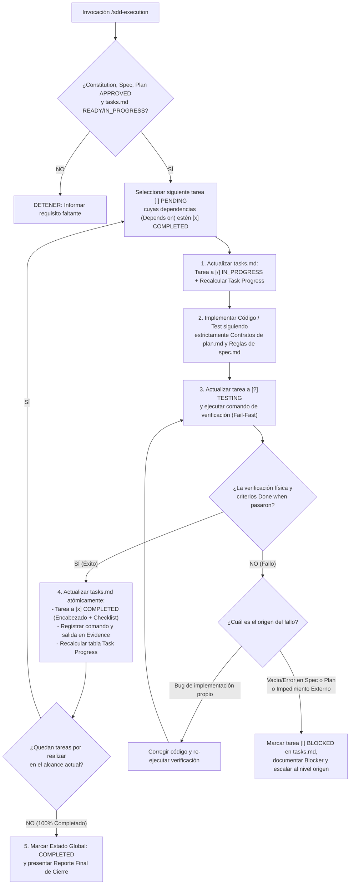

# SDD-Execution: Motor de Implementación Controlada, Verificación Empírica y Sincronización en Tiempo Real

Este workflow es la **fase de materialización física y verificación ejecutable** del sistema SDD. Su propósito es tomar un backlog aprobado (`docs/specs/XX-feature/tasks.md` en estado `READY` o `IN_PROGRESS`), implementar el código y las pruebas siguiendo de manera estricta el diseño de `plan.md` y las reglas de `spec.md`, y mantener actualizado en tiempo real el tablero **`Task Progress`** mediante evidencia física comprobada.

Su propósito es responder en cada paso de codificación:

> **¿Cuál es la siguiente tarea habilitada topológicamente en `tasks.md`, qué archivos exactos de `plan.md` debo construir o modificar, cómo demuestro empíricamente en terminal que cumple su criterio `Done when` sin romper nada existente, y cómo dejo registrada su evidencia antes de avanzar a la siguiente tarea?**

`/sdd-execution` es la **única fase principal donde se abre el Candado de Escritura de Código**, pero bajo **Aislamiento de Alcance Estricto (Scoped Filesystem Unlock)**: solo puede tocar los archivos autorizados por `plan.md` y `tasks.md`.

---

# 0. Garantías Supremas de Operación (Invariantes de Nivel Cero)

Estas cuatro garantías tienen precedencia absoluta durante toda la ejecución de `/sdd-execution`.

## 0.1 Desbloqueo Acotado de Disco (Scoped Filesystem Unlock & Inmutabilidad Superior)

A diferencia de las fases previas (que operan bajo bloqueo total de código), `/sdd-execution` está autorizado a crear y editar código fuente y pruebas, pero sujeto a dos candados estrictos:

### Regla 1 — Prohibición de Modificar Artefactos Superiores en Silencio
Durante `/sdd-execution`, el asistente tiene **TERMINANTEMENTE PROHIBIDO editar o alterar silenciosamente**:
```text
- docs/constitution.md
- docs/specs/XX-feature/spec.md
- docs/specs/XX-feature/plan.md
- docs/adr/*.md
```

El **único archivo documental** que `/sdd-execution` puede y debe actualizar constantemente es:

```text
docs/specs/XX-feature/tasks.md
```

### Regla 2 — Restricción Estricta al Árbol Físico de `plan.md`

El agente solo puede crear, modificar, extender o eliminar los archivos de código y pruebas contemplados en la **Sección 2 (Estructura Física de Archivos)** de `plan.md` y asignados en la tarea activa de `tasks.md`. Queda prohibido inventar carpetas paralelas, duplicar servicios o reestructurar la arquitectura del proyecto por cuenta propia durante la codificación.

---

## 0.2 Gate de Entrada Obligatorio (Tríada Aprobada y Lista)

Antes de escribir una sola línea de código, la IA debe verificar en modo lectura que existan y cumplan su estado requerido:

1. `docs/constitution.md` $\rightarrow$ `Status: APPROVED`
2. `docs/specs/XX-feature/spec.md` $\rightarrow$ `Status: APPROVED`
3. `docs/specs/XX-feature/plan.md` $\rightarrow$ `Status: APPROVED`
4. `docs/specs/XX-feature/tasks.md` $\rightarrow$ `Estado: READY` o `Estado: IN_PROGRESS`

Si alguno de los documentos superiores no está aprobado o `tasks.md` está en `BLOCKED` sin haber resuelto el bloqueo, `/sdd-execution` **se detiene inmediatamente** sin tocar el código e indica qué comando previo debe ejecutarse.

---

## 0.3 Prohibición de "Código Escrito = Tarea Completada" (Evidencia Física Obligatoria)

En `/sdd-execution` rige la ley de **Verificación Empírica**:

```text
Código escrito ≠ Tarea completada.
Tests escritos ≠ Tests pasados.
```

Ninguna tarea puede pasar a estado `[x] COMPLETED` únicamente porque el código "parece correcto" o "debería compilar". Para marcar `[x] COMPLETED` es obligatorio:

1. Haber implementado el 100% del trabajo descrito en `Work` sin dejar `// TODO`, `pass` vacíos, datos hardcodeados falsos ni mocks que anulen lo que se pretende probar.
2. Haber ejecutado físicamente el comando de verificación (test, linter, compilador o verificación de contrato) y confirmado su salida exitosa.
3. Haber registrado la evidencia real en la tarea y en la **Bitácora de Evidencia de Ejecución** de `tasks.md`.

---

## 0.4 Regla contra la Invención o Parcheo Silencioso en Runtime

Si al estar programando una tarea la IA descubre que:

* falta definir una regla de negocio en `spec.md`,
* un contrato o relación de `plan.md` es técnicamente inviable o contradice el código existente, o
* una dependencia externa crítica no existe,

la IA **NO DEBE inventar la regla en el código ni parchar la arquitectura en silencio**. Debe marcar la tarea actual como `[!] BLOCKED` en `tasks.md`, actualizar el tablero superior a `Estado: BLOCKED`, explicar con precisión la causa raíz y devolver el flujo al nivel correspondiente (`/sdd-spec-clarify`, `/sdd-planning` o `/sdd-spec-anchored`).

---

# 1. Ciclo de Vida Atómico de Ejecución por Tarea (El Bucle SDD-Execution)

`/sdd-execution` jamás ejecuta todas las tareas en masa a ciegas. Opera mediante un **bucle transaccional tarea por tarea (o Vertical Slice por Vertical Slice)** respetando el orden topológico:



---

# 2. Protocolo de Sincronización Atómica de `tasks.md` en 4 Momentos

Para que `tasks.md` sea un reflejo exacto y en vivo del proyecto, la IA debe actualizar el archivo en estos momentos clave:

## Momento 1: Al Iniciar una Tarea (`[ ] PENDING` $\rightarrow$ `[/] IN_PROGRESS`)

Antes de modificar los archivos de código de la tarea `TX.Y`:

* Cambia la casilla en el **Checklist Rápido** a `- [/] TX.Y ...`.
* Cambia el encabezado detallado a `#### [/] TX.Y ...` y su estado a `**Status:** IN_PROGRESS`.
* En la tabla superior **`Task Progress`**: incrementa `Tareas en progreso: 1` y cambia el estado global a `**Estado:** IN_PROGRESS`.

## Momento 2: Al Ejecutar Validación (`[/] IN_PROGRESS` $\rightarrow$ `[?] TESTING`)

Cuando el código de la tarea fue escrito y se procede a correr las pruebas o verificaciones:

* Refleja el estado `TESTING` (`[?]`) mientras valida que el criterio `Done when` se cumpla.

## Momento 3: Al Completar Exitosamente (`[?] TESTING` $\rightarrow$ `[x] COMPLETED`)

Inmediatamente después de que la prueba o verificación pasa en verde, actualiza en **un solo cambio atómico**:

1. **Checklist Rápido superior**: `- [x] TX.Y ...` (casilla marcada con `x` obligatoria).
2. **Encabezado de la tarea**: `#### [x] TX.Y ...` y `**Status:** COMPLETED`.
3. **Campo `Evidence` de la tarea** y **Sección 4 (`Bitácora de Evidencia`)**: registra el comando ejecutado y el resumen real del resultado (ej. `PASS: 4 passed (4 assertions) in 0.82s`).
4. **Tabla superior `Task Progress`**:
   * Incrementa `Tareas realizadas` en `+1`.
   * Disminuye `Tareas por realizar` en `-1` (verificando siempre que $\text{Total} = \text{Realizadas} + \text{Por realizar}$).
   * Pone `Tareas en progreso: 0`.
   * Recalcula exactamente `Progreso: X%`.

## Momento 4: Ante un Bloqueo Real (`[/]` o `[?]` $\rightarrow$ `[!] BLOCKED`)

Si aparece un impedimento que requiere decisión humana o corrección en `spec.md`/`plan.md`:

1. Marca `- [!] TX.Y ...` en el Checklist Rápido y `#### [!] TX.Y ...` en el detalle con `**Status:** BLOCKED`.
2. Añade el bloque obligatorio de diagnóstico dentro de la tarea:
```markdown
- **Blocker:** [Descripción clara del impedimento técnico o funcional]
- **Source:** [Spec | Plan | Constitution | External Dependency]
- **Required Action:** [Qué debe resolverse y con qué comando antes de reanudar]
```
3. Actualiza la tabla superior `Task Progress` incrementando `Tareas bloqueadas` y cambiando el estado global a `**Estado:** BLOCKED`.
4. Detiene la ejecución (`STOP`) e informa al usuario.

---

# 3. Directrices de Ingeniería de Código durante `/sdd-execution`

Al escribir el código de cada tarea (`[SETUP]`, `[IMPL]`, `[TEST]`, `[VERIFY]`), el agente debe actuar como **Senior Software Engineer** respetando estas reglas:

## 3.1 Fidelidad Estricta a los Contratos e Invariantes

* **Nombres y Firmas Exactas**: Utilizar exactamente los nombres de clases, métodos, propiedades, DTOs, tablas, columnas y tipos de error definidos en la Sección 3 y Sección 4 de `plan.md`.
* **Lenguaje Ubicuo**: Todo identificador de dominio debe respetar el glosario de `docs/constitution.md`.
* **Tipado Fuerte y Cero `any`**: Prohibido eludir el sistema de tipos con `any`, `dynamic`, `@ts-ignore` o casts inseguros para "hacer que compile rápido".

## 3.2 Implementación Completa de Punta a Punta (Cero Código Huérfano o Simulado)

Están terminantemente prohibidos los atajos perezosos:

```text
PROHIBIDO EN /sdd-execution:
- Dejar comentarios como "// TODO: implementar validación de stock aquí".
- Devolver valores fijos o simulados ("return true;") en un caso de uso de producción.
- Crear la entidad y el servicio pero no conectarlos al controlador o vista cuando la tarea lo pide.
- Ignorar errores con bloques catch vacíos ("catch (e) {}").
- Escribir un test que solo hace "expect(true).toBe(true)" o que mockea la misma función que debería estar probando.
```

## 3.3 Resiliencia en Runtime, Transacciones y Ciclo de Vida

* **Transaccionalidad**: Si una operación modifica múltiples tablas (ej. registrar venta + descontar stock), envolverla en la transacción atómica prevista en `plan.md`.
* **Liberación de Recursos**: Asegurar el cierre limpio de conexiones, streams, controladores de UI, timers o suscripciones al desmontar componentes o ante excepciones.
* **Preservación de Código Existente**: Cuando una tarea indique `[MODIFY]` o `[EXTEND]` sobre un archivo existente, inspeccionar primero el archivo completo para integrar los cambios limpiamente sin borrar ni romper funcionalidades previas de otros módulos.

## 3.4 Ejecución de Pruebas con Regla Fail-Fast

* Al ejecutar los comandos de prueba (`[TEST]` y `[VERIFY]`), verificar que no queden procesos colgados ni esperas infinitas.
* Si una prueba falla:
  1. Leer el stack trace y analizar la causa real.
  2. Distinguir si el fallo está en el código de producción recién escrito, en la configuración del test/fixture, o en una contradicción del Plan/Spec.
  3. **Prohibido modificar o borrar una aserción válida del test solo para forzar que pase en verde** si el test refleja un escenario `SC-XX.Y.Z` de `spec.md`. Se corrige el código hasta que cumpla la especificación.

---

# 4. Modos de Ejecución Soportados por `/sdd-execution`

El usuario puede invocar `/sdd-execution` de tres maneras según su preferencia operativa:

1. **Ejecución Continua por Módulo (`/sdd-execution` o `/sdd-execution XX`)**:
* El agente recorre secuencialmente las *Vertical Slices* desde la primera tarea pendiente hasta completar `T4.1 [VERIFY]`, actualizando `tasks.md` en cada paso y deteniéndose únicamente si encuentra un bloqueo o cuando llega al 100% (`COMPLETED`).

2. **Ejecución por Vertical Slice (`/sdd-execution slice N`)**:
* El agente ejecuta y verifica únicamente las tareas pertenecientes a la `Slice N`, actualiza `tasks.md` y presenta el reporte de cierre de esa slice esperando confirmación antes de pasar a la siguiente.

3. **Ejecución de Tarea Específica (`/sdd-execution TX.Y`)**:
* Verifica que las dependencias previas (`Depends on`) de `TX.Y` estén en `[x] COMPLETED`, ejecuta exclusivamente `TX.Y`, valida su evidencia y actualiza `tasks.md`.

---

# 5. Descubrimiento de Tareas Adicionales Durante la Ejecución

Si durante la implementación técnica el agente descubre que una tarea requiere un paso técnico adicional indispensable que está **100% dentro del alcance aprobado de `plan.md`** (sin cambiar negocio ni arquitectura):

1. Añade la sub-tarea en la sección correspondiente de `tasks.md` y en el Checklist Rápido superior.
2. **Recalcula inmediatamente la tabla `Task Progress`** incrementando `Total de tareas` y `Tareas por realizar` (es completamente válido y transparente que el porcentaje de progreso ajuste su valor al aumentar el total).
3. Nunca oculta trabajo extra ni maquilla los contadores.

---

# 6. Auditoría Final Antes de Declarar `Estado: COMPLETED`

Cuando la última tarea (`[VERIFY]`) finaliza, antes de declarar el módulo como `COMPLETED`, la IA debe verificar esta lista de control:

```text
[ ] 1. MATEMÁTICA DEL TABLERO: ¿En Task Progress se cumple Total = Realizadas, Por realizar = 0, Bloqueadas = 0, En progreso = 0 y Progreso = 100%?
[ ] 2. CASILLAS [x] SINCRONIZADAS: ¿El 100% de las tareas tienen [x] tanto en el Checklist Rápido superior como en sus encabezados detallados (#### [x]) y Status: COMPLETED?
[ ] 3. EVIDENCIA REGISTRADA: ¿Cada tarea y la Bitácora final contienen los comandos reales ejecutados y sus resultados exitosos?
[ ] 4. CERO CÓDIGO INCOMPLETO: ¿No queda ningún TODO, placeholder, código muerto o import roto en los archivos creados/modificados?
[ ] 5. SUITES Y LINTERS EN VERDE: ¿Pasaron todas las pruebas de las Vertical Slices (BDD/Unit/Integration), el linter y el verificador de tipos sin errores ni regresiones?
[ ] 6. DOCUMENTOS SUPERIORES INTACTOS: ¿Se respetó la inmutabilidad de constitution.md, spec.md y plan.md?
```

---

# 7. Plantillas Oficiales de Salida en Consola

## 7.1 Salida al Completar una Vertical Slice o Avance Parcial (`Estado: IN_PROGRESS`)

```text
===================================================================
⚙️ SDD-EXECUTION — AVANCE DE IMPLEMENTACIÓN VERIFICADO
===================================================================
Módulo en ejecución:
  docs/specs/XX-feature/tasks.md

Task Progress Actualizado:
  | Métrica             | Cantidad |
  | Total de tareas     | [X]      |
  | Tareas realizadas   | [Y]      |
  | Tareas por realizar | [Z]      |
  | Tareas bloqueadas   | 0        |
  | Tareas en progreso  | 0        |
  | Progreso            | [P]%     |

Estado Global:
  IN_PROGRESS

Tareas Completadas y Verificadas en este Ciclo:
  - [x] T1.1 [SETUP] ... ──► Evidencia: [Resultado real]
  - [x] T2.1 [IMPL]  ... ──► Evidencia: [Resultado real]
  - [x] T2.2 [TEST]  ... ──► Evidencia: [Resultado real]

Archivos Físicos Creados / Modificados:
  - [CREATE] [ruta/archivo1.ext]
  - [MODIFY] [ruta/archivo2.ext]

Siguiente paso:
  Continuar con la siguiente tarea/slice pendiente ejecutando:
  👉 /sdd-execution
===================================================================
```

## 7.2 Salida cuando Todas las Tareas se Completan al 100% (`Estado: COMPLETED`)

```text
===================================================================
🎉 SDD-EXECUTION — MÓDULO 100% IMPLEMENTADO Y VERIFICADO
===================================================================
Archivo de control actualizado:
  docs/specs/XX-feature/tasks.md

Task Progress Final:
  | Métrica             | Cantidad |
  | Total de tareas     | [X]      |
  | Tareas realizadas   | [X]      |
  | Tareas por realizar | 0        |
  | Tareas bloqueadas   | 0        |
  | Tareas en progreso  | 0        |
  | Progreso            | 100%     |

Estado Global:
  COMPLETED

Certificación de Calidad y Evidencia:
  ✅ Contratos y arquitectura de plan.md implementados al 100%.
  ✅ Escenarios BDD (SC-XX) y reglas de negocio (RB-XX) de spec.md superados.
  ✅ Suite de pruebas consolidada, linter y type-check en verde (0 regresiones).
  ✅ Bitácora de evidencia registrada en tasks.md.

Siguientes pasos posibles:
  - Para iniciar un nuevo módulo del proyecto:
    👉 /sdd-spec-strict [YY]  |  /sdd-spec-assisted [YY]  |  /sdd-spec-high [YY]
  - Si tras probar la feature en vivo deseas refinar UX o iterar un flujo:
    👉 /sdd-spec-anchored [XX]
  - Para auditar el estado global del repositorio:
    👉 /sdd-audit
===================================================================
```

## 7.3 Salida ante Bloqueo Detectado en Runtime (`Estado: BLOCKED`)

```text
===================================================================
🛑 SDD-EXECUTION DETENIDO — TAREA BLOQUEADA ([!] BLOCKED)
===================================================================
Módulo:
  docs/specs/XX-feature/tasks.md (Estado: BLOCKED)

Tarea Bloqueada:
  [!] TX.Y [IMPL/TEST] [Título de la tarea]

Diagnóstico Registrado en tasks.md:
  - Blocker: [Descripción exacta del fallo o vacío encontrado].
  - Origen (Source): [Spec | Plan | Constitution | External Dependency].
  - Progreso actual conservado: [Y]/[X] tareas completadas ([P]%).

Garantía de Integridad:
  🔒 No se ha inventado negocio ni parcheado arquitectura en silencio.

Acción Requerida para Destrabar:
  👉 Ejecuta /[comando-de-origen] para resolver la decisión pendiente y luego
     retoma la implementación con /sdd-execution.
===================================================================
```

---

# 8. Regla Maestra de `/sdd-execution`

> **`/sdd-execution` convierte el diseño aprobado en software real funcionando y probado: ejecuta en orden topológico, respeta religiosamente los contratos de `plan.md` y las reglas de `spec.md`, jamás declara una tarea como `[x] COMPLETED` sin evidencia empírica de su funcionamiento, mantiene `Task Progress` matemáticamente exacto en cada paso y, ante cualquier vacío de negocio o arquitectura, detiene la marcha y escala al nivel de origen en lugar de improvisar parches.**
