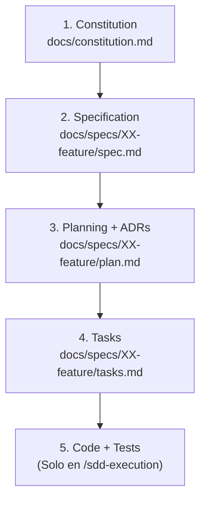
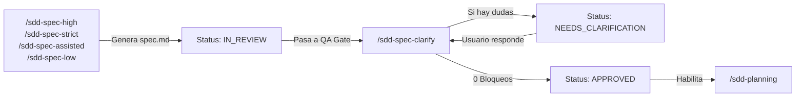
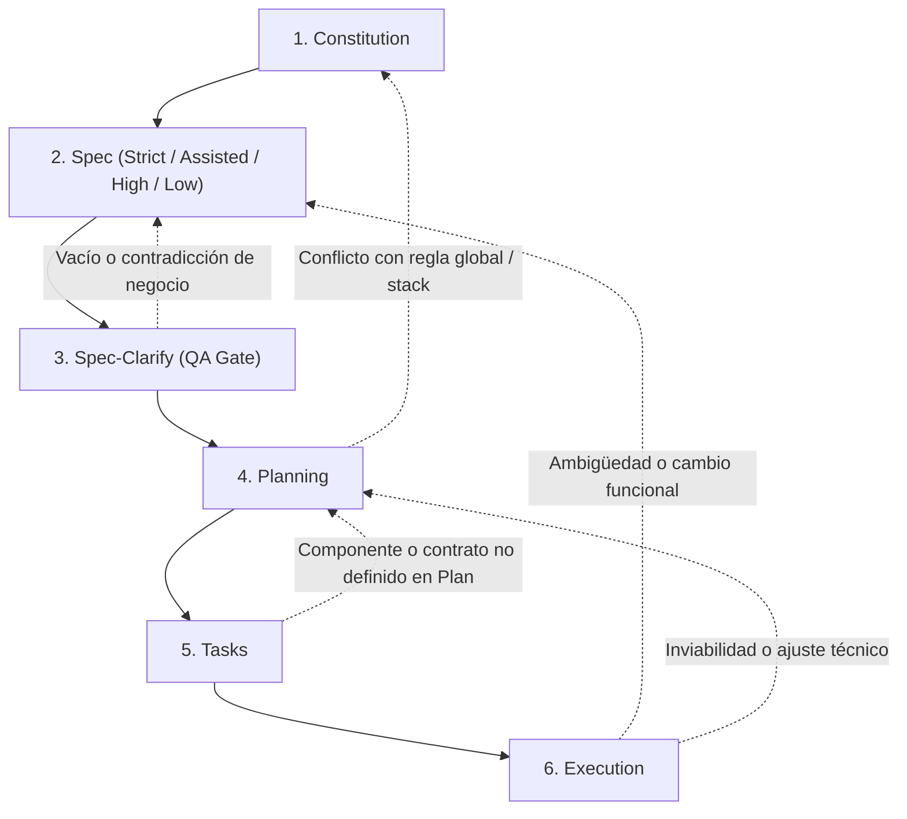

# SDD-Init: Inicializador, Constitución Operativa y Orquestador Maestro del Flujo SDD (Spec-Driven Development)

Este workflow es el **núcleo metodológico y de gobernanza del sistema SDD**. Su propósito es establecer las reglas globales, inquebrantables y verificables mediante las cuales el asistente de IA y el equipo de ingeniería desarrollan, documentan, auditan, implementan y evolucionan el proyecto bajo un flujo **Spec-Driven Development**.

`/sdd-init` define formalmente:

* el **Candado de Inmutabilidad en Disco (Filesystem Sandbox Gate)** antes de la fase de ejecución;
* el **Principio de Conservación Total de Contexto (Zero-Loss Structuring)** y el uso de **Inteligencia Contextual Activa**;
* la jerarquía de verdad y precedencia estricta entre artefactos;
* las responsabilidades y fronteras de cada fase y comando;
* los límites exactos de autonomía del asistente (negocio vs. arquitectura vs. implementación);
* la estructura documental canónica y los estados formales de aprobación;
* la matriz de trazabilidad de punta a punta;
* el mecanismo de retroalimentación y corrección en el nivel de origen;
* el catálogo completo de comandos SDD (Greenfield, Brownfield, Evolución, Auditoría y Mantenimiento);
* la auditoría, generación y mantenimiento del archivo rector `AGENTS.md`.

Este workflow **no diseña la arquitectura concreta de una aplicación ni define su estructura física de código ni modifica archivos de producción**. Esas decisiones pertenecen a `/sdd-planning` y su materialización física exclusivamente a `/sdd-execution`.

---

# 0. Garantías Supremas de Operación (Invariantes de Nivel Cero)

Estas tres garantías tienen precedencia absoluta sobre cualquier otro comportamiento del asistente en todo el ecosistema SDD.

## 0.1 Garantía de Inmutabilidad en Disco (Pre-Execution Filesystem Lock)

El sistema SDD protege el repositorio mediante un **Candado de Disco de Doble Nivel**. Ningún comando previo a `/sdd-execution` (o `/sdd-hotfix`) puede alterar jamás el código fuente ni el entorno del proyecto.

### Nivel 1 — Bloqueo Total del Árbol de Código en Fases de Diseño y Gobernanza
Durante la ejecución de `/sdd-init`, `/sdd-constitution-trial`, `/sdd-spec-strict`, `/sdd-spec-assisted`, `/sdd-spec-high`, `/sdd-spec-low`, `/sdd-spec-clarify`, `/sdd-planning`, `/sdd-task`, `/sdd-spec-anchored`, `/sdd-reverse`, `/sdd-audit` y `/sdd-adr`, el asistente tiene **TERMINANTEMENTE PROHIBIDO**:

```text
- Crear, editar, sobrescribir, mover o eliminar archivos de código fuente de producción.
- Crear, editar o eliminar archivos de pruebas (tests unitarios, integración, E2E/BDD).
- Modificar archivos de configuración del proyecto, dependencias (package.json, composer.json, pubspec.yaml, requirements.txt, pom.xml, etc.), variables de entorno o infraestructura.
- Ejecutar migraciones, seeders, compilaciones destructivas o scripts que alteren el estado de bases de datos o del sistema de archivos fuera de docs/.
```

El **único ámbito de escritura en disco permitido** antes de `/sdd-execution` es:

* `AGENTS.md` (exclusivamente durante `/sdd-init`).
* `docs/constitution.md` (exclusivamente durante `/sdd-constitution-trial` o `/sdd-reverse`).
* `docs/specs/XX-feature/spec.md`, `plan.md`, `tasks.md` (según la fase documental activa).
* `docs/adr/ADR-XX.md` (exclusivamente durante `/sdd-adr`).

### Nivel 2 — Modo 100% Read-Only durante el Tiempo 1 (Descubrimiento, Auditoría y Entrevista)

En cualquier workflow que opere en dos tiempos (Tiempo 1: Análisis/Entrevista $\rightarrow$ Tiempo 2: Generación Documental):

```text
Mientras existan preguntas abiertas, ambigüedades detectadas o decisiones pendientes de confirmación por parte del usuario, la IA NO DEBE escribir ni modificar ningún archivo en disco (ni siquiera dentro de docs/).
```

Toda detección de vacíos, propuesta de arquitectura, inferencia lógica o cuestionario de clarificación debe ocurrir **exclusivamente en la conversación**. Solo cuando las decisiones críticas estén resueltas o el usuario autorice la generación, se habilita la escritura del archivo `.md` correspondiente en `docs/`.

---

## 0.2 Principio de Conservación Total de Contexto (Zero-Loss Structuring)

Cuando el usuario proporcione un enunciado, requerimiento, documento funcional o contexto técnico extenso (por ejemplo, en `/sdd-constitution-trial` o en cualquiera de los flujos `/sdd-spec-*`), la IA tiene **estrictamente prohibido resumir de forma reductiva, simplificar artificialmente o recortar información**.

### Regla contra la Reducción Documental

* **"Limpio y preciso" NO significa "corto ni resumido"**: Un documento SDD limpio es aquel que no tiene palabrería vacía ni repeticiones inútiles, pero que **conserva y estructura el 100% de la riqueza funcional, reglas de negocio, restricciones, validaciones, excepciones, fórmulas y matices** entregados por el usuario.
* **Prohibición de pérdida por compresión**:
```text
INCORRECTO (Resumen destructivo):
El usuario entrega 80 líneas explicando reglas de descuentos escalonados, impuestos,
redondeos y excepciones por tipo de cliente, y la IA escribe en spec.md:
"RF-01: El sistema calculará descuentos e impuestos según las reglas del negocio."

CORRECTO (Estructuración sin pérdida - Zero-Loss):
La IA desglosa cada regla en RB-01, RB-02, RB-03..., formaliza cada condición
en cláusulas EARS específicas (RF-01.1, RF-01.2...), documenta la tabla exacta de
escalas, especifica la regla de redondeo y crea los escenarios Gherkin para cada caso borde.
```

---

## 0.3 Inteligencia Contextual Activa (Razonamiento Ingenieril vs. Invención Silenciosa)

La prohibición de *"no inventar reglas de negocio en silencio"* jamás debe interpretarse como pasividad intelectual ni limitarse a copiar y pegar el texto del usuario.

La IA **DEBE usar toda su capacidad analítica y de ingeniería de software** para leer entre líneas del enunciado, comprender la naturaleza profunda del dominio y deducir las implicaciones lógicas y técnicas necesarias para que el sistema funcione en el mundo real:

```text
1. ANALIZAR EL CONTEXTO PROFUNDO:
   Comprender qué problema real resuelve el enunciado, cómo interactúan los componentes
   y qué flujos implícitos son indispensables para sostener la operación.

2. DEDUCIR LÓGICAS DE IMPLEMENTACIÓN Y CASOS BORDE:
   Inferir estados intermedios necesarios, problemas de concurrencia, condiciones de carrera,
   integridad referencial, transacciones atómicas, manejo de desconexión/latencia,
   estados vacíos (Zero-State), validaciones de frontera y efectos secundarios entre módulos.

3. EXPONER Y FORMALIZAR (NUNCA OCULTAR):
   - Si la deducción es una implicación técnica o arquitectónica necesaria para que el
     sistema sea robusto, la IA debe estructurarla y proponerla detalladamente en el Plan o Spec.
   - Si la deducción revela una bifurcación de negocio (dos caminos funcionales válidos),
     la IA debe presentarla al usuario con su análisis de impacto y una recomendación fundamentada.
```

---

# 1. Jerarquía de Verdad y Precedencia por Ámbito

Cuando existan dudas, ambigüedades o conflictos durante el desarrollo, el asistente debe respetar rigurosamente la siguiente jerarquía:



La jerarquía representa **precedencia por ámbito de autoridad**, no que un documento inferior sea irrelevante.

### Regla Fundamental de Precedencia

> **Un nivel inferior jamás puede contradecir, debilitar ni ignorar una decisión explícita de un nivel superior, pero tiene plena autoridad para definir decisiones propias dentro de su ámbito específico.**

Ejemplo de propagación coherente por ámbito:

```text
Constitution (docs/constitution.md)
    ↓
Define que el sistema utiliza PostgreSQL, arquitectura Hexagonal y que ninguna
operación financiera confirmada puede eliminarse físicamente (Borrado Lógico / Anulación).

Spec (docs/specs/04-reservas/spec.md)
    ↓
Define que un Cliente puede solicitar la cancelación de una reserva hasta 24h antes,
pasando la reserva a estado CANCELADA y generando un saldo a favor.

Plan (docs/specs/04-reservas/plan.md)
    ↓
Define la estructura física de archivos del módulo, el servicio de dominio
ReservationCancellationService, el bloqueo pesimista en base de datos, los DTOs
y la transacción atómica entre las tablas reservations y wallet_credits.

Tasks (docs/specs/04-reservas/tasks.md)
    ↓
Divide la implementación en Vertical Slices ejecutables, ordenadas topológicamente
con criterios de Done y comandos de verificación.

Code + Tests (Ejecutado vía /sdd-execution)
    ↓
Materializa físicamente el código y demuestra con suites de prueba que se cumple el Spec y el Plan.
```

---

## 1.1 Constitution (`docs/constitution.md`)

Define las reglas globales, invariantes e identidad técnica y funcional del proyecto:

* misión, visión operativa y dominio completo del sistema;
* lenguaje ubicuo (glosario canónico de entidades, actores y términos del negocio);
* mapa de actores globales y matriz general de permisos;
* flujos globales transversales y arquitectura macro;
* restricciones funcionales y reglas de negocio universales;
* stack tecnológico aprobado (lenguajes, frameworks, motores de base de datos, librerías clave);
* principios de calidad, seguridad, auditoría, rendimiento y manejo global de errores;
* convenciones de código y gobernanza del repositorio.

La Constitución **no debe contener el detalle micro de una feature aislada**, salvo que constituya una regla o restricción transversal para todo el sistema.

---

## 1.2 Specification (`docs/specs/XX-feature/spec.md`)

Define con precisión exhaustiva el **QUÉ** funcional:

* actores participantes y permisos específicos dentro de la feature;
* objetivo de negocio y alcance explícito (*In Scope* vs. *Out of Scope*);
* flujo funcional completo (principal, alternativos y excepcionales);
* historias de usuario (`HU-XX`) y reglas de negocio (`RB-XX`);
* requerimientos funcionales estructurados (`RF-XX.Y`, apoyados en patrones EARS);
* modelo de datos funcional (atributos, obligatoriedad, tipos conceptuales, rangos, formatos, unicidad y relaciones funcionales entre entidades);
* máquina de estados funcional (estados, eventos disparadores, condiciones de guarda y transiciones permitidas/prohibidas);
* catálogo de errores observables, estados vacíos (*Empty States*) y casos borde (*Boundaries*);
* criterios de aceptación y escenarios observables Gherkin (`SC-XX.Y.Z`).

La especificación **no debe contaminarse con detalles internos de implementación** como:

```text
nombres de clases concretas;
controladores o middlewares;
repositorios u ORM (Eloquent, Prisma, TypeORM, Hibernate, Django ORM);
sentencias SQL, índices físicos o claves foráneas a nivel motor (VARCHAR, BIGINT, ON DELETE CASCADE);
estructura física de carpetas y rutas de archivos;
hooks o gestores de estado internos de UI (Pinia, Redux, Riverpod, Bloc).
```

*(Nota: Si el usuario proporciona restricciones técnicas explícitas en su enunciado inicial que desea conservar, se registran en una sección de "Restricciones de Diseño Conocidas para Planning" para no perderlas, sin mezclarlas con el comportamiento de caja negra).*

---

## 1.3 Planning (`docs/specs/XX-feature/plan.md`)

Define en profundidad el **CÓMO** técnico e ingenieril:

* arquitectura del módulo alineada con `constitution.md`;
* **estructura física exacta de directorios y archivos** (archivos a crear, modificar o extender en producción y pruebas);
* modelado de contratos técnicos tipados (Entidades de dominio, Value Objects, DTOs de entrada/salida, Interfaces/Puertos y jerarquía de errores tipados);
* diagramas técnicos (secuencia, componentes, estados o entidad-relación en Mermaid);
* diseño de persistencia física, migraciones, índices, transacciones y políticas de integridad referencial (`RESTRICT`, `CASCADE`, `SET NULL`);
* resolución de experiencia operativa en relaciones (como selección existente, creación en caliente o estado neutro cuando el dominio lo requiera);
* integraciones con APIs/servicios externos, timeouts, reintentos, *circuit breakers* y degradación elegante (*graceful degradation*);
* gestión de ciclo de vida en runtime (memoria, streams, concurrencia, bloqueos);
* estrategia de pruebas (Caja Negra BDD/E2E y Caja Blanca Unit/Integration proporcional al riesgo);
* particionado en *Vertical Slices* coherentes.

---

## 1.4 Tasks (`docs/specs/XX-feature/tasks.md`)

Define el **TRABAJO EJECUTABLE Y AUDITABLE**:

* tablero de progreso superior (`Task Progress`) sincronizado matemáticamente en tiempo real;
* grafo de dependencias y orden topológico de ejecución;
* descomposición en tareas atómicas agrupadas por *Vertical Slices* funcionales (`[SETUP]`, `[IMPL]`, `[TEST]`, `[VERIFY]`);
* trazabilidad explícita hacia `plan.md` y `spec.md` (`HU`, `RF`, `SC`, `PLAN`);
* descripción concreta del trabajo técnico y archivos físicos involucrados;
* criterios objetivos de finalización (*Done when*) y evidencia física verificable requerida.

---

## 1.5 Code + Tests (Exclusivo de `/sdd-execution` y `/sdd-hotfix`)

El código y los tests representan la **materialización física ejecutable** del sistema.

No sustituyen a los artefactos superiores como fuente de verdad. Si durante la ejecución o auditoría el código contradice una especificación o plan aprobado, el agente debe identificarlo inmediatamente como una desviación (*Spec Drift*) y determinar si:

1. el código contiene un bug de implementación (se corrige en `/sdd-execution` o `/sdd-hotfix`);
2. el plan técnico resultó inviable en runtime (se escala a `/sdd-planning` o `/sdd-spec-anchored`);
3. la especificación tenía un vacío o cambió el requerimiento (se escala a `/sdd-spec-anchored` o `/sdd-spec-clarify`).

**Jamás se debe alterar silenciosamente la documentación para encubrir código mal implementado, ni parchar código contradiciendo el `spec.md`.**

---

# 2. Separación de Decisiones y Modos de Especificación

## 2.1 Clasificación de Decisiones

El asistente debe distinguir con precisión quirúrgica tres niveles de decisión:

### A. Decisiones de Negocio (Autoridad del Usuario / Dominio)

Ejemplos:

```text
- ¿Un producto puede existir sin categoría asignada?
- ¿Quién tiene autorización para anular una venta confirmada y hasta qué plazo?
- ¿Qué ocurre con el saldo o inventario cuando una orden expira?
- ¿Cuál es la fórmula exacta de comisión o recargo por mora?
```

* **Regla**: Pertenecen al usuario o a la especificación funcional. La IA **no debe inventarlas ni asumirlas en silencio**.
* **Acción ante vacío**: Identificar la ambigüedad, deducir las opciones lógicas posibles en el dominio, presentar alternativas claras (incluyendo una recomendación fundamentada cuando aplique) y esperar confirmación antes de consolidar el artefacto.

### B. Decisiones Arquitectónicas y de Diseño Técnico Alto (Co-Diseño IA + Usuario en Planning)

Ejemplos:

```text
- ¿Política ON DELETE RESTRICT o SET NULL en la base de datos?
- ¿Procesamiento síncrono en la petición o asíncrono mediante cola de trabajos?
- ¿Estrategia de caché o bloqueo transaccional ante alta concurrencia?
- ¿Timeout y estrategia de fallback cuando falla un servicio externo de IA o pasarela de pago?
```

* **Regla**: La IA debe usar su criterio de **Arquitecto de Software Senior** para analizar el contexto, diseñar la solución óptima según `constitution.md` y, cuando existan alternativas críticas con impacto en datos o infraestructura, plantearlas en el Tiempo 1 de `/sdd-planning` con una opción `(Recomendada)`.

### C. Decisiones Técnicas de Bajo Impacto (Autonomía Plena del Agente en Execution)

Ejemplos:

```text
- Nombres de variables locales, métodos privados o funciones auxiliares (helpers).
- Orden de importaciones y estructuración interna limpia de una clase o componente.
- Optimización de consultas o estructuras de datos en memoria que respetan el contrato del Plan.
- Formato de código, tipado interno auxiliar y refactorización local sin cambio de contrato.
```

* **Regla**: La IA las resuelve autónomamente siguiendo las mejores prácticas de Clean Code y las reglas de `constitution.md`.

---

## 2.2 Los 4 Modos de Especificación Funcional (`/sdd-spec-*`)

Para adaptarse a cada necesidad y tipo de enunciado, el sistema ofrece cuatro flujos de especificación (todos sujetos al Candado de Disco Pre-Execution):

| Comando | Propósito y Comportamiento de la IA | Cuándo Utilizarlo |
| --- | --- | --- |
| **`/sdd-spec-strict`** | **Fidelidad Estricta 1:1 (Zero-Deviation)**. La IA traduce y formaliza **exactamente** lo que el usuario escribió en su enunciado hacia la estructura formal de `spec.md` (HU, RB, EARS, Gherkin, Datos) sin agregar funcionalidades extra, sin recortar ni resumir ni una sola regla, y deteniéndose únicamente si hay una contradicción lógica directa o un vacío que impida escribir el requisito. | Cuando ya tienes muy claro lo que quieres, redactaste un enunciado detallado o normativo y quieres que la IA lo convierta en un `spec.md` riguroso al pie de la letra sin desviarse. |
| **`/sdd-spec-assisted`** | **Co-Diseño Profundo e Inteligencia Contextual Expansiva**. La IA toma tu idea o enunciado (sea breve o extenso) y actúa como **Product Architect Senior**: analiza el dominio, deduce flujos implícitos, descubre casos borde ocultos, sugiere reglas de negocio complementarias, modela máquinas de estados completas y te propone mejoras y lógicas de implementación en una entrevista consultiva antes de redactar un `spec.md` exhaustivo. | Cuando quieres construir o expandir la especificación conversando con la IA para que use toda su inteligencia en proponer lógicas, prever problemas y enriquecer la feature. |
| **`/sdd-spec-high`** | **Especificación Funcional Estándar de Alto Nivel**. Flujo clásico en 2 tiempos: audita la entrada frente a `constitution.md`, formula preguntas priorizadas (`P0`–`P9`) para eliminar toda ambigüedad funcional y genera el `spec.md` completo en estado `IN_REVIEW`. | Para features de negocio estándar donde buscas el ciclo formal de auditoría de ambigüedades y generación estructurada. |
| **`/sdd-spec-low`** | **Especificación Ágil y Ligera**. Genera un `spec.md` directo pero completo en sus contratos de entrada/salida y criterios BDD de caja negra en una sola pasada tras validar que no existan bloqueos. | Para features pequeñas, ajustes acotados o CRUDs simples que no requieren una entrevista extensa pero sí trazabilidad SDD. |

---

# 3. Principio de Autonomía Técnica Senior y Pensamiento Sistémico

La IA debe actuar como **Copiloto e Ingeniero Técnico Senior**, nunca como un generador perezoso de fragmentos incompletos o plantillas vacías.

Cuando analice, planifique o implemente una feature, debe razonar sobre el **ciclo de vida completo de punta a punta**:

```text
Entrada / Evento Disparador
  ↓
Validación de Formato, Dominio y Permisos
  ↓
Reglas de Negocio e Invariantes
  ↓
Transacción, Persistencia e Integridad Relacional
  ↓
Efectos Secundarios (Stock, Historial, Eventos, Notificaciones)
  ↓
Respuesta / Contrato de Salida
  ↓
Actualización Reactiva de Estado en Interfaz
  ↓
Feedback Visual Observable (Éxito, Carga, Estado Vacío, Error)
  ↓
Liberación de Recursos y Manejo de Excepciones
  ↓
Verificación mediante Pruebas (BDD / Unit / Integration)
```

Debe evitar deliberadamente implementaciones o diseños miopes como:

```text
- Crear registros en base de datos sin diseñar cómo se consultan, listan o actualizan en la UI.
- Guardar una relación foránea sin definir qué ocurre cuando el registro padre no existe, está inactivo o se elimina.
- Diseñar una llamada a API o servicio de IA sin contemplar estado de carga (loading), timeout, desconexión y mensaje de error amigable.
- Escribir modelos o servicios que quedan huérfanos sin conectarse con los controladores o vistas reales.
- Redactar documentos .md genéricos que omiten las reglas específicas explicadas por el usuario.
```

---

# 4. Integridad de Entidades y Ciclo de Vida Relacional

Las relaciones entre entidades deben analizarse considerando todo su ciclo de vida:

* creación, consulta, actualización y eliminación (física o lógica);
* obligatoriedad vs. opcionalidad temporal o permanente;
* estado vacío del catálogo padre (*Zero-State*: qué ocurre cuando aún no existen registros de la entidad relacionada);
* integridad referencial y prevención de registros huérfanos.

### Regla de Desacoplamiento entre Negocio y Patrón Técnico

En la fase de **Specification (`/sdd-spec-*`)**, las relaciones se definen por su comportamiento de negocio:

```text
¿Puede la entidad dependiente existir sin la entidad relacionada?
¿Qué debe poder hacer el actor si al intentar crear la entidad dependiente el catálogo relacionado está vacío?
```

En la fase de **Planning (`/sdd-planning`)**, ese comportamiento se traduce en arquitectura física:

```text
- Políticas de clave foránea (ON DELETE RESTRICT, CASCADE, SET NULL).
- Patrones de UI/UX cuando el dominio lo requiera (por ejemplo: selector de existentes,
  creación rápida in-situ sin perder el estado del formulario, u opción neutra/fallback).
```

Ningún patrón de UI se impone ciegamente si no aplica al caso de uso, pero **toda relación dependiente debe tener resuelto su comportamiento ante catálogo vacío y ante eliminación**.

---

# 5. Ergonomía Funcional sin Cosmética Arbitraria

Los documentos SDD (`spec.md`) deben especificar con total rigor la **experiencia funcional observable**:

* qué información ve el usuario en cada estado (datos iniciales, estado vacío, estado cargando, éxito, error);
* qué acciones están habilitadas o bloqueadas según el estado y los permisos del actor;
* qué confirmaciones o advertencias son obligatorias antes de una acción destructiva o irreversible;
* cómo se comporta la interfaz ante fallos (congelamiento de vista, preservación de datos ingresados en formularios para no obligar al usuario a reescribir todo, continuidad operativa).

Lo que `spec.md` **no debe sobre-especificar innecesariamente** (salvo requerimiento explícito del usuario) son detalles puramente cosméticos como:

```text
colores hexadecimales arbitrarios;
píxeles exactos de margen o padding;
curvas de animación CSS;
nombres de componentes internos del framework visual.
```

---

# 6. Validación Basada en Riesgo (Testing Proporcional)

La calidad se demuestra mediante evidencia ejecutable proporcional al riesgo técnico y de negocio del cambio:

### 6.1 Pruebas de Caja Negra (Comportamiento Observable)

Validan que el flujo cumpla los escenarios `SC-XX.Y.Z` del `spec.md` desde la perspectiva del actor:

```text
Contexto (Given) → Acción (When) → Resultado Observable y Efectos Secundarios (Then)
```

Incluye pruebas BDD, E2E o pruebas de integración de flujo completo.

### 6.2 Pruebas de Caja Blanca (Lógica Interna Crítica)

Validan piezas internas donde reside la complejidad algorítmica o el riesgo de corrupción de datos:

* cálculos financieros, descuentos, impuestos, redondeos;
* máquinas de estados y transiciones complejas;
* validadores de dominio y transformaciones de datos;
* manejo de concurrencia, timeouts y fallbacks de servicios externos.

---

# 7. Calidad de Código en Fase de Ejecución

Todo código producido durante `/sdd-execution`, `/sdd-hotfix` o `/sdd-refactor` debe respetar las convenciones del proyecto y garantizar:

* tipado estricto y explícito (prohibido el uso injustificado de `any`, `dynamic` o mapas sin estructura cuando el lenguaje permite tipos fuertes);
* manejo explícito y tipado de errores (evitar `catch` vacíos o silenciosos);
* separación limpia de responsabilidades según la arquitectura definida en `plan.md`;
* ausencia de código muerto, variables no utilizadas, bloques comentados obsoletos o `TODOs` que oculten requisitos sin terminar;
* compatibilidad sin regresiones con los módulos existentes;
* ejecución limpia de linters, analizadores estáticos y suites de prueba antes de marcar cualquier tarea como `[x] COMPLETED`.

---

# 8. Estructura Canónica Documental

El sistema SDD administra la siguiente estructura documental dentro del repositorio:

```text
.
├── AGENTS.md                           # Guía operativa maestra para agentes IA
│
└── docs/
    ├── constitution.md                 # Gobernanza global, dominio, stack e invariantes
    │
    ├── adr/                            # Architecture Decision Records (opcional vía /sdd-adr)
    │   └── ADR-01-estrategia-auth.md
    │
    └── specs/                          # Módulos y features del sistema
        ├── 01-modulo-inicial/
        │   ├── spec.md                 # QUÉ funcional (Requisitos, Reglas, Datos, BDD)
        │   ├── plan.md                 # CÓMO técnico (Estructura física, Contratos, Secuencia)
        │   └── tasks.md                # TRABAJO ejecutable (Task Progress, Vertical Slices, Evidencia)
        │
        └── 02-siguiente-feature/
            ├── spec.md
            ├── plan.md
            └── tasks.md
```

La estructura física del código fuente del proyecto (`src/`, `app/`, `lib/`, `tests/`, etc.) **no se inventa en `/sdd-init` ni en `/sdd-spec-*`**: se audita del repositorio existente y se diseña formalmente en `/sdd-planning`.

---

# 9. Máquina de Estados de los Artefactos y Gate de Transición

Cada artefacto documental (`spec.md`, `plan.md`, `tasks.md`) gestiona su ciclo de vida mediante estados formales explícitos:

```text
DRAFT                → Documento en construcción inicial.
NEEDS_CLARIFICATION  → Bloqueado a la espera de respuestas del usuario ante ambigüedades o contradicciones.
IN_REVIEW            → Documento completo redactado por el workflow generador, listo para auditoría/QA.
APPROVED             → Validado formalmente sin bloqueos; habilita la transición hacia la siguiente fase.
READY                → Exclusivo de tasks.md cuando el backlog ha sido auditado y está listo para /sdd-execution.
IN_PROGRESS          → Ejecución activa de tareas en curso.
BLOCKED              → Detenido por impedimento técnico, dependencia faltante o contradicción descubierta.
COMPLETED            → 100% de las tareas ejecutadas con pruebas superadas y evidencia física registrada.
SUPERSEDED           → Reemplazado por una versión o iteración superior.
```

### Regla Estricta de Transición entre Especificación, Clarificación y Planning

Para garantizar que ningún diseño técnico se construya sobre supuestos no verificados:



1. Ningún generador de especificación (`/sdd-spec-high`, `/sdd-spec-strict`, `/sdd-spec-assisted`) debe saltarse el control de calidad: su salida final al crear el documento es `Status: IN_REVIEW` (o `NEEDS_CLARIFICATION` si quedaron preguntas pendientes).
2. **`/sdd-spec-clarify` es el QA Gate encargado de otorgar el `Status: APPROVED`** tras aplicar el Test de Implementación Doble y el Test de Implementador Externo.
3. **`/sdd-planning` exige que `spec.md` esté en `Status: APPROVED`** antes de generar un `plan.md` definitivo.
4. **`/sdd-task` exige que tanto `spec.md` como `plan.md` estén en `Status: APPROVED`** antes de generar `tasks.md` en `Estado: READY`.

---

# 10. Cadena de Trazabilidad de Punta a Punta

El sistema SDD conserva trazabilidad explícita y bidireccional entre la intención de negocio, el diseño técnico, las tareas y la evidencia de pruebas:

```text
Historia de Usuario (HU-XX) / Regla de Negocio (RB-XX)
  ↓
Requerimiento Funcional (RF-XX.Y)
  ↓
Escenario Observable BDD (SC-XX.Y.Z)
  ↓
Componente Arquitectónico / Contrato en Plan (PLAN-XX)
  ↓
Tarea Ejecutable en Vertical Slice (T1.1, T2.1...)
  ↓
Código Implementado + Evidencia Ejecutable de Prueba
```

* No se fuerza una relación artificial `1 RF = 1 SC = 1 Task`: un requerimiento complejo puede requerir múltiples escenarios Gherkin (`SC-01.1.1`, `SC-01.1.2`, `SC-01.1.3`), y una tarea de implementación puede satisfacer varios requisitos relacionados, siempre que la referencia cruzada quede declarada explícitamente.
* Las tareas técnicas transversales (migraciones, configuración base, infraestructura) se trazan directamente contra el componente del plan (`Traceability: PLAN-01` o `Cross-cutting`) sin inventar requisitos funcionales falsos.

---

# 11. Retroalimentación y Corrección en el Nivel de Origen

El flujo SDD reconoce que durante el diseño o la codificación pueden descubrirse vacíos en artefactos superiores:



### Regla de Oro de la Retroalimentación

> **Todo defecto, vacío o contradicción se corrige en el artefacto exacto donde reside la decisión que lo originó, nunca parcheando silenciosamente un nivel inferior.**

| Problema Descubierto | Nivel de Origen donde Debe Resolverse | Workflow a Invocar |
| --- | --- | --- |
| Regla de negocio ambigua o nuevo requerimiento funcional | `spec.md` (+ cascada a `plan.md` y `tasks.md`) | `/sdd-spec-clarify` o `/sdd-spec-anchored` |
| Contradicción con el stack global o política transversal | `docs/constitution.md` | `/sdd-constitution-trial` |
| Decisión arquitectónica compleja con múltiples alternativas | `docs/adr/` y `plan.md` | `/sdd-adr` $\rightarrow$ `/sdd-planning` |
| Diseño técnico incompleto o cambio interno sin alterar el negocio | `plan.md` y `tasks.md` | `/sdd-planning` o `/sdd-refactor` |
| Tarea mal particionada o dependencia omitida | `tasks.md` | `/sdd-task` |
| Bug puro de código (donde `spec.md` y `plan.md` son correctos) | Código + registro de tarea `[FIX]` en `tasks.md` | `/sdd-hotfix` o `/sdd-execution` |

---

# 12. Compatibilidad con Proyectos Existentes (Brownfield & Incremental)

SDD opera tanto en proyectos desde cero (*Greenfield*) como en repositorios con código existente (*Brownfield*):

* **Inspección Selectiva Segura**: Durante `/sdd-init`, `/sdd-planning`, `/sdd-reverse` o `/sdd-audit`, el agente puede leer de forma selectiva y acotada la estructura de directorios, archivos de configuración (`package.json`, `composer.json`, `pubspec.yaml`, etc.) y módulos relacionados para garantizar compatibilidad real con la arquitectura existente, **sin modificar ningún archivo de código**.
* **Preservación de Comportamiento**: Ninguna nueva feature debe romper silenciosamente contratos, rutas, tablas o comportamientos previos salvo que el `spec.md` y el `plan.md` documenten explícitamente su reemplazo o migración (`Modify`, `Extend`, `Replace`, `Delete`).

---

# 13. Catálogo Oficial de Comandos y Ciclo de Vida SDD Completo

A continuación se define la matriz completa de los **16 workflows oficiales** del ecosistema SDD, incluyendo qué archivos pueden tocar en disco:

| Fase / Categoría | Comando | Entrada Principal | Salida Oficial | Escritura Permitida en Disco | Propósito |
| --- | --- | --- | --- | --- | --- |
| **0. Gobernanza** | `/sdd-init` | Reglas SDD + Repo | `AGENTS.md` | Solo `AGENTS.md` | Inicializar gobernanza y reglas operativas de agentes. |
| **1. Constitución** | `/sdd-constitution-trial` | Visión / Enunciado global | `docs/constitution.md` | Solo `docs/constitution.md` (en Tiempo 2) | Definir dominio, glosario, actores, stack y reglas globales sin resumir. |
| **2A. Spec Estricta** | `/sdd-spec-strict` | Enunciado detallado + `constitution.md` | `docs/specs/XX/spec.md` (`IN_REVIEW`) | Solo `spec.md` (en Tiempo 2) | Formalizar 1:1 el enunciado del usuario con fidelidad absoluta y cero recorte. |
| **2B. Spec Asistida** | `/sdd-spec-assisted` | Idea / Enunciado + `constitution.md` | `docs/specs/XX/spec.md` (`IN_REVIEW`) | Solo `spec.md` (en Tiempo 2) | Co-diseñar con inteligencia contextual: la IA deduce casos borde, reglas y flujos. |
| **2C. Spec Estándar** | `/sdd-spec-high` | Necesidad funcional + `constitution.md` | `docs/specs/XX/spec.md` (`IN_REVIEW`) | Solo `spec.md` (en Tiempo 2) | Especificación funcional completa mediante entrevista priorizada (`P0`–`P9`). |
| **2D. Spec Ágil** | `/sdd-spec-low` | Cambio acotado / menor | `docs/specs/XX/spec.md` (`IN_REVIEW`) | Solo `spec.md` | Especificación rápida conservando contratos de E/S y criterios de caja negra. |
| **3. QA Funcional** | `/sdd-spec-clarify` | `spec.md` (`IN_REVIEW`) | `spec.md` (`APPROVED`) | Solo `spec.md` (en Tiempo 2) | Gate de auditoría funcional (Test de Doble Implementación y Cero Ambigüedad). |
| **4A. Decisión Arq.** | `/sdd-adr` | Duda arquitectónica crítica | `docs/adr/ADR-XX.md` | Solo `docs/adr/ADR-XX.md` | Evaluar pros, contras y benchmarks de decisiones técnicas de alto impacto. |
| **4B. Planning** | `/sdd-planning` | `spec.md` (`APPROVED`) + `constitution.md` | `docs/specs/XX/plan.md` (`APPROVED`) | Solo `plan.md` (en Tiempo 2) | Diseñar arquitectura, árbol físico de archivos, contratos tipados y secuencias. |
| **5. Tareas** | `/sdd-task` | `spec.md` + `plan.md` (`APPROVED`) | `docs/specs/XX/tasks.md` (`READY`) | Solo `tasks.md` | Descomponer en Vertical Slices atómicas con dependencias, Done y Task Progress. |
| **6. Ejecución** | `/sdd-execution` | `tasks.md` (`READY`) | Código + Tests + `tasks.md` (`COMPLETED`) | **Código + Tests + `tasks.md`** | **Única fase principal autorizada a escribir código**, ejecutar pruebas y registrar evidencia. |
| **7A. Evolución** | `/sdd-spec-anchored` | Ajuste / Cambio post-impl | Tríada `spec` + `plan` + `tasks` | Solo `docs/specs/XX/*.md` (en Tiempo 2) | Evolución en cascada: Estado Puro en Spec/Plan + nuevas tareas en cola en Tasks. |
| **7B. Sub-comandos Anchored** | `/sdd-spec-anchored-spec`<br><br>`/sdd-spec-anchored-plan`<br><br>`/sdd-spec-anchored-task` | Cambio puntual en un artefacto de la tríada | Archivo `.md` respectivo actualizado | Solo el archivo `.md` respectivo en `docs/specs/XX/` | Actualización atómica individual de Spec, Plan o Tasks dentro de una iteración. |
| **8A. Hotfix** | `/sdd-hotfix` | Bug puro de implementación | Código corregido + tarea `[FIX]` en `tasks.md` | **Código + Tests + `tasks.md`** | Corregir bug de código que no altera ni `spec.md` ni `plan.md`, con test de regresión. |
| **8B. Refactor** | `/sdd-refactor` | Mejora técnica / Deuda técnica | `plan.md` + tareas `[REFACTOR]` en `tasks.md` | Solo `plan.md` y `tasks.md` (luego usa `/sdd-execution`) | Reestructurar diseño interno manteniendo `spec.md` y sus escenarios BDD como invariante intocable. |
| **9A. Ing. Inversa** | `/sdd-reverse` | Código existente sin SDD | `constitution.md` o `spec.md` + `plan.md` | Solo `docs/` (100% Read-Only sobre el código) | Extraer por ingeniería inversa la documentación SDD fiel de un proyecto o módulo ya codificado. |
| **9B. Auditoría** | `/sdd-audit` | Todo `docs/` + Código | Reporte de Estado y *Spec Drift* en chat | **CERO escritura en disco (100% Read-Only)** | Auditar consistencia global, detectar desvíos entre código y Spec, y cuadrar métricas de `tasks.md`. |
| **10. Despliegue** | `/doc-deploy` | Proyecto implementado | Documentación y suite de despliegue | Solo documentación/artefactos de deploy | Generar guías operativas, variables y artefactos de puesta en producción. |

---

# 14. Regla de Finalización Real de Fases

Ninguna fase se considera completada por el simple hecho de haber generado texto:

1. **En fases documentales (`/sdd-constitution-trial` a `/sdd-task`)**:
* El artefacto debe haber superado su checklist de auditoría interna.
* No debe haberse omitido ni recortado ninguna regla del enunciado del usuario (*Zero-Loss*).
* No debe haberse modificado ningún archivo fuera de `docs/` (*Pre-Execution Lock*).
* Su estado formal (`IN_REVIEW`, `APPROVED`, `READY`) debe reflejar la realidad sin ocultar decisiones pendientes.

2. **En fases de ejecución (`/sdd-execution` y `/sdd-hotfix`)**:
* `spec.md creado ≠ spec.md aprobado`.
* `código escrito ≠ tarea completada`.
* `tests escritos ≠ tests ejecutados y pasados`.
* Una tarea solo puede marcarse como `[x] COMPLETED` cuando el trabajo fue realizado, el criterio `Done when` se cumplió y la evidencia de ejecución física (tests, linter, build) fue verificada y registrada.

---

# 15. Protocolo de Orquestación y Plantillas de Salida al Usuario

Al concluir cualquier comando SDD, el asistente debe guiar activamente al usuario informando con total claridad el estado actual y el siguiente paso lógico.

### 15.1 Salida Estándar cuando una Fase Documental se Completa sin Bloqueos

```text
===================================================================
✅ FASE SDD COMPLETADA
===================================================================
Artefacto generado/actualizado:
  docs/specs/XX-feature/[archivo.md]

Estado del artefacto:
  [IN_REVIEW | APPROVED | READY]

Garantía de Disco:
  🔒 Pre-Execution Lock respetado (0 archivos de código modificados).

Resumen de Decisiones y Cobertura:
  - [Resumen de puntos clave estructurados sin pérdida de información]
  - [Inferencias lógicas o componentes modelados]

Siguiente paso recomendado:
  👉 /[siguiente-comando-sdd]
===================================================================
```

### 15.2 Salida Estándar cuando Existen Ambigüedades o Bloqueos (Tiempo 1 — Modo Read-Only)

```text
===================================================================
⏸️ WORKFLOW DETENIDO — REQUIERE CONFIRMACIÓN (MODO 100% READ-ONLY)
===================================================================
Fase actual:
  /[comando-actual]

Estado:
  NEEDS_CLARIFICATION (Ningún archivo ha sido escrito ni modificado en disco).

Hallazgos / Decisiones Críticas Detectadas:
  1. [P0/P1 - Descripción clara del vacío o contradicción y su impacto]
     - A) [Opción A]
     - B) [Opción B] (Recomendada — [Justificación técnica/funcional])
     - C) Otro comportamiento.

Por favor, responde a los puntos anteriores para proceder a generar el artefacto definitivo.
===================================================================
```

---

# 16. Auditoría, Generación y Mantenimiento de `AGENTS.md`

Cuando el usuario invoque `/sdd-init`, el asistente debe auditar el repositorio en modo lectura antes de crear o actualizar `AGENTS.md`.

## 16.1 Auditoría Previa No Destructiva

1. Inspeccionar si ya existen:
* `AGENTS.md`
* `docs/constitution.md`
* `docs/specs/`
* Archivos de configuración de stack en la raíz (`package.json`, `composer.json`, `pubspec.yaml`, `pyproject.toml`, `requirements.txt`, `pom.xml`, `build.gradle`, `Cargo.toml`, `Makefile`, `docker-compose.yml`, etc.).

2. Si existen documentos previos:
* Preservar todo acuerdo, comando personalizado o regla válida del proyecto.
* Detectar posibles contradicciones e informarlas al usuario.
* Nunca borrar ni sobrescribir destructivamente configuraciones útiles existentes.

---

# 17. Estructura y Contenido Obligatorio de `AGENTS.md`

El archivo `AGENTS.md` generado en la raíz del proyecto debe funcionar como el **contrato operativo permanente para cualquier agente de IA** que trabaje en el repositorio, e incluir obligatoriamente las siguientes 6 secciones:

### 17.1 Jerarquía de Verdad y Rutas Relativas

* Declarar el orden estricto: `docs/constitution.md` $\rightarrow$ `docs/specs/XX-feature/spec.md` $\rightarrow$ `docs/specs/XX-feature/plan.md` $\rightarrow$ `docs/specs/XX-feature/tasks.md` $\rightarrow$ `Code + Tests`.
* **Prohibición absoluta de rutas dependientes de la máquina**:
```text
PROHIBIDO usar en cualquier documento:
- file:///...
- C:\Users\...
- /home/usuario/...
- /Users/...

OBLIGATORIO usar siempre rutas relativas a la raíz del repositorio:
- docs/constitution.md
- docs/specs/01-modulo/spec.md
```

### 17.2 Candado de Disco Pre-Execution (Filesystem Sandbox Gate)

* Instrucción explícita para que ningún agente edite código fuente, tests ni configuraciones cuando ejecute comandos de especificación, clarificación, planificación, tareas o auditoría.
* Regla de operación 100% en memoria/chat durante las rondas de preguntas (Tiempo 1).

### 17.3 Principio de Conservación Total (Zero-Loss) e Inteligencia Contextual

* Prohibición de resumir o recortar enunciados extensos del usuario.
* Obligación de deducir implicaciones técnicas, casos borde, estados intermedios y validaciones de integridad sin inventar reglas de negocio en silencio.

### 17.4 Catálogo y Flujo de Comandos SDD

* Diagrama del flujo completo y tabla de los 16 comandos (`/sdd-init`, `/sdd-constitution-trial`, `/sdd-spec-strict`, `/sdd-spec-assisted`, `/sdd-spec-high`, `/sdd-spec-low`, `/sdd-spec-clarify`, `/sdd-adr`, `/sdd-planning`, `/sdd-task`, `/sdd-execution`, `/sdd-spec-anchored`, `/sdd-hotfix`, `/sdd-refactor`, `/sdd-reverse`, `/sdd-audit`, `/doc-deploy`).

### 17.5 Reglas de Autonomía y Calidad de Ingeniería

* Distinción entre Decisiones de Negocio (preguntar siempre), Decisiones Arquitectónicas (proponer con opción recomendada en Planning) y Decisiones de Bajo Impacto (resolver con Clean Code).
* Exigencia de tipado fuerte, manejo explícito de errores, prohibición de código muerto, validación basada en riesgo y evidencia física obligatoria antes de marcar `[x] COMPLETED`.

### 17.6 Comandos Reales del Proyecto (Extraídos del Repositorio)

* Registrar los comandos reales detectados en el proyecto para:
```text
- Instalación y entorno de desarrollo (dev / serve)
- Compilación (build)
- Ejecución de pruebas unitarias, de integración y BDD/E2E
- Linters, formateadores y analizadores estáticos (lint / type-check / analyze)
- Migraciones y gestión de base de datos
```

* Si el repositorio aún está completamente vacío (Greenfield puro), dejar la sección preparada con marcadores claros que se actualizarán tras definir el stack en `/sdd-constitution-trial`.

---

# 18. Las 9 Invariantes Operativas del Ecosistema SDD

Durante todo el ciclo de vida del proyecto se deben cumplir estas 9 invariantes:

1. **Invariante 1 — Candado de Disco Pre-Execution**: Ninguna fase anterior a `/sdd-execution` (o `/sdd-hotfix`) crea ni modifica archivos fuera de `docs/` (y `AGENTS.md` en `/sdd-init`). Durante las entrevistas (Tiempo 1), la escritura en disco es cero.
2. **Invariante 2 — Cero Pérdida de Información (Zero-Loss)**: Los enunciados extensos del usuario jamás se resumen de forma reductiva; cada regla, restricción, dato y caso borde se conserva y estructura formalmente.
3. **Invariante 3 — Inteligencia Contextual Activa sin Invención Silenciosa**: La IA razona profundamente sobre el dominio y deduce implicaciones técnicas y casos borde; los expone y propone abiertamente, pero nunca asume en silencio una decisión de negocio ambigua.
4. **Invariante 4 — Subordinación Jerárquica**: `Spec` no contradice a `Constitution`; `Plan` no contradice a `Spec`; `Tasks` no contradice a `Plan`; `Code` no contradice a ninguno de los anteriores.
5. **Invariante 5 — Respeto a los Gates de Estado**: Ninguna fase consume como definitiva una entrada en `DRAFT` o `NEEDS_CLARIFICATION`. Solo `/sdd-spec-clarify` promueve un `spec.md` de `IN_REVIEW` a `APPROVED`.
6. **Invariante 6 — Evidencia Física Verificable**: Ninguna tarea en `tasks.md` pasa a `[x] COMPLETED` por el simple hecho de haber generado código; requiere pruebas ejecutadas y evidencia registrada.
7. **Invariante 7 — Trazabilidad Bidireccional**: Todo requisito funcional relevante (`HU` $\rightarrow$ `RF` $\rightarrow$ `SC`) debe poder rastrearse hasta su componente en `plan.md`, su tarea en `tasks.md` y su prueba verificable.
8. **Invariante 8 — Corrección en el Nivel de Origen**: Todo fallo o vacío se corrige en el documento donde pertenece la decisión, propagando el cambio en cascada hacia abajo.
9. **Invariante 9 — Separación QUÉ vs. CÓMO**: `spec.md` define comportamiento observable de caja negra; `plan.md` define arquitectura y estructura física de archivos.

---

# 19. Acción Exacta al Invocar `/sdd-init`

Cuando el usuario ejecute `/sdd-init`, el asistente debe seguir exactamente esta secuencia paso a paso:

```text
1. Activar el Candado de Disco (prohibido tocar código fuente o crear carpetas no autorizadas).
2. Inspeccionar en modo lectura la raíz del proyecto, AGENTS.md (si existe) y la carpeta docs/ (si existe).
3. Extraer de los archivos de configuración existentes (package.json, composer.json, pubspec.yaml, etc.) los comandos reales de build, test, lint y ejecución.
4. Detectar qué artefactos SDD existen actualmente y en qué estado se encuentran (constitution.md, carpetas en docs/specs/).
5. Generar o actualizar el archivo AGENTS.md en la raíz del proyecto incorporando íntegramente las secciones 17.1 a 17.6, utilizando exclusivamente rutas relativas.
6. NO crear automáticamente docs/constitution.md, ni spec.md, ni plan.md, ni tasks.md en este paso.
7. Presentar al usuario el reporte de inicialización (Sección 15.1) indicando los artefactos detectados y recomendando el siguiente comando lógico:
   - Si no existe docs/constitution.md o está incompleto → recomendar /sdd-constitution-trial (o /sdd-reverse si es un proyecto ya codificado que se desea documentar por ingeniería inversa).
   - Si docs/constitution.md ya existe y está aprobado → recomendar /sdd-spec-strict, /sdd-spec-assisted o /sdd-spec-high según la necesidad del usuario.
```
