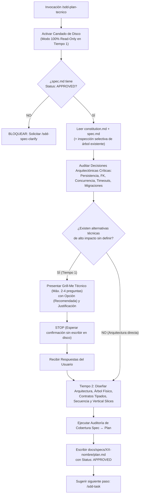

# SDD-Plan-Tecnico: Arquitectura Técnica, Contratos Tipados, Runtime y Estructura Física (Protocolo de 2 Tiempos)

Este workflow transforma una especificación funcional aprobada (`docs/specs/XX-nombre/spec.md`) y las leyes globales del proyecto (`docs/constitution.md`) en un **diseño técnico e ingenieril completo, determinista y verificable** dentro de **`docs/specs/XX-nombre/plan.md`**.

Su propósito es responder con precisión quirúrgica:

> **¿CÓMO vamos a construir técnicamente el comportamiento exigido en `spec.md`, en qué archivos físicos exactos vivirá cada pieza, qué contratos tipados y esquemas de persistencia gobernarán los datos, cómo manejaremos la concurrencia, fallos y recursos en runtime, y en qué Vertical Slices se organizará la implementación?**

`/sdd-planning` (o `/sdd-plan-tecnico`) es la frontera donde las decisiones de negocio se traducen en decisiones de ingeniería de software. **No inventa ni modifica reglas de negocio, y tampoco escribe código de producción en el repositorio.**

---

# 0. Garantías Supremas de Operación (Invariantes de Nivel Cero)

Estas cuatro garantías tienen precedencia absoluta dentro de este workflow.

## 0.1 Candado de Inmutabilidad en Disco (Pre-Execution Filesystem Lock)

### Nivel 1 — Prohibición Absoluta de Tocar el Árbol de Código del Proyecto
Aunque este workflow diseña al milímetro la estructura física de directorios, clases, tablas, endpoints y tests, el asistente tiene **TERMINANTEMENTE PROHIBIDO**:

```text
- Crear carpetas o archivos reales dentro del directorio de código fuente (src/, app/, lib/, etc.).
- Crear o modificar archivos de pruebas reales (tests/, spec/, e2e/).
- Crear o ejecutar migraciones reales en la base de datos o modificar esquemas físicos fuera de docs/.
- Instalar paquetes o modificar archivos de dependencias (package.json, composer.json, pubspec.yaml, etc.).
```

El **único archivo que este workflow tiene autorización para escribir o actualizar en disco** es:

```text
docs/specs/XX-nombre/plan.md
```

### Nivel 2 — Modo 100% Read-Only durante el Tiempo 1 (Grill-Me Técnico)

Mientras existan decisiones arquitectónicas críticas con múltiples alternativas viables pendientes de confirmación por el usuario (Tiempo 1):

```text
La IA NO DEBE escribir ni modificar docs/specs/XX-nombre/plan.md en disco.
```

El cuestionario técnico y las opciones recomendadas se presentan exclusivamente en el chat. Solo en el **Tiempo 2** se escribe `plan.md`.

---

## 0.2 Gate de Entrada Obligatorio (`spec.md` en Estado `APPROVED`)

Antes de diseñar cualquier arquitectura, la IA debe verificar el estado de `docs/specs/XX-nombre/spec.md`:

* Si `spec.md` está en `Status: APPROVED`: Puede iniciar la planificación técnica.
* Si `spec.md` está en `DRAFT`, `IN_REVIEW` o `NEEDS_CLARIFICATION`:
```text
DETENER INMEDIATAMENTE.
No generar un plan técnico sobre una especificación no aprobada.
Indicar al usuario que debe ejecutar primero /sdd-spec-clarify para aprobar el spec.md.
```

---

## 0.3 Principio de Densidad Técnica sin Recortes (Zero-Loss Engineering)

Un `plan.md` nunca debe ser un resumen superficial con frases genéricas como *"Se creará el controlador y el servicio correspondiente"*.

La IA tiene **prohibido resumir o simplificar artificialmente el diseño técnico**:

* Todo requisito funcional (`RF-XX.Y`), regla de negocio (`RB-XX`), dato funcional y escenario (`SC-XX.Y.Z`) de `spec.md` debe tener su contraparte técnica explícita en `plan.md`.
* Los contratos de código (Entidades, Value Objects, DTOs, Interfaces/Puertos y Tipos de Error) deben escribirse con **sus campos, tipos de datos y firmas de métodos completos**, listos para que `/sdd-task` y `/sdd-execution` trabajen sin adivinar nombres ni firmas.
* Cada componente arquitectónico importante debe recibir un identificador trazable (`PLAN-01`, `PLAN-02`, etc.) para que `tasks.md` pueda enlazarlo directamente.

---

## 0.4 Inteligencia Arquitectónica Activa (Copiloto Técnico Senior)

La IA debe aplicar razonamiento profundo de ingeniería para prever y resolver problemas técnicos que el usuario no necesita especificar en el negocio:

1. **Concurrencia y Atomicidad**: Determinar qué operaciones requieren transacciones de base de datos (`BEGIN / COMMIT / ROLLBACK`), bloqueos pesimistas/optimistas o idempotencia (ej. evitar doble cobro o descuento duplicado de stock).
2. **Integridad del Grafo de Datos**: Definir índices para consultas frecuentes, claves únicas compuestas, políticas de borrado foráneo (`RESTRICT`, `CASCADE`, `SET NULL`) y prevención de estados huérfanos.
3. **Resiliencia de I/O y Ciclo de Vida**: Diseñar liberación limpia de recursos (streams, cámaras, sockets, timers, listeners), manejo de memoria, timeouts explícitos y degradación elegante cuando falla una red o API externa.
4. **Mapeo Exacto de Errores**: Traducir cada error observable del `spec.md` en una clase/tipo de fallo técnico específico dentro del dominio, prohibiendo excepciones genéricas sin control.

---

# 1. Regla de Lectura Acotada y Compatibilidad con el Repositorio

Al iniciar la planificación técnica, el asistente debe seguir una política de lectura estricta pero inteligente:

1. **Fuente de Verdad Normativa (Carpeta `docs/`)**:
* Lee obligatoriamente `docs/constitution.md` (para obtener el stack oficial, arquitectura macro, invariantes `INV-BIZ` / `INV-ARCH` y convenciones).
* Lee obligatoriamente `docs/specs/XX-nombre/spec.md` (para obtener el alcance, requerimientos, datos, estados y escenarios BDD).
* Lee `docs/adr/` si existen decisiones arquitectónicas previas vinculadas.

2. **Inspección Selectiva de Compatibilidad (Solo en Proyectos con Código Existente)**:
* Si el repositorio ya cuenta con código fuente implementado por módulos anteriores, la IA puede inspeccionar de forma **selectiva, puntual y en modo 100% lectura** la estructura de carpetas existente y los modelos/contratos compartidos con los que este nuevo módulo debe integrarse.
* **Prohibido hacer barridos indiscriminados** de todo el repositorio cuando no aporten al diseño del módulo actual.
* **Prohibido derivar reglas de negocio del código viejo** que contradigan a `spec.md` o `constitution.md`.

---

# 2. Protocolo Operativo en 2 Tiempos



---

## 2.1 TIEMPO 1: Análisis Técnico y Cuestionamiento de Decisiones Críticas (Grill-Me Técnico)

Antes de redactar `plan.md`, la IA audita la especificación y detecta si existen **decisiones técnicas de alto impacto** que admitan más de una estrategia arquitectónica válida.

### Los 6 Ejes de Auditoría Técnica en Tiempo 1:

1. **Políticas de Integridad Referencial y Borrado**:
* Ante el borrado o desactivación de una entidad padre, ¿se aplica a nivel técnico `ON DELETE RESTRICT`, `ON DELETE SET NULL`, `ON DELETE CASCADE` o borrado lógico (`deleted_at` / `status`)?

2. **Estrategia de Concurrencia y Transaccionalidad**:
* Si la operación modifica saldos, inventario o cupos, ¿se utiliza bloqueo pesimista (`SELECT ... FOR UPDATE`), control optimista por versión o cola seriada?

3. **Integraciones Externas, Timeouts y Fallbacks**:
* ¿Cuál es el timeout técnico exacto (ej. 5s, 10s), la política de reintentos (*backoff*) y el mecanismo técnico de contingencia (caché local, cola offline, fallback manual)?

4. **Evolución de Esquema y Migraciones de Datos**:
* Si se modifica una tabla existente con datos previos, ¿cómo se migran o transforman los registros actuales sin pérdida de integridad?

5. **Almacenamiento Temporal, Archivos o Recursos de Hardware**:
* ¿Dónde y cómo se gestionan archivos temporales, buffers en memoria, streams de cámara/audio o caché de sesión, y cuándo se destruyen físicamente?

6. **Complejidad Arquitectónica Disputada (Escalado a `/sdd-adr`)**:
* Si surge una disyuntiva estructural mayor (ej. elegir entre dos motores o arquitecturas completamente distintas), la IA puede resolverla aquí o sugerir documentar primero un `/sdd-adr`.

### Regla para Formular las Preguntas del Tiempo 1:

* Formular únicamente las preguntas estrictamente necesarias (**entre 2 y 4 preguntas directas**).
* **No volver a preguntar reglas de negocio** que ya están cerradas en `spec.md`.
* Cada pregunta debe presentar opciones técnicas concretas (`A`, `B`, `C`) y destacar siempre una opción **`(Recomendada)`** fundamentada en robustez, simplicidad y alineación con `constitution.md`.
* **Si no existen dudas técnicas críticas** (porque `constitution.md` y `spec.md` ya determinan unívocamente toda la solución técnica), la IA expone brevemente las decisiones estándar adoptadas y **avanza directamente al Tiempo 2** sin hacer perder tiempo al usuario.

---

## 2.2 TIEMPO 2: Diseño Exhaustivo del Copiloto Técnico Senior y Generación de `plan.md`

Una vez confirmadas las decisiones técnicas, la IA diseña la solución completa y escribe `docs/specs/XX-nombre/plan.md`.

---

# 3. Directrices de Ingeniería para el Contenido de `plan.md`

## 3.1 Estructura Física Exacta y Operaciones por Archivo

Es en `plan.md` donde se define formalmente dónde irá cada archivo del módulo.

* Cada archivo listado en el árbol físico debe indicar su **operación prevista**:
  * `[CREATE]`: Archivo nuevo a crear desde cero.
  * `[MODIFY]`: Archivo existente cuya lógica interna se ajustará.
  * `[EXTEND]`: Archivo existente al que se agregarán nuevos métodos, rutas o registros sin alterar lo previo.
  * `[DELETE]`: Archivo obsoleto que será eliminado.

* Las tareas de `/sdd-task` usarán exactamente estas rutas físicas; por tanto, no deben usarse nombres genéricos como `controller.ts`, sino la ruta real según la convención del proyecto (ej. `src/modules/sales/presentation/controllers/RegisterSaleController.ts` o `app/Http/Controllers/SaleController.php`).

## 3.2 Contratos Fuertemente Tipados y Dominio Rico

En la sección de contratos de `plan.md`, la IA debe escribir las definiciones de tipos en el lenguaje real del stack (`TypeScript`, `PHP`, `Dart`, `Python`, `Java`, etc.):

* **Modelos de Dominio y Value Objects**: Con sus propiedades tipadas, constructores/fábricas e invariantes internas.
* **DTOs / Commands / Queries**: Estructuras exactas de entrada y salida, indicando qué validaciones técnicas se aplican en la frontera.
* **Jerarquía Explícita de Errores (`DomainFailure` / `Exceptions`)**: Cada escenario de error de `spec.md` debe mapearse a un tipo de error técnico concreto.
* **Puertos / Interfaces de Repositorio y Servicios**: Con la firma exacta de cada método, parámetros y tipos de retorno (ej. `Promise<Result<Sale, SaleFailure>>`).

## 3.3 Integridad Relacional y Patrones de Interacción Condicionales

1. **Esquema de Persistencia e Índices**:
* Especificar tablas/colecciones, columnas, tipos físicos (`UUID`, `BIGINT`, `DECIMAL(12,2)`, `TIMESTAMP`), nulabilidad (`NOT NULL` vs `NULL`), índices de búsqueda y restricciones `UNIQUE` o `FOREIGN KEY`.

2. **Patrón de Selección Tridimensional (*The 3-Way Selector Pattern* — Cuando aplique a relaciones de catálogo)**:
* Cuando el `spec.md` defina una entidad que depende de seleccionar un registro padre o catálogo (ej. *Producto $\rightarrow$ Categoría*, *Venta $\rightarrow$ Cliente*), el plan debe diseñar cómo se soportan técnicamente las modalidades requeridas por el negocio:
  * **A) Selección existente**: Consulta indexada/reactiva de elementos activos del catálogo.
  * **B) Creación en caliente (*Inline Creation*)**: Si el `spec.md` lo permite, mecanismo técnico para crear el registro padre al vuelo conservando intacto el estado en memoria del formulario hijo.
  * **C) Estado neutro / Zero-State**: Manejo técnico cuando el catálogo está vacío o la relación es opcional, garantizando que la pantalla jamás colapse ni quede bloqueada sin salida.

* *(Si la feature no involucra selección de relaciones, se documenta únicamente la garantía de estado vacío o inicial correspondiente).*

## 3.4 Diseño de Vertical Slices para Alimentar `/sdd-task`

Para que `/sdd-task` no tenga que inventar cómo partir el trabajo, `plan.md` debe incluir una sección que agrupe los componentes técnicos (`PLAN-XX`) en **Vertical Slices funcionales de punta a punta**:

* Cada Slice debe cortar transversalmente las capas necesarias (Persistencia $\rightarrow$ Dominio/Lógica $\rightarrow$ Presentación/API $\rightarrow$ Verificación) para entregar un flujo observable del `spec.md`.

---

# 4. Plantilla Canónica Oficial: `docs/specs/XX-nombre/plan.md`

El archivo generado debe seguir rigurosamente esta estructura completa:

```markdown
# Plan Técnico: [Nombre del Módulo o Feature]

> **Estado:** APPROVED | IN_REVIEW | NEEDS_CLARIFICATION
> **Versión:** 1.0.0
> **Módulo:** `docs/specs/XX-nombre/`
> **Especificación Base:** `docs/specs/XX-nombre/spec.md`
> **Constitución Base:** `docs/constitution.md`
> **Metodología:** SDD-Planning

---

## 1. Resumen Arquitectónico y Decisiones de Diseño

- **Objetivo Técnico**: [Descripción precisa de la solución técnica que materializa el `spec.md`]
- **Estilo y Patrón Arquitectónico**: [Ej. Clean Architecture / Hexagonal / Modular MVC / Feature-First según `constitution.md`]
- **Decisiones Arquitectónicas Clave Tomadas**:
  - **Persistencia e Integridad**: [Política de transacciones, claves foráneas `RESTRICT`/`SET NULL`/`CASCADE`, estrategia de borrado].
  - **Concurrencia y Estado**: [Manejo de estado reactivo, bloqueos o sincronización].
  - **Resiliencia y Timeouts**: [Timeouts configurados, reintentos y degradación elegante].

### 1.1 Matriz de Componentes Técnicos (`PLAN-XX`)

| ID Componente | Nombre / Artefacto Técnico | Capa Arquitectónica | Responsabilidad Técnica | Requisitos que Cubre (`RF` / `RB` / `SC`) |
| :--- | :--- | :--- | :--- | :--- |
| **`PLAN-01`** | `[Nombre de Migración / Esquema / Modelo DB]` | Infraestructura / Datos | [Persistencia física, índices y restricciones] | `RF-01.1`, `RB-01` |
| **`PLAN-02`** | `[Entidad / Value Objects / Errores de Dominio]` | Dominio | [Reglas de negocio puras e invariantes en memoria] | `RB-01`, `RB-02`, `SC-01.1.2` |
| **`PLAN-03`** | `[Caso de Uso / Servicio de Aplicación]` | Aplicación | [Orquestación transaccional y flujo principal] | `HU-01`, `RF-01.1`, `RF-01.2` |
| **`PLAN-04`** | `[Repositorio / Adaptador Externo]` | Infraestructura | [Implementación de puertos e integración I/O] | `RF-01.1`, `SC-01.1.1` |
| **`PLAN-05`** | `[Controlador / Endpoint / Vista / Estado UI]` | Presentación | [Interacción con el actor, validación de entrada y feedback] | `HU-01`, `SC-01.1.1`, `SC-01.1.2` |

---

## 2. Estructura Física de Archivos del Proyecto / Módulo

> Mapa exacto de rutas relativas a crear, modificar o extender durante `/sdd-execution`. Prohibido inventar rutas fuera de este mapa en la fase de tareas.

```text
<raíz-del-proyecto>/
├── [ruta_capa_dominio]/
│   ├── [CREATE] [entidad_o_value_object.ext]          # (PLAN-02)
│   ├── [CREATE] [errores_de_dominio.ext]              # (PLAN-02)
│   └── [CREATE] [interfaz_repositorio.ext]            # (PLAN-02)
├── [ruta_capa_aplicacion]/
│   ├── [CREATE] [dto_entrada_salida.ext]              # (PLAN-03)
│   └── [CREATE] [caso_de_uso_o_servicio.ext]          # (PLAN-03)
├── [ruta_capa_infraestructura]/
│   ├── [CREATE] [migracion_o_esquema_db.ext]          # (PLAN-01)
│   └── [CREATE] [implementacion_repositorio.ext]      # (PLAN-04)
├── [ruta_capa_presentacion]/
│   ├── [CREATE | MODIFY] [controlador_o_store.ext]    # (PLAN-05)
│   └── [CREATE | MODIFY] [vista_o_componente_ui.ext]  # (PLAN-05)
└── [ruta_directorio_tests]/
    ├── [CREATE] [test_bdd_e2e_flujo.ext]              # Verificación Caja Negra (SC-XX)
    └── [CREATE] [test_unitario_reglas.ext]            # Verificación Caja Blanca (RB-XX)
```

---

## 3. Modelo Físico de Persistencia y Esquema de Datos

### 3.1 Definición de Tablas / Colecciones / Esquemas (`PLAN-01`)

* **Tabla / Entidad Física**: `[nombre_tabla]`
| Columna / Campo | Tipo Físico | Nulabilidad | Restricciones / Índices / Default | Regla Funcional Asociada |
| --- | --- | --- | --- | --- |
| `id` | `UUID` / `BIGINT` | `NOT NULL` | `PRIMARY KEY` | Identidad única |
| `[campo_fk_id]` | `UUID` / `BIGINT` | `NULL` / `NOT NULL` | `FOREIGN KEY REFERENCES [tabla](id) ON DELETE [POLÍTICA]`, `INDEX` | `[RB-XX]` |
| `[campo_dato]` | `VARCHAR(150)` / `DECIMAL(12,2)` | `NOT NULL` | `CHECK (...)` / `UNIQUE` | `[RF-XX.Y]` |
| `created_at` | `TIMESTAMP UTC` | `NOT NULL` | `DEFAULT CURRENT_TIMESTAMP` | Auditoría constitucional |

### 3.2 Estrategia de Migración y Compatibilidad de Datos

* **Versión de Esquema / Orden de Migración**: [Detalle de la migración y cómo convive con tablas existentes].
* **Política de Transaccionalidad y Bloqueo**: [Qué operaciones se envuelven en transacción atómica y qué nivel de aislamiento o bloqueo utilizan].

---

## 4. Contratos de Código, Interfaces Tipadas y Jerarquía de Errores

### 4.1 Entidades de Dominio y Value Objects Inmutables (`PLAN-02`)

```[lenguaje]
// Definición completa de las entidades, propiedades, constructores y métodos de dominio
```

### 4.2 DTOs de Entrada/Salida y Reglas de Validación Técnica (`PLAN-03`)

```[lenguaje]
// Definición exacta de payloads de entrada, reglas de validación en frontera y DTOs de respuesta
```

### 4.3 Jerarquía de Errores Tipados y Mapeo a Escenarios (`PLAN-02` / `PLAN-05`)

```[lenguaje]
// Clases o tipos unión sellados para cada fallo de dominio e infraestructura
```

| Error Técnico / Tipo de Fallo | Condición Técnica que lo Dispara | Código / Estado de Salida | Mensaje / Comportamiento Observable en UI (`spec.md`) | Escenario BDD Asociado |
| --- | --- | --- | --- | --- |
| `[InsufficientStockFailure]` | `availableStock < requestedQty` | `422` / `DomainError` | [Comportamiento definido en Spec] | `SC-01.1.2` |
| `[ExternalServiceTimeoutFailure]` | `Timeout > Xs` en cliente externo | `504` / `FallbackState` | [Degradación elegante definida en Spec] | `SC-01.2.1` |

### 4.4 Puertos de Entrada y Salida (Interfaces de Casos de Uso y Repositorios) (`PLAN-02` / `PLAN-03`)

```[lenguaje]
// Interfaces con firmas exactas de métodos, argumentos y retornos
```

---

## 5. Diagramas Técnicos de Secuencia y Estados

### 5.1 Flujo Principal y Manejo de Excepciones

```mermaid
sequenceDiagram
    autonumber
    actor Actor as [Actor]
    participant UI as [Presentación / Controlador] (PLAN-05)
    participant UC as [Caso de Uso / Servicio] (PLAN-03)
    participant Dom as [Entidad / Dominio] (PLAN-02)
    participant Repo as [Repositorio / Adaptador] (PLAN-04)
    participant DB as [Base de Datos / API Externa] (PLAN-01)

    Actor->>UI: Ejecuta acción con datos de entrada
    UI->>UI: Valida formato de DTO y activa estado de procesamiento
    UI->>UC: execute(InputDTO)
    UC->>Repo: Verifica precondiciones / obtiene entidades
    Repo->>DB: Consulta indexada / bloqueo si aplica
    DB-->>Repo: Datos actuales
    UC->>Dom: Aplica reglas de negocio (RB-XX)
    alt Regla de negocio o validación falla
        Dom-->>UC: Retorna DomainFailure tipado
        UC-->>UI: Result.failure(DomainFailure)
        UI-->>Actor: Restaura estado interactivo y muestra error observable (SC-XX)
    else Reglas superadas exitosamente
        UC->>Repo: Persiste cambios en transacción atómica
        Repo->>DB: COMMIT (Entidad + Efectos secundarios)
        DB-->>Repo: Confirmación
        Repo-->>UC: Entidad persistida
        UC-->>UI: Result.success(OutputDTO)
        UI-->>Actor: Actualiza vista y muestra confirmación observable (SC-XX)
    end
```

---

## 6. Garantías de Runtime, Relaciones y Ciclo de Vida Operativo

1. **Integridad Relacional y Manejo de Dependencias (Patrón de Selección / Zero-State)**:
* *Comportamiento con registros existentes*: [Cómo se cargan, filtran o paginan las entidades relacionadas].
* *Comportamiento ante catálogo vacío (Zero-State Invariant)*: [Cómo garantiza la capa de presentación y aplicación que el flujo no se rompa si no existen registros relacionados].
* *Creación en caliente / Fallback (si aplica)*: [Cómo se preserva el estado temporal del formulario si el usuario necesita crear una dependencia al vuelo].

2. **Resiliencia de Red, Hardware y Liberación de Recursos**:
* *Timeouts y Cancelación*: [Límites de tiempo y cancelación limpia de peticiones en vuelo si el usuario abandona la pantalla].
* *Disposición de Recursos (`dispose` / `cleanup`)*: [Cierre garantizado de streams, controladores, suscripciones o archivos temporales].

3. **Seguridad y Autorización Técnica**:
* *Guards / Middlewares / Policies*: [Dónde y cómo se valida técnicamente que solo el actor autorizado en `spec.md` pueda invocar la operación].

---

## 7. Arquitectura de Vertical Slices (Hoja de Ruta para `/sdd-task`)

> División funcional incremental para que `/sdd-task` genere tareas atómicas sin caer en el antipatrón de capas horizontales aisladas.

* **Fundación / Setup (`Slice 0` — Si requiere preparación base)**:
  * Componentes: `PLAN-01` (Migraciones, esquemas base y configuración de dependencias).

* **Vertical Slice 1: [Nombre del Flujo Principal de Punta a Punta]**:
  * Componentes: `PLAN-02` $\rightarrow$ `PLAN-03` $\rightarrow$ `PLAN-04` $\rightarrow$ `PLAN-05`.
  * Escenarios cubiertos: `SC-01.1.1`.
  * Entregable verificable: [Flujo principal operativo desde la entrada hasta la persistencia y respuesta].

* **Vertical Slice 2: [Nombre de Reglas de Borde, Errores y Efectos Secundarios]**:
  * Componentes: Extensiones sobre `PLAN-02`, `PLAN-03`, `PLAN-05`.
  * Escenarios cubiertos: `SC-01.1.2`, `SC-01.2.1`.
  * Entregable verificable: [Validaciones de frontera, degradación elegante y bloqueo de operaciones inválidas].

---

## 8. Estrategia de Testing y Verificación Técnica

| Nivel de Prueba | Tipo | Archivo de Test Físico Previsto | Qué Valida Exactamente | Escenarios / Reglas Asociadas |
| --- | --- | --- | --- | --- |
| **1. Caja Negra (BDD / E2E / Feature)** | Comportamiento Observable | `[ruta_test_bdd.ext]` | Flujo completo de extremo a extremo con timeout fail-fast | `SC-01.1.1`, `SC-01.1.2` |
| **2. Caja Blanca (Unitaria)** | Lógica Pura de Dominio | `[ruta_test_unit.ext]` | Cálculos, invariantes de entidad y transiciones de estado | `RB-01`, `RB-02` |
| **3. Integración** | Persistencia / Contratos | `[ruta_test_integration.ext]` | Integridad de claves foráneas, transacciones y mapeo de repositorio | `PLAN-01`, `PLAN-04` |

* **Comandos de Verificación para `/sdd-execution`**:
  * Test Suite del Módulo: `[comando exacto]`
  * Linter / Type-Check: `[comando exacto]`

---

## 9. Matriz de Trazabilidad Técnica (`Spec` ↔ `Plan`)

| Requisito / Regla / Escenario (`spec.md`) | Componente(s) del Plan (`PLAN-XX`) | Contrato / Archivo Físico Principal | Prueba que lo Verifica |
| --- | --- | --- | --- |
| `HU-01` / `RF-01.1` | `PLAN-01`, `PLAN-03`, `PLAN-04`, `PLAN-05` | `[caso_de_uso.ext]`, `[controlador.ext]` | `[test_bdd_e2e.ext]` |
| `RB-01` / `SC-01.1.2` | `PLAN-02`, `PLAN-03` | `[entidad.ext]`, `[errores.ext]` | `[test_unitario.ext]`, `[test_bdd_e2e.ext]` |
```

---

# 5. Checklist de Auditoría Interna Antes de Marcar `plan.md` como `APPROVED`

Antes de finalizar `/sdd-planning`, la IA debe verificar cada uno de estos puntos:

```text
[ ] 1. CANDADO DE DISCO: ¿Se garantizó que solo se escribió docs/specs/XX-nombre/plan.md y 0 archivos de código o migraciones reales?
[ ] 2. SUBORDINACIÓN AL SPEC Y CONSTITUCIÓN: ¿El plan respeta el 100% del stack de constitution.md y el 100% de las reglas de spec.md sin inventar negocio nuevo?
[ ] 3. CERO REDUCCIÓN TÉCNICA (ZERO-LOSS): ¿Están todos los contratos (Entidades, DTOs, Puertos, Errores) escritos con sus campos y tipos completos, sin usar comentarios perezosos como "// resto de campos aquí"?
[ ] 4. ÁRBOL FÍSICO COMPLETO: ¿Cada archivo necesario para implementar y probar la feature tiene su ruta exacta y su etiqueta [CREATE], [MODIFY] o [EXTEND]?
[ ] 5. MAPEO DE ERRORES: ¿Cada error observable del spec.md tiene su tipo técnico y su flujo en el diagrama de secuencia?
[ ] 6. INTEGRIDAD Y CONCURRENCIA: ¿Están definidas las políticas de claves foráneas, transacciones y manejo de estados vacíos?
[ ] 7. VERTICAL SLICES DEFINIDAS: ¿La Sección 7 deja listos los cortes verticales para que /sdd-task pueda descomponer sin fricción?
[ ] 8. TRAZABILIDAD 100%: ¿Todos los RF, RB y SC del spec.md aparecen cubiertos en la Matriz de Trazabilidad (Sección 9)?
```

---

# 6. Plantillas de Salida del Workflow

## 6.1 Salida en Tiempo 1 (Grill-Me Técnico — Modo 100% Read-Only)

```text
===================================================================
🏗️ SDD-PLANNING — ANÁLISIS ARQUITECTÓNICO PRELIMINAR (READ-ONLY)
===================================================================
Módulo auditado:
  docs/specs/XX-nombre/spec.md (Status: APPROVED)

Estado del Plan:
  NEEDS_CLARIFICATION (Ningún archivo ha sido escrito ni modificado en disco).

1. Síntesis de Ingeniería Detectada:
   - Patrón y Stack a aplicar (según constitution.md): [Resumen]
   - Componentes técnicos proyectados: [PLAN-01 a PLAN-0X]
   - Integración con código existente: [Compatible / Módulo nuevo]

2. Decisiones Técnicas Críticas a Confirmar (Grill-Me Técnico):
   Antes de congelar la arquitectura en plan.md, confirma por favor:

   [Pregunta Técnica 1 — Ej. Política de Integridad Referencial / Concurrencia]
   - Impacto en runtime/datos: [Explicación breve]
   - A) [Opción técnica A] (Recomendada — [Justificación de ingeniería])
   - B) [Opción técnica B]

   [Pregunta Técnica 2 — Ej. Estrategia de Persistencia Temporal / Timeout / Migración]
   - Impacto en runtime/datos: [Explicación breve]
   - A) [Opción técnica A] (Recomendada — [Justificación de ingeniería])
   - B) [Opción técnica B]

Responde con tu elección (ej. "1A, 2A") para generar docs/specs/XX-nombre/plan.md.
===================================================================
```

## 6.2 Salida en Tiempo 2 (Cuando `plan.md` ha sido Generado y Aprobado)

```text
===================================================================
✅ PLAN TÉCNICO APROBADO (/sdd-planning)
===================================================================
Archivo generado:
  docs/specs/XX-nombre/plan.md

Estado del Artefacto:
  Status: APPROVED | Versión: 1.0.0

Garantía de Inmutabilidad en Disco:
  🔒 Pre-Execution Lock respetado (0 archivos de código fuente o migraciones tocados).
  📐 Contratos tipados completos, árbol físico y esquema de datos modelados sin recortes.

Resumen de Arquitectura Diseñada:
  - Componentes Técnicos: [X] componentes (PLAN-01 a PLAN-0X).
  - Archivos Físicos Proyectados: [X] a crear, [Y] a modificar, [Z] archivos de test.
  - Vertical Slices Preparadas: [N] slices funcionales de punta a punta.
  - Cobertura de Trazabilidad: 100% de RF, RB y SC mapeados a componentes y pruebas.

Siguiente paso recomendado:
  El diseño técnico está completo y aprobado. Ahora podemos descomponerlo en
  tareas ejecutables y verificables:
  👉 /sdd-task
===================================================================
```

---

# 7. Regla Maestra de `/sdd-planning`

> **`/sdd-planning` elimina toda incertidumbre técnica antes de escribir una sola línea de código. Un buen `plan.md` es aquel donde la estructura física de archivos, los contratos de tipos, el esquema de base de datos, el manejo de errores y las Vertical Slices están definidos con tanta claridad que `/sdd-task` y `/sdd-execution` pueden operar con precisión mecánica sin tener que improvisar arquitectura.**
