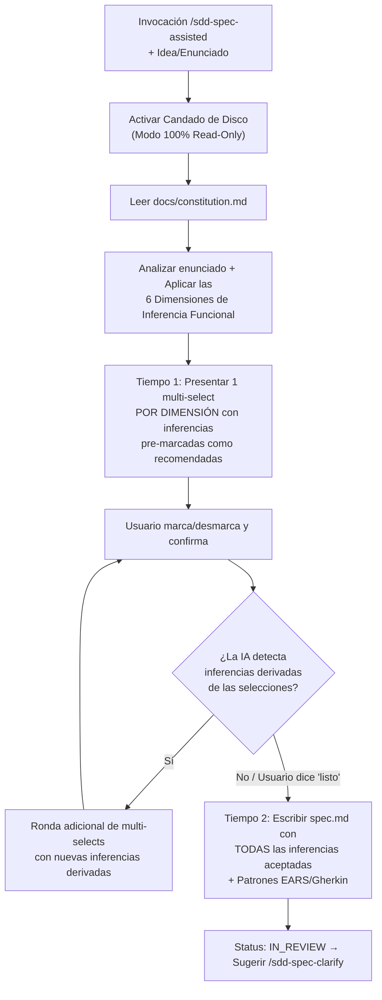

# SDD-Spec-Assisted: Especificación Funcional con Inferencia Proactiva y Selección Asistida (Multi-Select)

Este workflow es el **motor de expansión analítica del sistema SDD**. Su propósito es tomar una idea, necesidad o enunciado funcional inicial del usuario y someterlo a un proceso de **inferencia proactiva y selección asistida** donde la IA actúa como Arquitecto de Producto Senior.

`/sdd-spec-assisted` **exige que la IA deduzca proactivamente los flujos ocultos, casos borde, estados vacíos, condiciones de carrera y excepciones funcionales**, presentándolos como **propuestas pre-seleccionadas en formato multi-select** para que el usuario acepte, descarte o modifique antes de generar la especificación.

> **Objetivo:** Convertir una intención funcional ("Quiero que los clientes puedan devolver productos") en un **`docs/specs/XX-feature/spec.md` exhaustivo y a prueba de balas**, eliminando las lagunas de negocio mediante inferencia masiva y selección controlada por el usuario.

---

# 0. Garantías Supremas de Operación

## 0.1 Candado de Inmutabilidad en Disco (Pre-Execution Lock)
* **Nivel 1 (Prohibición Total de Código):** La IA tiene terminantemente prohibido modificar, crear o eliminar archivos fuera de `docs/`. No se toca código fuente, ni tests, ni configuraciones.
* **Nivel 2 (Tiempo 1 Read-Only):** Durante la fase de inferencia y selección asistida (Tiempo 1), la IA **no escribe en disco**. Todas las propuestas e inferencias se presentan en la conversación mediante controles multi-select. Solo se genera el `spec.md` cuando el usuario confirma su selección final.

## 0.2 Zero-Loss Structuring (Cero Pérdida de Información Original)
Aunque la IA agregue valor y expansiones, **no puede omitir, resumir destructivamente ni alterar las reglas originales** que el usuario haya establecido en su prompt. La inteligencia contextual de la IA suma y estructura, pero no borra la intención del humano.

---

# 1. Inteligencia Contextual Activa (Responsabilidades de Inferencia de la IA)

Cuando la IA recibe el enunciado inicial, debe auditarlo mentalmente contra estas **6 Dimensiones de Inferencia Funcional**. Si detecta vacíos, debe proponer el comportamiento lógico:

| Dimensión de Inferencia | Lo que la IA debe deducir y proponer si el usuario no lo mencionó |
| :--- | :--- |
| **1. Estados Vacíos (Zero-State)** | ¿Qué ve o qué hace el usuario si esta pantalla/lista aún no tiene datos? ¿Se bloquea el flujo o se ofrece una acción de creación rápida? |
| **2. Casos Borde y Límites** | ¿Qué pasa si la cantidad es 0, si el texto excede el límite, si se envía la petición dos veces seguidas (debounce funcional), o si la fecha solicitada ya pasó? |
| **3. Transiciones de Estado** | Si una entidad tiene estados (ej. *Pendiente* $\rightarrow$ *Aprobado*), ¿qué pasa si se intenta rechazar un elemento ya aprobado? ¿Se permite revertir? |
| **4. Fallos e Interrupciones** | ¿Qué experiencia tiene el usuario si falla el servicio externo (timeout) o no hay conectividad? (Degradación elegante: ej. guardar borrador local). |
| **5. Integridad y Dependencias** | Si esta feature requiere seleccionar una entidad padre (ej. seleccionar cliente para una venta) y esta fue eliminada, ¿se permite continuar? |
| **6. Efectos Secundarios** | Si la acción principal tiene éxito, ¿qué más debería ocurrir en el negocio? (ej. descontar stock, enviar notificación, generar traza de auditoría). |

---

# 2. Protocolo Operativo en 2 Tiempos



---

## 2.1 TIEMPO 1: Inferencia Proactiva y Selección Asistida Multi-Select (Modo Read-Only)

**Paso 1: Leer el Marco Legal**
La IA lee `docs/constitution.md` para entender los actores existentes, el lenguaje ubicuo y las reglas inquebrantables del dominio.

**Paso 2: Generar la Matriz de Inferencia Exhaustiva**
La IA analiza la idea del usuario y mapea **todo lo que falta funcionalmente** utilizando las 6 Dimensiones. No existe límite en la cantidad de inferencias: la IA debe ser ambiciosa y deducir todo lo que pueda (10, 15, 20 inferencias si es necesario). Es más fácil para el usuario descartar lo que no aplica que inventar lo que falta.

**Paso 3: Presentar Propuestas Multi-Select por Dimensión**

La IA **no pregunta, propone**. En lugar de formular preguntas abiertas, presenta directamente las inferencias como propuestas de comportamiento ya redactadas. El usuario selecciona cuáles incluir en la especificación.

### Reglas del Formato Multi-Select

1. **Una pregunta multi-select por cada Dimensión** (hasta 6 multi-selects): La IA agrupa sus inferencias por dimensión para que el usuario entienda el contexto de cada grupo.
2. **Pre-selección de recomendadas**: Todas las inferencias que la IA considere esenciales deben venir **pre-marcadas como seleccionadas** (`(Recommended)`). El usuario solo desmarca lo que no quiere.
3. **Opciones cortas y directas**: Cada opción del multi-select debe ser concisa y autoexplicativa. Sin justificaciones extensas. El usuario confía en la recomendación de la IA.
4. **Sin límite de cantidad por dimensión**: Si una dimensión genera 5 inferencias, se presentan 5. Si genera 1, se presenta 1. Si una dimensión no aplica, se omite.

```text
INCORRECTO (Grill-Me Pasivo — Modelo Obsoleto):
  - ¿Qué estados tendrá la reserva?
  - ¿Qué pasa si falla el pago?
  - A) Opción A (Recomendada - porque...)
  - B) Opción B

CORRECTO (Multi-Select Proactivo — Modelo Actual):
  La IA presenta directamente una pregunta multi-select:

  Dimensión: Transiciones de Estado
  Seleccione las inferencias que aplican:
  ☑ (Recommended) La reserva inicia en estado "Pendiente" y transiciona a "Confirmada" tras el pago
  ☑ (Recommended) Una reserva cancelada no puede restaurarse; requiere flujo nuevo
  ☑ (Recommended) Prohibido confirmar una reserva ya cancelada o expirada
  ☐ Una reserva pendiente expira automáticamente tras 15 minutos sin pago
```

### Rondas Iterativas de Refinamiento

Tras la primera ronda de multi-selects, la IA evalúa si las selecciones del usuario generan **inferencias derivadas** (consecuencias lógicas de lo aceptado). Si las detecta:

1. Presenta una **ronda adicional de multi-selects** con las nuevas inferencias derivadas.
2. El ciclo se repite hasta que:
   * La IA declara que no tiene más inferencias derivadas, o
   * El usuario indica explícitamente "listo, genera el spec.md".

```text
Ejemplo de Ronda Derivada:
  El usuario aceptó "reserva cancelada no puede restaurarse" →
  La IA infiere y presenta:
  ☑ (Recommended) Al cancelar, los asientos reservados se liberan inmediatamente al inventario
  ☑ (Recommended) Se envía notificación al usuario confirmando la cancelación
  ☐ Se guarda historial de cancelaciones para análisis de métricas
```

### Dimensiones Omitidas

Si alguna de las 6 dimensiones no genera inferencias relevantes para la feature analizada, la IA la omite sin presentar un multi-select vacío. Solo se muestran las dimensiones con inferencias detectadas.

---

## 2.2 TIEMPO 2: Generación del Artefacto (`spec.md`)

Tras la confirmación del usuario (todas las rondas de multi-select cerradas), la IA consolida toda la información (la intención original del usuario + todas las inferencias aceptadas en las rondas de selección) y genera el archivo `docs/specs/XX-feature/spec.md`.

---

# 3. Reglas de Modelado Documental para el `spec.md`

El documento generado debe cumplir los más altos estándares de ingeniería de requisitos:

### 3.1 Prohibición de Jerga de Implementación

El `spec.md` describe comportamiento de "Caja Negra" (observable).

```text
PROHIBIDO USAR: Controller, ORM, SQL, JWT, PINIA, Endpoint, Tabla, Middleware.
PERMITIDO USAR: Flujo, Actor, Condición, Regla de Negocio, Escenario, Vista, Evento.
```

### 3.2 Formalización EARS para Requerimientos

Los requisitos funcionales (`RF-XX.Y`) deben usar la sintaxis EARS (*Easy Approach to Requirements Syntax*) cuando sea posible para eliminar ambigüedad:

* **Ubiquitous:** `El sistema deberá [comportamiento].`
* **Event-Driven:** `Cuando [evento observable], el sistema deberá [respuesta].`
* **Unwanted Behavior:** `Si [condición no deseada], el sistema deberá impedir [acción] y mostrar [mensaje].`

### 3.3 Consolidación Gherkin (Criterios de Aceptación)

La IA no crea secciones separadas y redundantes para "Precondiciones" y "Criterios de Aceptación" si dicen lo mismo. Todo el comportamiento verificable se consolida en **Escenarios BDD (Gherkin)** (`Given`, `When`, `Then`), garantizando la cobertura de:

* Happy Path.
* Manejo de Errores Observables.
* Estados Vacíos.
* Límites (Boundaries) inferidos en el Tiempo 1.

---

# 4. Estructura Canónica de `docs/specs/XX-feature/spec.md`

El archivo generado debe seguir exactamente esta plantilla:

```markdown
# Specification: [Nombre de la Feature]

> **Estado:** IN_REVIEW
> **Módulo:** XX-[nombre]
> **Metodología:** SDD-Spec-Assisted

---

## 1. Objetivo y Alcance
- **Objetivo de Negocio**: [El valor real que aporta la feature]
- **In-Scope**: [Flujos y capacidades explícitamente incluidas]
- **Out-of-Scope**: [Lo que explícitamente no se maneja en esta feature]

---

## 2. Actores y Autorización
- **[Actor 1]**: [Qué permisos tiene sobre esta feature específica, respetando constitution.md]
- **[Actor 2]**: [Restricciones de acceso]

---

## 3. Modelo Funcional de Datos y Reglas de Negocio Específicas
> Define la información necesaria desde la perspectiva del usuario, no el esquema de base de datos.

- **Datos Requeridos**:
  - `[Campo 1]`: [Tipo conceptual, Obligatorio/Opcional, Restricción de Dominio, ej. "Debe ser > 0"].
- **Reglas de Negocio (RB)**:
  - `RB-01`: [Regla específica de la feature deducida en la entrevista].
  - `RB-02`: [Regla de límite o cálculo].

---

## 4. Máquina de Estados (Si aplica a la feature)
- **Estado Inicial**: [Estado]
- **Transiciones Permitidas**: [Estado A] → [Evento/Acción] → [Estado B].
- **Transiciones Prohibidas**: [Qué cambios están explícitamente bloqueados por el negocio].

---

## 5. Requerimientos Funcionales (Patrón EARS)
- `HU-01`: [Como actor, quiero..., para...]
  - `RF-01.1`: [Requisito EARS].
  - `RF-01.2`: [Requisito EARS sobre manejo de errores].

---

## 6. Comportamiento Observable y Criterios de Aceptación (Gherkin)
> Estos escenarios definen la validación funcional requerida para /sdd-tasks.

### Escenario 1: Flujo Principal (Happy Path)
```gherkin
Given [Contexto y precondición]
When [El actor realiza la acción]
Then [El resultado funcional es observable]
And [Se dispara el efecto secundario X]
```

### Escenario 2: Casos Borde y Prevención de Errores
```gherkin
Given [Contexto adverso o límite deducido]
When [Acción]
Then [El sistema impide la acción y comunica X]
```

---

## 7. Efectos Secundarios e Integraciones

* **Dependencias Funcionales**: [Qué necesita esta feature de otras partes del sistema].
* **Efectos Secundarios**: [Qué otras áreas se ven afectadas si esta feature tiene éxito].
```

---

# 5. Plantillas de Salida en Consola

## 5.1 Salida en Tiempo 1 (Inferencia Proactiva Multi-Select)

```text
===================================================================
🧠 SDD-SPEC-ASSISTED — INFERENCIA PROACTIVA Y SELECCIÓN ASISTIDA (READ-ONLY)
===================================================================
Estado:
  NEEDS_CLARIFICATION (Modo Diseño - Cero modificaciones en disco)

1. Mapeo Inicial (Zero-Loss):
   - Intención detectada: [Resumen conciso del objetivo]
   - Actores identificados: [Actores]

2. Inferencias Detectadas por Dimensión:
   A continuación presento mis inferencias agrupadas por dimensión.
   Todas las recomendadas vienen pre-seleccionadas.
   Desmarca las que no aplican a tu caso.

   [Se presentan multi-selects interactivos por cada dimensión aplicable]

   Ronda: [1 | N] (Si hay inferencias derivadas, se presentará una ronda adicional)
===================================================================
```

> **Nota operativa para la IA:** Los multi-selects deben presentarse utilizando la herramienta `ask_question` con `is_multi_select: true`, generando una pregunta por cada dimensión que tenga inferencias. Las opciones recomendadas deben llevar el prefijo `(Recommended)` para que aparezcan pre-seleccionadas. Ejemplo de invocación:
>
> ```text
> Pregunta 1 de N — Dimensión: Estados Vacíos (Zero-State)
> Opciones (multi-select):
>   ☑ (Recommended) Si la lista no tiene registros, mostrar mensaje con botón de creación rápida
>   ☑ (Recommended) Si el catálogo padre está vacío, permitir crear el primer registro al vuelo
>   ☐ Mostrar ilustración SVG personalizada en el estado vacío
>
> Pregunta 2 de N — Dimensión: Casos Borde y Límites
> Opciones (multi-select):
>   ☑ (Recommended) Bloquear envío del formulario si cantidad = 0
>   ☑ (Recommended) Truncar texto a 255 caracteres con contador visible
>   ☑ (Recommended) Protección anti-doble submit con debounce funcional
> ```

## 5.2 Salida en Tiempo 2 (Generación Final)

```text
===================================================================
✅ ESPECIFICACIÓN ASISTIDA GENERADA (/sdd-spec-assisted)
===================================================================
Archivo generado:
  docs/specs/XX-[feature]/spec.md

Estado Oficial:
  Status: IN_REVIEW

Garantía de Calidad:
  🔒 Pre-Execution Lock mantenido (0 archivos de código tocados).
  🧠 Casos Borde, Flujos Alternos y Errores Observables modelados en Gherkin.
  🧩 Reglas de negocio acopladas al lenguaje ubicuo de constitution.md.

Siguiente paso requerido:
  El artefacto está redactado, pero debe someterse a la auditoría formal
  para buscar ambigüedades implícitas.

  👉 Ejecuta: /sdd-spec-clarify
===================================================================
```

---

# 6. Regla Maestra de `/sdd-spec-assisted`

> **Tu trabajo principal no es redactar Markdown rápido, sino pensar profundamente sobre el dominio del software. Infiere de forma ambiciosa y exhaustiva todo lo que el usuario no mencionó, presenta tus inferencias como propuestas pre-seleccionadas agrupadas por dimensión, y tras la confirmación del usuario, formalízalas con rigor implacable (EARS + Gherkin) en el Tiempo 2. Es más fácil para el usuario descartar lo que no aplica que inventar lo que falta.**
