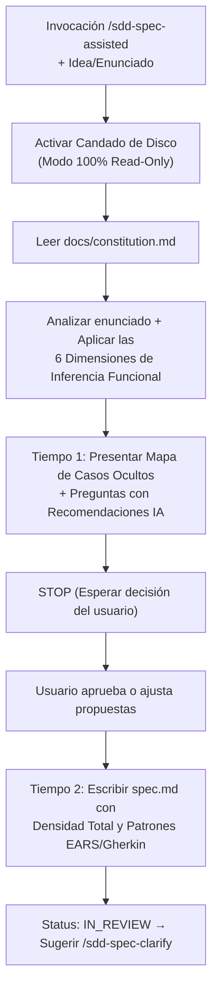

# SDD-Spec-Assisted: Especificación Funcional con Inteligencia Contextual y Co-Diseño

Este workflow es el **motor de expansión analítica del sistema SDD**. Su propósito es tomar una idea, necesidad o enunciado funcional inicial del usuario y someterlo a un proceso de **co-diseño profundo** donde la IA actúa como Arquitecto de Producto Senior.

`/sdd-spec-assisted` **exige que la IA deduzca proactivamente los flujos ocultos, casos borde, estados vacíos, condiciones de carrera y excepciones funcionales**, proponiéndolos al usuario para blindar la feature antes de que llegue a diseño técnico.

> **Objetivo:** Convertir una intención funcional ("Quiero que los clientes puedan devolver productos") en un **`docs/specs/XX-feature/spec.md` exhaustivo y a prueba de balas**, eliminando las lagunas de negocio mediante inferencia lógica guiada.

---

# 0. Garantías Supremas de Operación

## 0.1 Candado de Inmutabilidad en Disco (Pre-Execution Lock)
* **Nivel 1 (Prohibición Total de Código):** La IA tiene terminantemente prohibido modificar, crear o eliminar archivos fuera de `docs/`. No se toca código fuente, ni tests, ni configuraciones.
* **Nivel 2 (Tiempo 1 Read-Only):** Durante la fase de entrevista y co-diseño (Tiempo 1), la IA **no escribe en disco**. Todo el desglose de inferencias y preguntas se hace en la conversación. Solo se genera el `spec.md` cuando el usuario aprueba el alcance.

## 0.2 Zero-Loss Structuring (Cero Pérdida de Información Original)
Aunque la IA agregue valor y expansiones, **no puede omitir, resumir destructivamente ni alterar las reglas originales** que el usuario haya establecido en su prompt. La inteligencia contextual de la IA suma y estructura, pero no borra la intención del humano.

---

# 1. Inteligencia Contextual Activa (Responsabilidades de Inferencia de la IA)

Cuando la IA recibe el enunciado inicial, debe auditarlo mentalmente contra estas **6 Dimensiones de Inferencia Funcional**. Si detecta vacíos, debe proponer el comportamiento lógico:

| Dimensión de Inferencia | Lo que la IA debe deducir y proponer si el usuario no lo mencionó |
| :--- | :--- |
| **1. Estados Vacíos (Zero-State)** | ¿Qué ve o qué hace el usuario si esta pantalla/lista aún no tiene datos? ¿Se bloquea el flujo o se ofrece una acción de creación rápida? |
| **2. Casos Borde y Límites** | ¿Qué pasa si la cantidad es 0, si el texto excede el límite, si se envía la petición dos veces seguidas (debounce funcional), o si la fecha solicitada ya pasó? |
| **3. Transiciones de Estado** | Si una entidad tiene estados (ej. *Pendiente* $\rightarrow$ *Aprobado*), ¿qué pasa si se intenta rechazar un elemento ya aprobado? ¿Se permite revertir? |
| **4. Fallos e Interrupciones** | ¿Qué experiencia tiene el usuario si falla el servicio externo (timeout) o no hay conectividad? (Degradación elegante: ej. guardar borrador local). |
| **5. Integridad y Dependencias** | Si esta feature requiere seleccionar una entidad padre (ej. seleccionar cliente para una venta) y esta fue eliminada, ¿se permite continuar? |
| **6. Efectos Secundarios** | Si la acción principal tiene éxito, ¿qué más debería ocurrir en el negocio? (ej. descontar stock, enviar notificación, generar traza de auditoría). |

---

# 2. Protocolo Operativo en 2 Tiempos



---

## 2.1 TIEMPO 1: Análisis, Inferencia y Propuestas Consultivas (Modo Read-Only)

**Paso 1: Leer el Marco Legal**
La IA lee `docs/constitution.md` para entender los actores existentes, el lenguaje ubicuo y las reglas inquebrantables del dominio.

**Paso 2: Generar la Matriz de Inferencia**
La IA analiza la idea del usuario y mapea todo lo que falta funcionalmente utilizando las 6 Dimensiones.

**Paso 3: Presentar el Interrogatorio Consultivo (El "Grill-Me" Inteligente)**
La IA presenta al usuario un análisis estructurado. No hace preguntas vagas como *"¿Qué pasa si hay error?"*, sino preguntas de **arquitectura de producto**:

```text
INCORRECTO (Pasivo):
- ¿Qué estados tendrá la reserva?
- ¿Qué pasa si falla el pago?

CORRECTO (Activo / Co-diseño):
- Detección de Inferencia (Concurrencia): ¿Qué ocurre si dos clientes intentan
  reservar el mismo asiento al mismo tiempo?
  - A) Bloquear el asiento temporalmente al iniciar el checkout (Recomendado).
  - B) Permitir avanzar a ambos y rechazar al segundo en la confirmación final.

- Detección de Inferencia (Transición de Estado): Si una reserva es cancelada,
  ¿el cliente puede restaurarla o debe iniciar un flujo nuevo?
  - A) Requiere flujo nuevo para recalcular tarifas (Recomendado).
  - B) Se puede restaurar si hay disponibilidad.
```

La IA formula un máximo de **3 a 5 preguntas agrupadas de alto impacto** y se detiene (`STOP`).

---

## 2.2 TIEMPO 2: Generación del Artefacto (`spec.md`)

Tras la confirmación del usuario, la IA consolida toda la información (la inicial + las deducciones aprobadas) y genera el archivo `docs/specs/XX-feature/spec.md`.

---

# 3. Reglas de Modelado Documental para el `spec.md`

El documento generado debe cumplir los más altos estándares de ingeniería de requisitos:

### 3.1 Prohibición de Jerga de Implementación

El `spec.md` describe comportamiento de "Caja Negra" (observable).

```text
PROHIBIDO USAR: Controller, ORM, SQL, JWT, PINIA, Endpoint, Tabla, Middleware.
PERMITIDO USAR: Flujo, Actor, Condición, Regla de Negocio, Escenario, Vista, Evento.
```

### 3.2 Formalización EARS para Requerimientos

Los requisitos funcionales (`RF-XX.Y`) deben usar la sintaxis EARS (*Easy Approach to Requirements Syntax*) cuando sea posible para eliminar ambigüedad:

* **Ubiquitous:** `El sistema deberá [comportamiento].`
* **Event-Driven:** `Cuando [evento observable], el sistema deberá [respuesta].`
* **Unwanted Behavior:** `Si [condición no deseada], el sistema deberá impedir [acción] y mostrar [mensaje].`

### 3.3 Consolidación Gherkin (Criterios de Aceptación)

La IA no crea secciones separadas y redundantes para "Precondiciones" y "Criterios de Aceptación" si dicen lo mismo. Todo el comportamiento verificable se consolida en **Escenarios BDD (Gherkin)** (`Given`, `When`, `Then`), garantizando la cobertura de:

* Happy Path.
* Manejo de Errores Observables.
* Estados Vacíos.
* Límites (Boundaries) inferidos en el Tiempo 1.

---

# 4. Estructura Canónica de `docs/specs/XX-feature/spec.md`

El archivo generado debe seguir exactamente esta plantilla:

```markdown
# Specification: [Nombre de la Feature]

> **Estado:** IN_REVIEW
> **Módulo:** XX-[nombre]
> **Metodología:** SDD-Spec-Assisted

---

## 1. Objetivo y Alcance
- **Objetivo de Negocio**: [El valor real que aporta la feature]
- **In-Scope**: [Flujos y capacidades explícitamente incluidas]
- **Out-of-Scope**: [Lo que explícitamente no se maneja en esta feature]

---

## 2. Actores y Autorización
- **[Actor 1]**: [Qué permisos tiene sobre esta feature específica, respetando constitution.md]
- **[Actor 2]**: [Restricciones de acceso]

---

## 3. Modelo Funcional de Datos y Reglas de Negocio Específicas
> Define la información necesaria desde la perspectiva del usuario, no el esquema de base de datos.

- **Datos Requeridos**:
  - `[Campo 1]`: [Tipo conceptual, Obligatorio/Opcional, Restricción de Dominio, ej. "Debe ser > 0"].
- **Reglas de Negocio (RB)**:
  - `RB-01`: [Regla específica de la feature deducida en la entrevista].
  - `RB-02`: [Regla de límite o cálculo].

---

## 4. Máquina de Estados (Si aplica a la feature)
- **Estado Inicial**: [Estado]
- **Transiciones Permitidas**: [Estado A] → [Evento/Acción] → [Estado B].
- **Transiciones Prohibidas**: [Qué cambios están explícitamente bloqueados por el negocio].

---

## 5. Requerimientos Funcionales (Patrón EARS)
- `HU-01`: [Como actor, quiero..., para...]
  - `RF-01.1`: [Requisito EARS].
  - `RF-01.2`: [Requisito EARS sobre manejo de errores].

---

## 6. Comportamiento Observable y Criterios de Aceptación (Gherkin)
> Estos escenarios definen la validación funcional requerida para /sdd-tasks.

### Escenario 1: Flujo Principal (Happy Path)
```gherkin
Given [Contexto y precondición]
When [El actor realiza la acción]
Then [El resultado funcional es observable]
And [Se dispara el efecto secundario X]
```

### Escenario 2: Casos Borde y Prevención de Errores
```gherkin
Given [Contexto adverso o límite deducido]
When [Acción]
Then [El sistema impide la acción y comunica X]
```

---

## 7. Efectos Secundarios e Integraciones

* **Dependencias Funcionales**: [Qué necesita esta feature de otras partes del sistema].
* **Efectos Secundarios**: [Qué otras áreas se ven afectadas si esta feature tiene éxito].
```

---

# 5. Plantillas de Salida en Consola

## 5.1 Salida en Tiempo 1 (Interrogatorio de Co-Diseño)

```text
===================================================================
🧠 SDD-SPEC-ASSISTED — ANÁLISIS E INFERENCIA ACTIVA (READ-ONLY)
===================================================================
Estado:
  NEEDS_CLARIFICATION (Modo Diseño - Cero modificaciones en disco)

1. Mapeo Inicial (Zero-Loss):
   - Intención detectada: [Resumen conciso del objetivo]
   - Actores identificados: [Actores]

2. Análisis de Inteligencia Contextual (Vacíos Detectados):
   He proyectado tu idea contra los flujos lógicos del sistema y he detectado
   casos borde que necesitamos definir antes de construir el spec.md:

   [Inferencia 1 - Ej. Manejo de Estado Vacío o Concurrencia]
   - A) [Solución propuesta A] (Recomendada - [Por qué])
   - B) [Solución alternativa B]

   [Inferencia 2 - Ej. Fallo de Dependencia o Limite de Negocio]
   - A) [Solución propuesta A] (Recomendada - [Por qué])
   - B) [Solución alternativa B]

Indícame tus elecciones o si deseas modificar alguna regla para generar el spec.md.
===================================================================
```

## 5.2 Salida en Tiempo 2 (Generación Final)

```text
===================================================================
✅ ESPECIFICACIÓN ASISTIDA GENERADA (/sdd-spec-assisted)
===================================================================
Archivo generado:
  docs/specs/XX-[feature]/spec.md

Estado Oficial:
  Status: IN_REVIEW

Garantía de Calidad:
  🔒 Pre-Execution Lock mantenido (0 archivos de código tocados).
  🧠 Casos Borde, Flujos Alternos y Errores Observables modelados en Gherkin.
  🧩 Reglas de negocio acopladas al lenguaje ubicuo de constitution.md.

Siguiente paso requerido:
  El artefacto está redactado, pero debe someterse a la auditoría formal
  para buscar ambigüedades implícitas.

  👉 Ejecuta: /sdd-spec-clarify
===================================================================
```

---

# 6. Regla Maestra de `/sdd-spec-assisted`

> **Tu trabajo principal no es redactar Markdown rápido, sino pensar profundamente sobre el dominio del software. Encuentra las fallas lógicas en la idea del usuario, propón arquitecturas de producto robustas en el Tiempo 1, y formalízalas con rigor implacable (EARS + Gherkin) en el Tiempo 2.**
