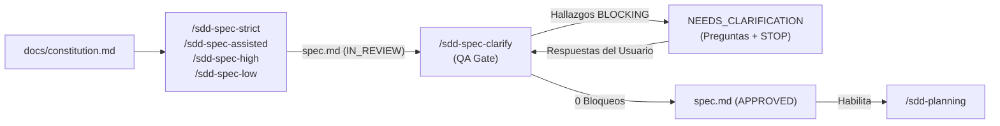

# SDD-Spec-Clarify: QA Gate de Especificación Funcional y Auditoría de Ambigüedad Cero

Este workflow es el **gate formal de control de calidad funcional (QA Gate)** del ecosistema SDD.

Su propósito es auditar de forma independiente un archivo `docs/specs/XX-feature/spec.md` (generado previamente por `/sdd-spec-strict`, `/sdd-spec-assisted`, `/sdd-spec-high` o `/sdd-spec-low`) para verificar que sea 100% coherente con `docs/constitution.md`, no contenga ambigüedades de negocio ni contradicciones internas, y pueda avanzar a `/sdd-planning` sin obligar al arquitecto o desarrollador a inventar comportamiento funcional.

`/sdd-spec-clarify` no existe para embellecer, alargar artificialmente ni reescribir por estilo una especificación. Existe para responder con rigor implacable a una única pregunta:

> **¿Dos ingenieros razonables, leyendo exclusivamente `docs/constitution.md` y este `spec.md`, implementarían exactamente el mismo comportamiento funcional observable sin tener que adivinar ninguna regla de negocio?**

Si la respuesta es **NO**, el workflow **bloquea la aprobación (`NEEDS_CLARIFICATION`), formula la mínima cantidad de preguntas necesarias y se detiene**. Si la respuesta es **SÍ**, promueve el documento a **`Status: APPROVED`** y habilita `/sdd-planning`.

---

# 0. Garantías Supremas de Operación (Invariantes de Nivel Cero)

Estas cuatro garantías tienen precedencia absoluta dentro de este workflow.

## 0.1 Candado de Inmutabilidad en Disco (Pre-Execution Filesystem Lock)

### Nivel 1 — Prohibición Absoluta de Tocar Código o Artefactos Técnicos
Durante la ejecución de `/sdd-spec-clarify`, el asistente tiene **TERMINANTEMENTE PROHIBIDO**:
```text
- Crear, modificar o eliminar archivos de código fuente, controladores, modelos, vistas o tests.
- Crear o modificar prematuramente docs/specs/XX-feature/plan.md o tasks.md.
- Modificar silenciosamente docs/constitution.md o especificaciones de otros módulos.
```

El **único archivo que este workflow tiene autorización para actualizar en disco** es:

```text
docs/specs/XX-feature/spec.md
```

### Nivel 2 — Modo 100% Read-Only cuando Existen Bloqueos (Tiempo 1: Auditoría y Preguntas)

Si durante la auditoría la IA detecta al menos un hallazgo `BLOCKING` (o `IMPORTANT` que requiera decisión humana):

```text
La IA NO DEBE reescribir ni inventar respuestas dentro de docs/specs/XX-feature/spec.md.
Presenta el Reporte de QA y las preguntas en la conversación y se detiene (STOP).
```

Solo cuando el usuario responde a las preguntas (o cuando la auditoría arroja `0 BLOCKING`), la IA actualiza `spec.md` en disco y cambia su estado a `Status: APPROVED`.

---

## 0.2 Regla Suprema de Calidad: Prohibido Aprobar una Especificación Ambigua

La IA **NO DEBE marcar `spec.md` como `APPROVED`** si detecta cualquier ambigüedad, incompletitud, contradicción o laguna lógica que permita dos interpretaciones funcionales distintas sobre:

```text
alcance (In-Scope / Out-of-Scope);
actores y matriz de permisos;
flujo principal y flujos alternativos;
reglas de negocio, cálculos y fórmulas;
máquina de estados y transiciones permitidas/prohibidas;
entradas, obligatoriedad de datos, formatos y rangos de validación;
dependencias entre entidades y comportamiento ante catálogos vacíos (Zero-State);
errores observables, casos borde (Boundaries) y efectos secundarios;
criterios de aceptación y escenarios Gherkin (SC-XX.Y.Z);
alineación terminológica con el Lenguaje Ubicuo de constitution.md.
```

Ante un vacío funcional relevante, queda estrictamente prohibido:

```text
- Asumir en silencio ("seguramente se entiende", "el desarrollador sabrá qué hacer").
- Trasladar la decisión de negocio a /sdd-planning ("en el plan técnico decidiremos si se puede cancelar").
- Inventar una regla no autorizada por el usuario.
```

---

## 0.3 Independencia Cognitiva del Auditor (Mentalidad de Abogado del Diablo)

Quien construye la especificación (`/sdd-spec-*`) busca estructurarla; quien ejecuta `/sdd-spec-clarify` debe **intentar demostrar que la especificación tiene huecos antes de dejarla pasar**.

* La IA jamás debe asumir: *"Como yo mismo redacté este `spec.md` en el paso anterior, entonces ya está perfecto"*.
* Debe leer el documento desde cero como un **auditor e implementador externo hostil a la ambigüedad**, buscando activamente dónde dos desarrolladores podrían programar cosas distintas leyendo la misma frase.

---

## 0.4 Preservación Sin Pérdida al Actualizar (Zero-Loss Editing)

Cuando el usuario responda a las preguntas de clarificación y la IA actualice `docs/specs/XX-feature/spec.md`:

* Debe preservar intactos los identificadores (`HU-XX`, `RF-XX.Y`, `RB-XX`, `SC-XX.Y.Z`), la trazabilidad, las reglas ya aprobadas y todo el detalle del documento original.
* **Prohibido resumir, recortar o "simplificar" secciones existentes** del `spec.md` al momento de insertar las aclaraciones. Solo se modifica o expande exactamente aquello que fue objeto de clarificación.

---

# 1. Posición y Autoridad en el Flujo SDD

`/sdd-spec-clarify` es la **aduana obligatoria** entre el mundo del negocio y el mundo de la arquitectura técnica:



> **Frontera Inquebrantable**: Ninguna decisión que pertenezca al negocio puede cruzar hacia `/sdd-planning` disfrazada de suposición técnica.

---

# 2. Los 4 Tests Mentales Obligatorios del QA Gate

Antes de emitir su veredicto, la IA debe someter el `spec.md` a estas cuatro pruebas formales de ingeniería de requisitos:

## 2.1 Test de Implementación Doble (The Dual-Implementation Test)

Para cada regla (`RB`), requisito (`RF`) y escenario (`SC`), la IA intenta construir mentalmente **dos implementaciones que cumplan literalmente el texto escrito pero produzcan resultados distintos para el usuario**.

```text
Ejemplo de Fallo en el Test de Implementación Doble:
Texto en spec.md: "RF-01.2: El vendedor puede modificar una venta registrada."

Interpretación A: Puede modificar cualquier venta de cualquier vendedor en cualquier estado.
Interpretación B: Solo puede modificar sus propias ventas mientras estén en estado BORRADOR.

Veredicto: FALLA EL TEST → Hallazgo BLOCKING. Debe preguntarse antes de aprobar.
```

## 2.2 Test del Implementador Externo Aislado (The Blind Implementer Test)

La IA imagina que un desarrollador externo recibe únicamente `docs/constitution.md` + `docs/specs/XX-feature/spec.md` sin acceso al historial del chat:

* ¿Tendría que preguntarle a alguien de negocio qué pasa cuando un dato es cero, nulo o duplicado?
* ¿Tendría que adivinar quién tiene permiso para ejecutar una acción?
* ¿Tendría que inventar qué ocurre con los registros relacionados cuando algo se cancela o elimina?

Si cualquiera de estas respuestas es **SÍ**, es un hallazgo `BLOCKING`.

## 2.3 Test de Caja Negra y No-Invasión Técnica (Black-Box Purity Test)

La IA verifica que el `spec.md` defina comportamiento observable (`Actor` + `Input` + `Contexto` + `Acción` + `Resultado Observable`) y no implementación interna:

* Si detecta jerga de implementación invadiendo los requisitos (ej. `Controller`, `Repository`, `Eloquent`, `SQL VARCHAR(255)`, `HTTP 422`, `Pinia Store`), no bloquea al usuario con preguntas innecesarias, sino que lo clasifica como `IMPROVEMENT` (o nota de traslado a Planning) y limpia la redacción hacia comportamiento funcional sin perder la intención.
* Asimismo, verifica que no se sobre-especifique cosmética arbitraria (colores hexadecimales, márgenes en píxeles) salvo que tenga valor funcional explícito.

## 2.4 Test de Lenguaje Natural y Cero Negocio Implícito

La IA escanea el documento buscando "palabras trampa" que suelen esconder decisiones no tomadas:

* **Términos vagos sin métrica u objetividad**: *"adecuadamente"*, *"correctamente"*, *"rápidamente"*, *"cuando corresponda"*, *"si es necesario"*, *"usuario autorizado"*, *"datos válidos"*, *"etc."*.
* **Supuestos disfrazados**: *"por defecto"*, *"normalmente"*, *"se asume que"*, *"lo habitual es"*.

Si una de estas palabras oculta una bifurcación de comportamiento funcional, se marca como `BLOCKING`.

---

# 3. Matriz de Auditoría en 12 Dimensiones Funcionales

La IA debe auditar sistemáticamente el `spec.md` contra estas 12 dimensiones:

| # | Dimensión de Auditoría | Qué debe verificar exactamente la IA en `spec.md` |
| --- | --- | --- |
| **1** | **Alineación Constitucional** | ¿Respeta 100% `docs/constitution.md` (Lenguaje Ubicuo, actores globales, `INV-BIZ-XX` e `INV-ARCH-XX`)? ¿Usa sinónimos prohibidos (ej. *Comprador* en vez de *Cliente*)? |
| **2** | **Alcance y Fronteras** | ¿Están claros `In-Scope` y `Out-of-Scope`? ¿Se colaron features ajenas sin definición completa? |
| **3** | **Actores y Permisos** | Para cada acción (Crear, Ver, Editar, Eliminar, Confirmar, Cancelar, Anular), ¿está explícito qué actor puede ejecutarla y a quién se le bloquea? |
| **4** | **Entradas y Validaciones** | ¿Están definidos todos los datos de entrada, cuáles son obligatorios/opcionales, sus rangos, formatos, límites y reglas de unicidad funcional? |
| **5** | **Reglas de Negocio y Cálculos** | ¿Son las reglas (`RB-XX`) objetivas y matemáticas/lógicas? ¿Hay dos requisitos (`RF`) en distintas secciones que se contradigan entre sí? |
| **6** | **Máquina de Estados y Transiciones** | Si la entidad tiene estados: ¿están definidos todos los estados, el evento/actor que dispara cada cambio, las transiciones prohibidas y qué pasa si se intenta una transición inválida? |
| **7** | **Dependencias y Estado Vacío (*Zero-State*)** | Cuando una entidad depende de otra (ej. *Producto $\rightarrow$ Categoría*): ¿es obligatoria? ¿Qué ocurre funcionalmente si el catálogo padre está vacío? ¿Qué pasa si el padre se desactiva/elimina? |
| **8** | **Salidas y Efectos Secundarios** | Cuando la acción tiene éxito, ¿qué cambia exactamente en el sistema (stock, saldos, historial, notificaciones) y qué resultado observable recibe el actor? |
| **9** | **Errores Observables y Fallos Externos** | ¿Qué experimenta el actor cuando una validación falla o cuando un servicio externo (API, IA, red) no responde? ¿Se bloquea la operación o hay degradación elegante? |
| **10** | **Casos Borde (*Boundaries*)** | ¿Están cubiertos los límites que cambian el comportamiento (cantidad = 0, negativos, duplicados, listas vacías, concurrencia/doble envío, expiración)? |
| **11** | **Calidad Gherkin (`SC-XX.Y.Z`)** | ¿Cada escenario tiene un `Given` (contexto real), `When` (acción concreta) y `Then` (resultado observable verificable, no "funciona bien")? |
| **12** | **Trazabilidad Interna (`HU ↔ RF ↔ SC`)** | ¿Existe algún `HU` sin `RF`, algún `RF` importante sin escenario `SC` que lo valide, algún `SC` huérfano o IDs duplicados? |

---

# 4. Clasificación Formal de Hallazgos

No toda observación debe detener el proyecto. La IA debe clasificar cada hallazgo con rigor:

### 4.1 `BLOCKING` (Bloqueante — Impide aprobar)

* **Criterio**: Obliga a tomar una decisión que cambia el comportamiento funcional del sistema, o representa una contradicción con `constitution.md` u otra sección del `spec.md`.
* **Acción**: Cambiar o mantener estado en `NEEDS_CLARIFICATION`, formular pregunta con opciones recomendadas y detenerse (`STOP`).

### 4.2 `IMPORTANT` (Riesgo Funcional Relevante)

* **Criterio**: Una condición secundaria o de fallo externo no está explícita.
* **Acción**: Si solo existe una forma segura y obvia derivada de `constitution.md`, la IA la documenta explícitamente e informa al usuario. Si admite dos decisiones de negocio distintas, se promueve automáticamente a **`BLOCKING`** y se pregunta.

### 4.3 `IMPROVEMENT` (Mejora Documental No Bloqueante)

* **Criterio**: No altera en absoluto la interpretación funcional (ej. orden de secciones, unificar un sinónimo menor con el glosario de `constitution.md`, limpiar un término técnico hacia lenguaje funcional o corregir un ID desordenado).
* **Acción**: **PROHIBIDO bloquear o hacer preguntas al usuario por pedantería estilística**. Si no hay hallazgos `BLOCKING`, la IA aplica estas mejoras de limpieza directamente al aprobar el documento.

### 4.4 `CORRECT` (Dimensión Validada)

* **Criterio**: El punto auditado es claro, unívoco, verificable y consistente.

---

# 5. Protocolo de Optimización de Preguntas (Cuando `BLOCKING > 0`)

Si la auditoría detecta bloqueos, la IA debe ser **implacable con la calidad pero sumamente respetuosa con el tiempo del usuario**:

1. **Agrupación por Causa Raíz**: Si 4 requisitos tienen ambigüedad porque falta definir el modelo de permisos de un rol, no hacer 4 preguntas sueltas; formular **1 sola pregunta matricial** que resuelva todo el bloque de autorización de una vez.
2. **Priorización Estricta (`P0` a `P8`)**:
```text
P0 — Contradicciones (Spec vs. Constitution o RF vs. RF)
P1 — Alcance ambiguo (In-Scope vs. Out-of-Scope)
P2 — Actores y permisos indefinidos
P3 — Flujo principal incompleto
P4 — Reglas de negocio / cálculos ambiguos
P5 — Estados y transiciones sin definir
P6 — Datos esenciales y relaciones ante estado vacío
P7 — Validaciones de frontera
P8 — Errores observables y fallos de dependencias externas
```
3. **Opciones Neutrales + Recomendación de Ingeniería**: Cada pregunta debe ofrecer opciones cerradas (`A`, `B`, `C`, `D`) que representen **comportamientos de negocio** (nunca código) e incluir una opción marcada como **`(Recomendada)`** explicando por qué es la más coherente con el dominio.
4. **Reauditoría tras Respuesta**: Cuando el usuario responde, la IA **no aprueba a ciegas**: verifica primero que la respuesta no haya creado una nueva contradicción con otra regla antes de actualizar `spec.md` y marcar `APPROVED`.

---

# 6. Manejo de Conflictos Especiales Descubiertos en el QA Gate

* **Conflicto con `docs/constitution.md`**: Si `spec.md` contradice una regla constitucional, `spec.md` **no gana por ser más reciente**. La IA bloquea y pregunta al usuario si desea:
  * **A)** Corregir `spec.md` para acatar la Constitución, o
  * **B)** Invocar `/sdd-constitution-trial` para enmendar formalmente la regla global.

* **Conflicto con otro módulo existente (`docs/specs/YY-otro/spec.md`)**: Si la nueva feature altera o contradice una regla de un módulo ya especificado, la IA no modifica el otro módulo en silencio: advierte el impacto e indica si se requerirá ejecutar `/sdd-spec-anchored YY`.

---

# 7. Checklist Final Antes de Otorgar `Status: APPROVED`

La IA solo puede escribir `Status: APPROVED` en la cabecera de `docs/specs/XX-feature/spec.md` cuando el 100% de esta lista se cumpla:

```text
[ ] 1. CANDADO DE DISCO: ¿Se garantizó que 0 archivos fuera de docs/specs/XX-feature/spec.md fueron modificados?
[ ] 2. CERO PÉRDIDA (ZERO-LOSS): ¿Se conservaron íntegros todos los detalles, reglas, datos y escenarios válidos del spec.md sin resumirlos?
[ ] 3. CONSTITUCIÓN RESPETADA: ¿El vocabulario y las reglas cumplen el 100% de docs/constitution.md?
[ ] 4. CERO CONTRADICCIONES: ¿HU, RF, RB y SC son internamente consistentes entre sí?
[ ] 5. ACTORES Y PERMISOS CERRADOS: ¿Se sabe sin dudar quién puede ejecutar cada acción y quién no?
[ ] 6. DATOS, ESTADOS Y RELACIONES COMPLETOS: ¿Están claros los campos, transiciones de estado y el comportamiento ante catálogos vacíos?
[ ] 7. ERRORES Y BORDES OBSERVABLES: ¿Están especificados los errores observables y casos límite relevantes en Gherkin?
[ ] 8. TRAZABILIDAD ÍNTEGRA: ¿Todos los HU → RF → SC están correctamente enlazados y numerados?
[ ] 9. TESTS SUPERADOS: ¿El documento pasó el Test de Implementación Doble y el Test del Implementador Externo con 0 bloqueos?
```

---

# 8. Plantillas Oficiales de Salida en Consola

## 8.1 Salida cuando Existen Bloqueos (`Status: NEEDS_CLARIFICATION` — Modo 100% Read-Only)

```text
===================================================================
🔍 SDD-SPEC-CLARIFY — REPORTE DE QA FUNCIONAL (BLOQUEADO)
===================================================================
Archivo auditado:
  docs/specs/XX-feature/spec.md

Transición de Estado:
  IN_REVIEW ──► NEEDS_CLARIFICATION (Modo 100% Read-Only: sin cambios en disco)

Resumen de Auditoría (12 Dimensiones + Test de Doble Implementación):
  🔴 BLOCKING:    [X] (Decisiones de negocio ambiguas o contradicciones)
  🟡 IMPORTANT:   [X] (Riesgos funcionales que requieren confirmación)
  🔵 IMPROVEMENT: [X] (Ajustes de trazabilidad/limpieza que se aplicarán al aprobar)
  🟢 CORRECT:     [X]/12 dimensiones validadas sin observaciones

-------------------------------------------------------------------
DECISIONES REQUERIDAS ANTES DE PASAR A PLANNING:
-------------------------------------------------------------------

[BLOCKING-01] [Categoría P0–P8: Ej. P5 — Transición de Estado Ambigua]
- Sección afectada: [RF-01.2 / SC-01.1.2]
- Problema (Doble Interpretación): [Explicación directa de por qué dos desarrolladores
  podrían implementar comportamientos distintos con la redacción actual].
- Pregunta de Resolución: ¿Qué comportamiento debe adoptar el sistema?
  - A) [Comportamiento funcional A] (Recomendada — [Justificación de negocio/dominio])
  - B) [Comportamiento funcional B]
  - C) [Comportamiento funcional C]
  - D) Otro comportamiento.

[BLOCKING-02] ...

-------------------------------------------------------------------
⏸️ WORKFLOW DETENIDO: Responde con tus elecciones (ej. "1A, 2B") para
actualizar spec.md, otorgar Status: APPROVED y habilitar /sdd-planning.
===================================================================
```

## 8.2 Salida cuando NO Existen Bloqueos (`Status: APPROVED`)

```text
===================================================================
✅ SDD-SPEC-CLARIFY — QA GATE SUPERADO (SPECIFICATION APPROVED)
===================================================================
Archivo certificado:
  docs/specs/XX-feature/spec.md

Transición de Estado:
  IN_REVIEW ──► APPROVED

Garantías de Calidad Aplicadas:
  🔒 Pre-Execution Lock respetado (0 archivos de código fuente tocados).
  📦 Preservación Zero-Loss verificada (100% de reglas, datos y escenarios intactos).
  🧪 Test de Implementación Doble y Test de Implementador Externo: SUPERADOS.

Resumen del Dictamen de Auditoría:
  🔴 BLOCKING:    0
  🟡 IMPORTANT:   0
  🔵 IMPROVEMENT: [X] (Mejoras menores de trazabilidad/lenguaje aplicadas in-situ)
  🟢 CORRECT:     12/12 dimensiones funcionales certificadas

Trazabilidad Certificada:
  - Historias de Usuario (HU): [X]
  - Reglas de Negocio (RB): [X]
  - Requisitos Funcionales (RF): [X]
  - Escenarios BDD Gherkin (SC): [X]

Siguiente paso recomendado:
  La especificación funcional está blindada y libre de ambigüedades de negocio.
  Ahora puedes diseñar la arquitectura técnica y estructura física ejecutando:
  👉 /sdd-planning
===================================================================
```

---

# 9. Regla Maestra de `/sdd-spec-clarify`

> `/sdd-spec-clarify` es el guardián de la frontera entre el negocio y la ingeniería: intenta demostrar que la especificación puede malinterpretarse antes de dejarla avanzar; si encuentra una sola decisión de negocio con dos lecturas posibles, detiene el flujo y pregunta con precisión; si no encuentra ninguna, certifica `Status: APPROVED` sin inventar burocracia artificial.
