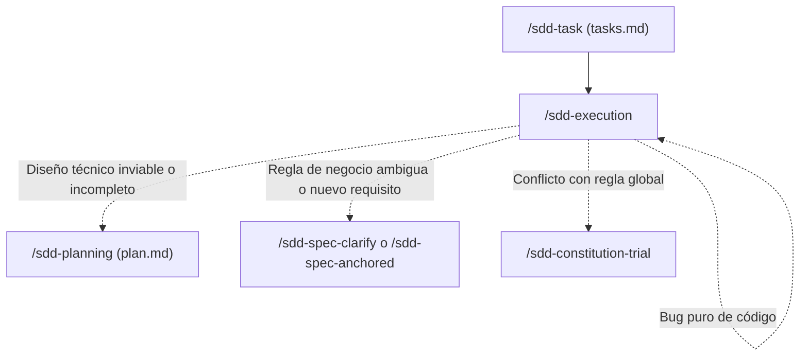
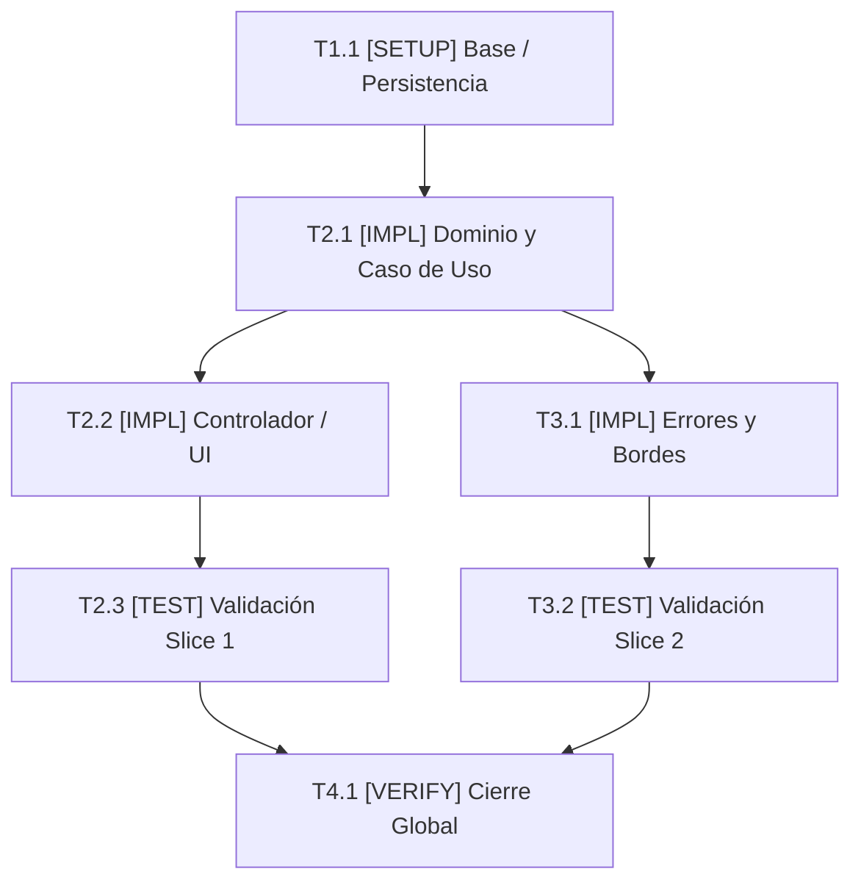

# SDD-Task: Descomposición Atómica, Trazable y Ejecutable por Vertical Slices

Este workflow transforma una especificación funcional aprobada (`docs/specs/XX-feature/spec.md`) y un plan técnico aprobado (`docs/specs/XX-feature/plan.md`) en un **backlog técnico de tareas atómicas, ordenadas topológicamente, trazables y verificables** dentro de **`docs/specs/XX-feature/tasks.md`**.

Su propósito es responder con precisión absoluta:

> **¿Qué unidades de trabajo técnico concretas debemos ejecutar para materializar el `spec.md` siguiendo exactamente la arquitectura y rutas físicas de `plan.md`, en qué orden de dependencias, y qué evidencia física demostrará que cada tarea está 100% terminada?**

`/sdd-task` es una fase de **descomposición e ingeniería de ejecución**, no de descubrimiento de negocio ni de rediseño arquitectónico.

---

# 0. Garantías Supremas de Operación (Invariantes de Nivel Cero)

Estas cuatro garantías tienen precedencia absoluta dentro de este workflow.

## 0.1 Candado de Inmutabilidad en Disco (Pre-Execution Filesystem Lock)

### Nivel 1 — Prohibición Absoluta de Tocar el Árbol de Código del Proyecto
Durante la ejecución de `/sdd-task`, el asistente tiene **TERMINANTEMENTE PROHIBIDO**:
```text
- Crear, modificar o eliminar archivos de código fuente de producción.
- Crear o ejecutar archivos de pruebas o migraciones.
- Modificar configuraciones del proyecto o instalar dependencias.
- Modificar silenciosamente docs/constitution.md, spec.md o plan.md.
```

El **único archivo que `/sdd-task` tiene autorización para escribir o actualizar en disco** es:

```text
docs/specs/XX-feature/tasks.md
```

### Nivel 2 — Modo 100% Read-Only ante Vacíos de Plan o Spec (Bloqueo Previo)

Si al auditar `spec.md` y `plan.md` la IA detecta que falta una decisión arquitectónica o funcional crítica que impide definir una tarea concreta:

```text
DETENER INMEDIATAMENTE (Modo 100% Read-Only).
No inventar una tarea vaga como "T1.1 Decidir arquitectura" o "T2.1 Investigar qué debe hacer el sistema".
Identificar el vacío, indicar a qué fase pertenece (Spec o Planning) y solicitar su resolución antes de generar tasks.md.
```

---

## 0.2 Gate de Entrada Obligatorio (`spec.md` y `plan.md` en Estado `APPROVED`)

Antes de generar tareas definitivas, la IA debe localizar y verificar:

1. `docs/constitution.md` (`Status: APPROVED`)
2. `docs/specs/XX-feature/spec.md` (`Status: APPROVED`)
3. `docs/specs/XX-feature/plan.md` (`Status: APPROVED`)

Si `spec.md` o `plan.md` no están aprobados (ej. están en `DRAFT`, `IN_REVIEW` o `NEEDS_CLARIFICATION`), el workflow se detiene y solicita completar primero `/sdd-spec-clarify` o `/sdd-planning`.

---

## 0.3 Regla Suprema de Fidelidad: Prohibido Inventar Negocio o Rediseñar Arquitectura

Las tareas heredan y operacionalizan las decisiones de los niveles superiores (`Constitution` $\rightarrow$ `Spec` $\rightarrow$ `Plan` $\rightarrow$ `Tasks` $\rightarrow$ `Execution`). Por tanto, en `/sdd-task` la IA **NO DEBE**:

```text
- Inventar requisitos funcionales o reglas de negocio no presentes en spec.md.
- Modificar el alcance (In-Scope / Out-of-Scope) de la feature.
- Rediseñar la arquitectura, cambiar contratos tipados o alterar el esquema de datos definido en plan.md.
- Inventar rutas físicas de archivos distintas al Árbol Físico de Archivos aprobado en plan.md.
```

---

## 0.4 Principio de Densidad Ejecutable (Zero-Loss Tasking)

Un `tasks.md` nunca debe reducirse a títulos genéricos como *"T2.1 Hacer el backend"* o *"T2.2 Crear la vista"*.

Cada tarea generada debe conservar el 100% del contexto técnico de `plan.md` para que otro agente en `/sdd-execution` pueda implementarla sin adivinar:

* Qué archivos físicos exactos debe tocar y con qué operación (`[CREATE]`, `[MODIFY]`, `[EXTEND]`, `[DELETE]`).
* Qué contratos, DTOs, entidades o casos de uso (`PLAN-XX`) debe implementar.
* Qué reglas de negocio (`RB-XX`), requisitos (`RF-XX.Y`) y escenarios (`SC-XX.Y.Z`) debe satisfacer.
* Qué comando o prueba exacta constituye su evidencia de cierre.

---

# 1. Gobernanza del Tablero `Task Progress` y Simbología Visual Universal

El archivo `tasks.md` funciona simultáneamente como **backlog técnico, matriz de trazabilidad y tablero de estado en tiempo real** de la feature.

## 1.1 Posición y Reglas Matemáticas del `Task Progress`

La tabla `Task Progress` debe ubicarse **obligatoriamente en la parte superior del documento**, inmediatamente debajo del título principal. Nunca debe colocarse al final ni en otro archivo.

La IA debe garantizar siempre la consistencia matemática derivada del conteo real de tareas del archivo:

* **Total de tareas (`TOTAL`)**: Conteo exacto de todas las tareas existentes en `tasks.md`.
* **Tareas realizadas (`REALIZADAS`)**: Conteo exclusivo de tareas con estado `COMPLETED` (`[x]`).
* **Tareas por realizar (`POR REALIZAR`)**: Suma de todas las tareas no completadas (`PENDING` + `IN_PROGRESS` + `TESTING/REVIEW` + `BLOCKED`). Siempre debe cumplirse la identidad:

$$\text{TOTAL} = \text{REALIZADAS} + \text{POR REALIZAR}$$

* **Progreso (`%`)**: Calculado con precisión mediante:

$$\text{Progreso} = \left(\frac{\text{REALIZADAS}}{\text{TOTAL}}\right) \times 100$$

> **Transparencia de Progreso**: Queda prohibido alterar manualmente los contadores sin que coincidan con las casillas reales de las tareas, o mantener fijo el `TOTAL` si durante la ejecución o mediante `/sdd-spec-anchored` se encolan nuevas tareas.

---

## 1.2 Tabla Maestra de Estados y Simbología Visual Universal

Para garantizar legibilidad instantánea tanto para humanos como para agentes, cada tarea debe sincronizar su **símbolo de casilla** en el **Checklist Rápido superior** y en el **Encabezado de su sección detallada**:

| Símbolo Visual | Estado Formal (`Status`) | Significado Operativo y Regla de Aplicación |
| --- | --- | --- |
| **`[ ]`** | **`PENDING`** | **Pendiente de inicio.** Estado inicial de toda tarea recién generada por `/sdd-task`. |
| **`[/]`** *(o `[-]`)* | **`IN_PROGRESS`** | **En ejecución activa.** Se marca cuando `/sdd-execution` comienza a codificar esa tarea específica (solo una a la vez salvo paralelismo real). |
| **`[?]`** | **`TESTING` / `REVIEW`** | **En validación.** El código fue escrito pero las pruebas o verificaciones de evidencia están corriendo o en revisión. |
| **`[x]`** | **`COMPLETED`** | **100% Finalizada con Evidencia.** Código implementado + criterio `Done when` cumplido + pruebas superadas y evidencia física registrada. |
| **`[!]`** | **`BLOCKED`** | **Bloqueada.** Detenida por impedimento técnico, dependencia externa rota o vacío descubierto en Spec/Plan. |

### Regla de Sincronización Atómica del Estado

Cada vez que una tarea cambie de estado durante `/sdd-execution`, el agente debe actualizar en un único paso atómico:

1. La casilla y el campo `**Status:**` en el detalle de la tarea (`### [x] T2.1 ...`).
2. La casilla correspondiente en el **Checklist Rápido de Tareas por Vertical Slice** (`- [x] T2.1 ...`).
3. Los contadores y el porcentaje de la tabla superior **`Task Progress`**.
4. El registro de **Evidencia** verificada.

---

## 1.3 Coherencia entre el Estado Global del Documento y las Tareas Individuales

El estado global de `tasks.md` debe reflejar fielmente la situación de sus tareas:

* **`READY`**: Estado inicial al terminar `/sdd-task` (todas las tareas están en `[ ] PENDING`, dependencias validadas y sin bloqueos).
* **`IN_PROGRESS`**: Existe al menos una tarea en `[/] IN_PROGRESS`, `[?] TESTING` o algunas en `[x] COMPLETED` mientras quedan tareas pendientes.
* **`BLOCKED`**: Existe al menos una tarea en `[!] BLOCKED` que impide continuar el flujo.
* **`COMPLETED`**: El 100% de las tareas requeridas están en `[x] COMPLETED` (`Por realizar = 0`, `Progreso = 100%`) con evidencia verificada.

---

# 2. Reglas de Ingeniería para la Descomposición de Tareas

## 2.1 Atomicidad Coherente vs. Micro-Tareas Artificiales

Una tarea debe ser lo suficientemente acotada para entenderse, ejecutarse, verificarse y aislar un posible fallo, pero **nunca debe fragmentarse en micro-pasos triviales**:

```text
INCORRECTO (Micro-tareas artificiales que inflan el archivo sin valor):
- T1.1 Crear archivo SaleService.ts
- T1.2 Agregar imports en SaleService.ts
- T1.3 Escribir método createSale()
- T1.4 Guardar archivo

CORRECTO (Unidad técnica coherente y verificable):
- T2.1 [IMPL] Implementar caso de uso RegisterSaleUseCase y entidad Sale (PLAN-02, PLAN-03)
  incluyendo validación de stock, cálculo de totales e invariantes de dominio (RB-01, RF-01.1).
```

## 2.2 Estrategia Feature-First mediante Vertical Slices

La descomposición debe priorizar **flujos funcionales completos de punta a punta** siguiendo la Sección 7 de `plan.md`, evitando el antipatrón de capas horizontales aisladas:

```text
PROHIBIDO (Descomposición Horizontal por Capas Aisladas):
Hacer todas las migraciones del módulo → luego todos los modelos → luego todos los
repositorios → luego todos los controladores → luego todas las pantallas → luego todos los tests.
(Produce un sistema inutilizable hasta el último minuto).

OBLIGATORIO (Descomposición por Vertical Slices Incrementales):
- Fase de Setup Base (Preparación e infraestructura mínima compartida)
- Vertical Slice 1 (Flujo principal completo: Persistencia → Dominio/Caso de Uso → UI/Endpoint → Test de Slice)
- Vertical Slice 2 (Flujo alternativo / Casos borde / Errores observables → Test de Slice)
- Verificación Consolidada y Cierre Global (Suites completas, Linter, Type-check, Build)
```

## 2.3 Tipos Oficiales de Tarea

Toda tarea debe llevar su etiqueta de clasificación en el título:

* **`[SETUP]`**: Preparación de infraestructura, dependencias, esquemas base, migraciones (`[MIGRATION]`) o fixtures previstos en `plan.md`.
* **`[IMPL]`**: Implementación de código de dominio, casos de uso, repositorios, integraciones (`[INTEGRATION]`) o interfaz de usuario derivados de `plan.md`.
* **`[TEST]`**: Creación y ejecución de pruebas de Caja Negra (BDD/E2E), Caja Blanca (Unitarias) o Integración proporcionales al riesgo.
* **`[VERIFY]`**: Auditoría de cierre mediante ejecución consolidada de suites, linters, formateadores, analizadores estáticos (`type-check`) y compilación (`build`).

## 2.4 Orden Topológico y Grafo de Dependencias Reales

* Las tareas deben numerarse y ordenarse respetando un **orden topológico estricto**: si `T2.2` depende de `T2.1`, entonces `T2.1` debe definirse antes que `T2.2`.
* Solo deben declararse dependencias reales (ej. `T2.2` consume el contrato o tabla producida por `T2.1`). Si dos tareas pueden ejecutarse de forma independiente en paralelo, no encadenarlas artificialmente.

## 2.5 Estrategia de Pruebas Basada en Riesgo y Regla Fail-Fast

* **Integración de pruebas en cada Slice**: Cada *Vertical Slice* debe cerrar con su tarea `[TEST]` que valide los escenarios `SC-XX.Y.Z` correspondientes a ese flujo, evitando acumular todas las pruebas para el final.
* **Cero Duplicación de Tests**: La fase final de pruebas consolidadas ejecuta la suite completa para prevenir regresiones, sin volver a escribir tests duplicados que ya fueron creados dentro de las slices.
* **Fail-Fast y Asincronía Segura**: Las tareas de prueba (especialmente en UI o integraciones) deben exigir condiciones de espera explícitas y timeouts razonables, prohibiendo esperas infinitas, bucles colgados o `pumpAndSettle` ciegos que congelen el runner.

---

# 3. Protocolo de Retroalimentación y Manejo de Bloqueos

Si durante la generación de tareas o durante su posterior ejecución en `/sdd-execution` surge un impedimento o falla una prueba, **el problema se corrige en el artefacto donde reside su causa raíz**:



Cuando una tarea quede en estado `[!] BLOCKED`, debe documentar obligatoriamente dentro de su bloque:

```markdown
**Status:** BLOCKED
**Blocker:** [Descripción exacta del impedimento técnico o funcional]
**Source:** [Spec | Plan | Constitution | External Dependency]
**Required Action:** [Acción o comando exacto requerido para destrabarla]
```

---

# 4. Los 4 Tests de Auditoría Antes de Declarar `Estado: READY`

Antes de guardar `tasks.md`, la IA debe someter el conjunto de tareas a estas 4 pruebas obligatorias:

1. **Test de Ejecutabilidad Inmediata**: Leer cada tarea de forma aislada y preguntarse: *"¿Un agente en `/sdd-execution` puede codificar esta tarea ahora mismo con la información de `Work` y `Files` sin tener que inventar una decisión arquitectónica o de negocio?"*.
2. **Test de Terminación Objetiva**: Para cada tarea, verificar: *"¿El criterio `Done when` y el campo `Evidence` permiten demostrar objetivamente en consola o en pruebas que la tarea terminó, más allá de decir 'el código fue escrito'?"*.
3. **Test de Cobertura Total (`Spec` $\rightarrow$ `Plan` $\rightarrow$ `Tasks`)**: Comprobar que el 100% de los componentes `PLAN-XX`, requisitos `RF-XX.Y`, reglas `RB-XX` y escenarios `SC-XX.Y.Z` tengan al menos una tarea de implementación y una tarea de validación asociada.
4. **Test de Cero Exceso (Anti-Gold-Plating)**: Verificar que no se haya infiltrado ninguna tarea no solicitada por `plan.md` ni se hayan inventado códigos `RF` falsos para tareas de infraestructura (las tareas técnicas transversales deben usar `Traceability: PLAN-XX (Cross-cutting)`).

---

# 5. Plantilla Canónica Oficial: `docs/specs/XX-feature/tasks.md`

El archivo generado debe seguir rigurosamente esta estructura (sin tablas duplicadas al final):

```markdown
# Tasks: [Nombre del Módulo o Feature]

## Task Progress

| Métrica | Cantidad |
| :--- | ---: |
| Total de tareas | [X] |
| Tareas realizadas | 0 |
| Tareas por realizar | [X] |
| Tareas bloqueadas | 0 |
| Tareas en progreso | 0 |
| Progreso | 0% |

**Estado:** READY

---

## Checklist Rápido de Tareas por Vertical Slice

### Fase 0: Setup y Fundación Base
- [ ] `T1.1` `[SETUP]` [Título conciso de la tarea de preparación / migración]

### Slice 1: [Nombre del Flujo Funcional Principal]
- [ ] `T2.1` `[IMPL]` [Título conciso de tarea de dominio / aplicación / persistencia]
- [ ] `T2.2` `[IMPL]` [Título conciso de tarea de presentación / controlador / UI]
- [ ] `T2.3` `[TEST]` [Título conciso de validación BDD / Unitaria de la Slice 1]

### Slice 2: [Nombre de Casos Borde, Errores Observables y Reglas Secundarias]
- [ ] `T3.1` `[IMPL]` [Título conciso de manejo de errores / casos borde]
- [ ] `T3.2` `[TEST]` [Título conciso de validación de escenarios de error / borde]

### Fase Final: Verificación Consolidada y Cierre
- [ ] `T4.1` `[VERIFY]` Ejecutar suite completa de pruebas, linter, type-check y build de cierre.

---

## 1. Resumen de Trazabilidad (`Spec` $\rightarrow$ `Plan` $\rightarrow$ `Tasks`)

| Requisito / Regla / Escenario (`spec.md`) | Componente Técnico (`plan.md`) | Tareas Asociadas (`tasks.md`) |
| :--- | :--- | :--- |
| `HU-01`, `RF-01.1`, `RB-01` | `PLAN-01`, `PLAN-02`, `PLAN-03` | `T1.1`, `T2.1`, `T2.3` |
| `RF-01.2`, `SC-01.1.1` | `PLAN-04`, `PLAN-05` | `T2.2`, `T2.3` |
| `SC-01.1.2` (Error / Borde) | `PLAN-02`, `PLAN-05` | `T3.1`, `T3.2` |

---

## 2. Estrategia de Ejecución y Grafo de Dependencias

- **Estrategia**: Implementación incremental *Feature-First* mediante *Vertical Slices* verificables de punta a punta.



---

## 3. Desglose Detallado de Tareas Ejecutables

### Fase 0: Setup y Fundación Base

#### [ ] T1.1 [SETUP] [Título de la Tarea]

* **Status:** PENDING
* **Traceability:** `PLAN-01` (Cross-cutting / Persistencia base)
* **Depends on:** —
* **Files (según `plan.md`):**
  * `[CREATE]` `[ruta/exacta/migracion_o_esquema.ext]`
* **Objective:** [Objetivo técnico directo y sin ambigüedad]
* **Work:**
  * [Acción técnica concreta 1 siguiendo el esquema de `plan.md`]
  * [Acción técnica concreta 2]
* **Done when:**
  * [Criterio verificable 1]
  * [Criterio verificable 2]
* **Evidence:**
  * Comando a verificar en `/sdd-execution`: `[comando exacto]`
  * Resultado registrado: *(Pendiente de ejecución)*

---

### Slice 1: [Nombre del Flujo Funcional Principal]

#### [ ] T2.1 [IMPL] [Título de la Tarea]

* **Status:** PENDING
* **Traceability:** `PLAN-02`, `PLAN-03` | `HU-01`, `RF-01.1`, `RB-01`
* **Depends on:** `T1.1`
* **Files (según `plan.md`):**
  * `[CREATE]` `[ruta/exacta/entidad.ext]`
  * `[CREATE]` `[ruta/exacta/caso_de_uso.ext]`
  * `[CREATE]` `[ruta/exacta/repositorio_impl.ext]`
* **Objective:** [Objetivo técnico concreto]
* **Work:**
  * [Implementar contrato tipado X con las invariantes definidas en `plan.md`]
  * [Implementar persistencia transaccional y manejo de errores tipados]
* **Done when:**
  * [Los contratos compilan sin errores de tipos y cumplen las firmas de `plan.md`]
* **Evidence:**
  * Comando a verificar en `/sdd-execution`: `[comando de análisis de tipos o test unitario]`
  * Resultado registrado: *(Pendiente de ejecución)*

#### [ ] T2.2 [IMPL] [Título de la Tarea de Interfaz / Endpoint]

* **Status:** PENDING
* **Traceability:** `PLAN-05` | `HU-01`, `SC-01.1.1`
* **Depends on:** `T2.1`
* **Files (según `plan.md`):**
  * `[CREATE | MODIFY]` `[ruta/exacta/controlador_o_vista.ext]`
* **Objective:** [Conectar el flujo de presentación/API con el caso de uso]
* **Work:**
  * [Conectar entrada de datos, estado de carga y presentación de resultados]
* **Done when:**
  * [El flujo de punta a punta de la Slice 1 responde según el contrato]
* **Evidence:**
  * Comando a verificar en `/sdd-execution`: `[comando]`
  * Resultado registrado: *(Pendiente de ejecución)*

#### [ ] T2.3 [TEST] [Título de la Prueba de la Slice 1]

* **Status:** PENDING
* **Traceability:** `SC-01.1.1`, `RB-01`
* **Depends on:** `T2.1`, `T2.2`
* **Test Type:** BDD / E2E + Unit
* **Files (según `plan.md`):**
  * `[CREATE]` `[ruta/exacta/test_bdd_o_unitario.ext]`
* **Objective:** Validar empíricamente el flujo principal y las invariantes de `RB-01`.
* **Work:**
  * [Implementar y ejecutar el test para `SC-01.1.1` con timeout fail-fast]
* **Done when:**
  * [La prueba pasa en verde validando las postcondiciones del escenario]
* **Evidence:**
  * Comando a verificar en `/sdd-execution`: `[comando exacto del test runner]`
  * Resultado registrado: *(Pendiente de ejecución)*

---

### Slice 2: [Nombre de Casos Borde y Errores Observables]

#### [ ] T3.1 [IMPL] [Título de Tarea]

...

#### [ ] T3.2 [TEST] [Título de Prueba]

...

---

### Fase Final: Verificación Consolidada y Cierre

#### [ ] T4.1 [VERIFY] Ejecutar suites completas, análisis estático y verificación de regresiones

* **Status:** PENDING
* **Traceability:** Cross-cutting (Cierre de Módulo)
* **Depends on:** `T2.3`, `T3.2`
* **Objective:** Garantizar cero regresiones, tipado limpio y cumplimiento total del módulo.
* **Work:**
  * Ejecutar la batería completa de tests del módulo y del proyecto.
  * Ejecutar linter y verificador de tipos (`type-check` / `analyze`).
* **Done when:**
  * 100% de tests en verde y 0 errores de linter o compilación.
* **Evidence:**
  * Comandos a verificar en `/sdd-execution`: `[comandos de test + lint + build]`
  * Resultado registrado: *(Pendiente de ejecución)*

---

## 4. Bitácora de Evidencia de Ejecución (`/sdd-execution`)

> Sección actualizada automáticamente por `/sdd-execution` conforme cada tarea alcanza el estado `[x] COMPLETED`.

* *(Pendiente de inicio de `/sdd-execution`)*
```

---

# 6. Protocolo de Regeneración y Cambios Sobre un `tasks.md` Existente

Si `plan.md` cambia materialmente o se invoca `/sdd-task` sobre un módulo que ya tenía avances previos:
1. **Prohibido destruir historial válido**: La IA debe preservar todas las tareas `[x] COMPLETED` cuya implementación siga siendo válida y conservar su evidencia registrada.
2. **Actualización incremental**: Solo se invalidan o ajustan las tareas afectadas por el cambio del Plan, se insertan las nuevas tareas necesarias, se actualiza el grafo de dependencias y se recalcula la tabla superior `Task Progress`.

---

# 7. Secuencia Exacta de Ejecución de `/sdd-task` y Checklist de Auditoría

Al invocar `/sdd-task`, el asistente ejecuta en orden:
1. Activar el **Candado de Disco** (prohibido tocar código fuente).
2. Leer `docs/constitution.md`, `docs/specs/XX-feature/spec.md` y `docs/specs/XX-feature/plan.md`.
3. Verificar que tanto `spec.md` como `plan.md` tengan `Status: APPROVED`.
4. Extraer las *Vertical Slices*, los componentes `PLAN-XX` y el Árbol Físico de Archivos definidos en `plan.md`.
5. Diseñar las tareas (`[SETUP]`, `[IMPL]`, `[TEST]`, `[VERIFY]`) en orden topológico y enlazar su trazabilidad (`HU`, `RF`, `RB`, `SC`, `PLAN`).
6. Ejecutar el **Checklist de Auditoría Final**:
   ```text
   [ ] 1. CANDADO DE DISCO: ¿Se garantizó que 0 archivos fuera de docs/specs/XX-feature/tasks.md fueron tocados?
   [ ] 2. FIDELIDAD AL PLAN: ¿Todas las rutas de archivos en las tareas coinciden exactamente con el Árbol Físico de plan.md?
   [ ] 3. CERO INVENCIÓN: ¿Se verificó que ninguna tarea introduce reglas de negocio o decisiones arquitectónicas nuevas?
   [ ] 4. VERTICAL SLICES REALES: ¿Cada slice cierra con un flujo funcional verificable y sus pruebas correspondientes?
   [ ] 5. MATEMÁTICA EXACTA EN CABECERA: ¿Total = Realizadas + Por realizar y los contadores coinciden con el número real de tareas?
   [ ] 6. SINCRONIZACIÓN DE CASILLAS: ¿Coinciden exactamente los IDs y casillas del Checklist Rápido con los encabezados detallados?
   [ ] 7. LOS 4 TESTS SUPERADOS: ¿Pasaron todas las tareas los tests de Ejecutabilidad, Terminación, Cobertura y Cero Exceso?
   ```
7. Escribir `docs/specs/XX-feature/tasks.md` con `**Estado:** READY` y mostrar la salida oficial.

---

# 8. Plantillas Oficiales de Salida en Consola

## 8.1 Salida cuando `tasks.md` está Listo (`Estado: READY`)

```text
===================================================================
✅ SDD-TASK — DESCOMPOSICIÓN EJECUTABLE COMPLETADA
===================================================================
Archivo generado:
  docs/specs/XX-feature/tasks.md

Estado del Backlog:
  Estado: READY

Garantía de Inmutabilidad en Disco:
  🔒 Pre-Execution Lock respetado (0 archivos de código o tests creados aún).
  🔗 Trazabilidad 100% conectada: Spec (HU/RF/RB/SC) ──► Plan (PLAN-XX) ──► Tasks.

Resumen de Task Progress:
  - Total de tareas:      [X]
  - Tareas realizadas:    0
  - Tareas por realizar:  [X]
  - Progreso actual:      0%

Distribución por Vertical Slices y Tipo:
  - Vertical Slices funcionales: [N] slices
  - [SETUP]:  [X] tareas
  - [IMPL]:   [X] tareas
  - [TEST]:   [X] tareas
  - [VERIFY]: [X] tareas

Siguiente paso recomendado:
  Toda la fase documental (Constitution → Spec → Plan → Tasks) está aprobada y
  verificada. Para abrir el candado de disco e iniciar la codificación guiada:
  👉 /sdd-execution
===================================================================
```

## 8.2 Salida cuando se Detecta un Vacío en `plan.md` o `spec.md` (`Estado: BLOCKED` — Modo 100% Read-Only)

```text
===================================================================
🛑 SDD-TASK DETENIDO — VACÍO DETECTADO EN ARTEFACTO SUPERIOR
===================================================================
Estado:
  BLOCKED (Modo 100% Read-Only: no se ha generado un tasks.md incompleto).

Causa del Bloqueo:
  [Descripción exacta de la decisión técnica o funcional ausente o contradictoria].

Nivel de Origen donde Debe Resolverse:
  👉 [Planning (/sdd-planning) | Specification (/sdd-spec-clarify)]

Acción Requerida:
  No se creará una tarea ambigua para ocultar esta decisión no tomada.
  Resuelve primero el punto en el nivel indicado y vuelve a ejecutar /sdd-task.
===================================================================
```

---

# 9. Regla Maestra de `/sdd-task`

> **`/sdd-task` no decide qué hace el sistema ni cómo se diseña su arquitectura; convierte decisiones aprobadas en unidades de trabajo atómicas, verificables y trazables, manteniendo el tablero `Task Progress` superior como el reflejo matemático exacto de la realidad del proyecto.**
